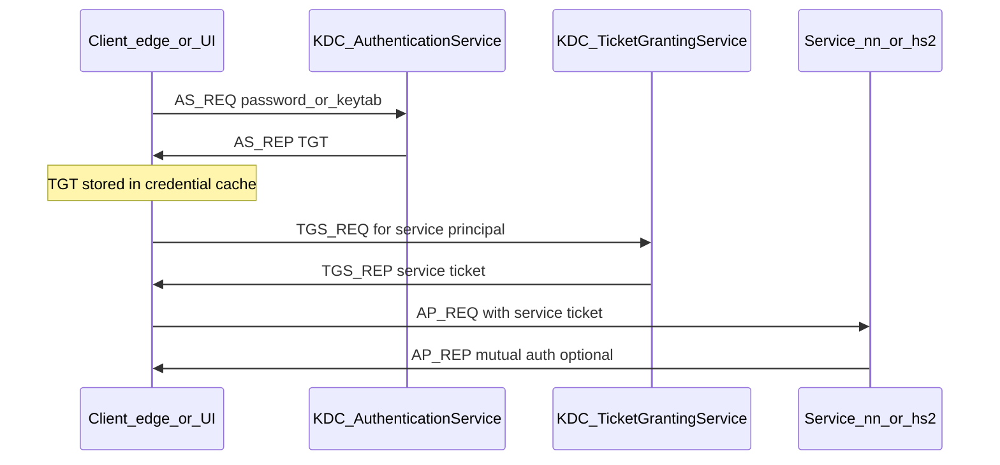

# Technical deep-dive — Kerberos (Module 01)

## Why this matters

Every read of smart-meter CSVs in HDFS, every Hive or Impala query over `landisgyr` data, and every Spark job that joins weather and price feeds runs **as a named principal**. Kerberos is CDP’s default answer to “who is calling?” Without a valid ticket (or keytab-backed identity for services and batch jobs), clients fail before authorization (Ranger, POSIX ACLs) is even evaluated. Data engineers need predictable identity for pipelines; analysts and scientists need tickets or gateway auth that JDBC and notebook tools understand.

---

## Architecture



**Client** — edge-node shell (`kinit`), Java tools (HDFS, YARN, Hive JDBC), or a browser session through Knox (SPNEGO). The client never sends the password to HDFS or Hive; it proves identity to the KDC and presents short-lived **service tickets** to each service.

**KDC — Authentication Service (AS)** — validates the user (password, keytab, or PKINIT) and issues a **Ticket-Granting Ticket (TGT)** bound to the client’s session.

**KDC — Ticket Granting Service (TGS)** — exchanges the TGT for **service tickets** (NameNode, ResourceManager, HiveServer2, Impala, etc.). Each service has a **service principal** such as `hdfs/_HOST@REALM` or `hive/host.example.com@REALM`.

**Service** — verifies the ticket with keys shared only with the KDC, then maps the authenticated principal to a local Unix/HDFS user for authorization checks.

Authentication (Kerberos) is separate from authorization (Ranger policies, HDFS permissions, SQL grants). A valid ticket with no policy still yields `Permission denied`.

---

## How it works internally

**Principals and realms** — Users are `user@REALM`; services are `service/hostname@REALM`. The realm is the administrative boundary; cross-realm trust is possible but rare inside a single CDP cluster.

**Credential cache** — After `kinit`, the TGT (and sometimes service tickets) live in a **ccache**. Location is controlled by `KRB5CCNAME`:

| Type | Typical use | Java/Hadoop note |
|------|-------------|------------------|
| `FILE:/path/krb5cc_*` | Explicit file cache | Most predictable for mixed CLI + Java on one session |
| `KCM:` | Credential manager (RHEL 8+) | CLI may work while JVM tools see no ticket |
| `KEYRING:` | Linux kernel keyring | Same split as KCM for some stacks |

**Ticket lifetime and renewal** — TGT lifetime is KDC policy (often 10–24 h). **Renewable** tickets can extend wall-clock use without re-entering a password until `renew_until` expires. Long batch jobs that outlive the TGT need **keytabs**, **delegation tokens** (YARN/HDFS/Spark), or periodic renewal in the job driver.

**Keytabs** — A keytab holds long-lived keys for a principal. `kinit -kt keytab principal` obtains a TGT without a password. Treat keytabs like passwords: filesystem permissions `600`, rotation on compromise, separate principals for humans vs services vs automation.

**SPNEGO and Knox** — Browser UIs often use Kerberos over HTTP (SPNEGO). Knox terminates TLS and forwards identity to backend services. Analysts may never run `kinit` on a laptop if the corporate SSO path handles the browser; edge-node CLI still needs `kinit` or keytab.

**Delegation tokens** — For multi-hour Spark or MapReduce jobs, the framework can obtain HDFS/YARN delegation tokens so executors access storage after the user’s TGT would expire. Tokens are scoped and time-limited; they complement rather than replace Kerberos at job submission time.

---

## Day-to-day usage by role

### Data engineers

- Run `kinit` (or `kinit -kt …`) at the start of deploy scripts; fail fast if `klist` shows no ticket.
- Use **dedicated service principals and keytabs** for Oozie, Airflow, cron, and CI — never embed human passwords.
- Set `KRB5CCNAME=FILE:…` in job wrappers when participants report “hdfs works in shell but Spark fails with GSS”.
- When debugging pipeline failures, capture **`KRB5_TRACE=/dev/stderr`** once (verbose); correlate timestamp with KDC lockout or clock skew.
- Understand that **distcp**, **Spark**, and **Hive** each run as the submitting principal unless impersonation (`doAs`) is configured for trusted services.

### Data analysts

- Hue/Beeline/JDBC: ensure the session runs as the intended user; shared edge accounts break audit trails.
- If Impala or Hive returns `GSS initiate failed`, check ticket on the **host that runs the client** (edge node or gateway), not only the laptop VPN.
- Query timeouts after hours of idle UI may be ticket expiry — refresh with `kinit` or re-login through Knox.

### Data scientists

- Notebook kernels on the cluster edge inherit the shell ticket; kernels on remote gateways need the same cache or keytab story as batch jobs.
- Reproducible runs: document principal + date in experiment notes; use a service keytab for scheduled training jobs, not personal passwords.
- Sampling from `${WORKSHOP_ROOT}/data/...` via Spark or `hdfs dfs` requires the same Kerberos session as production paths.

---

## Cheat sheet

```bash
# Identity and ticket inspection
export WORKSHOP_USER=<your_username>
kinit "${WORKSHOP_USER}"
klist
klist -ef
```

```bash
# Custom cache for Java + CLI alignment
export KRB5CCNAME=FILE:/tmp/krb5cc_${WORKSHOP_USER}
kinit "${WORKSHOP_USER}"
klist
```

```bash
# Keytab login (automation; protect the file)
kinit -kt /path/to/service.keytab service/principal@REALM
klist
```

```bash
# Short-lived ticket for testing renewal behavior
kinit -l 10m -r 5m "${WORKSHOP_USER}"
klist
```

```bash
# Destroy session tickets
kdestroy
klist
```

```bash
# Verbose Kerberos trace (one failing command)
KRB5_TRACE=/dev/stderr kinit "${WORKSHOP_USER}" 2>&1 | head -50
```

Common **service principal patterns** (exact hostnames vary by cluster):

- HDFS NameNode: `hdfs/_HOST@REALM`
- YARN RM: `yarn/_HOST@REALM` or `rm/_HOST@REALM`
- HiveServer2: `hive/hs2-host@REALM`
- Impala: `impala/impalad-host@REALM`

---

## Gotchas and best practices

| Gotcha | What to do |
|--------|------------|
| Clock skew > 5 min | Sync NTP on edge nodes and clients; Kerberos rejects skewed clocks |
| `klist` empty after successful `kinit` in another terminal | Each shell has its own cache unless `KRB5CCNAME` is shared |
| Java “No valid credentials” while CLI works | Force `FILE:` cache; confirm `java.security.krb5.conf` points at cluster `krb5.conf` |
| Copying `krb5cc_*` files | Equivalent to sharing password until expiry — forbid for production |
| Wrong realm in `krb5.conf` | AS_REQ fails with “Cannot find KDC”; verify `default_realm` and `[domain_realm]` |
| Lockout after lab “wrong password once” | Use KDC/admin policy; trainers cap failed attempts in demos |
| Confusing authz errors with authn | After good `klist`, `Permission denied` is Ranger/HDFS/SQL — not Kerberos |

**Best practices:** one principal per human; keytabs for automation; renew or delegate for long jobs; never disable Kerberos on a subset of clients “just for dev”; document Knox vs edge `kinit` paths for your cohort.

---

## Further reading

- MIT Kerberos documentation: [Kerberos V5 concepts](https://web.mit.edu/kerberos/krb5-latest/doc/basic/index.html)
- Cloudera documentation: Securing CDP (Kerberos enablement, principal creation, keytabs)
- Apache Hadoop: [Hadoop in Secure Mode](https://hadoop.apache.org/docs/current/hadoop-project-dist/hadoop-common/SecureMode.html) (delegation tokens, `hadoop.security.authentication`)
