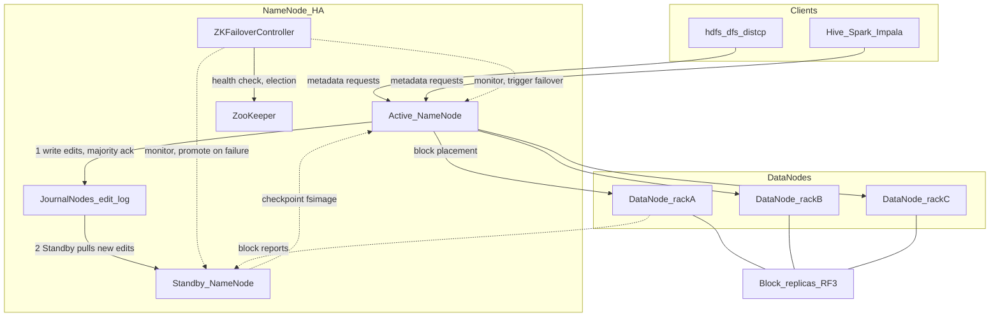

# Technical deep-dive — HDFS (Module 02)

## Why this matters

Grid-monitoring pilot data — Landis+Gyr-style meter CSVs, operator weather, and market price files — lands on HDFS under `${WORKSHOP_ROOT}/data/`. Hive external tables, Spark reads, and Impala all treat those paths as the **source of truth** for bytes on disk. Data engineers own layout, compression, and lifecycle; analysts and scientists rarely touch the NameNode API directly but feel HDFS through **file format, partition folders, and scan size**. Understanding blocks, replication, and the small-file problem explains most “slow query” and “metadata pressure” stories before SQL tuning.

---

## Architecture



**Clients** — `hdfs dfs`, DistCp, and engines’ Hadoop FileSystem API. Reads ask the NameNode for block locations, then read directly from DataNodes (short-circuit local read when co-located).

**Active NameNode** — holds the namespace tree (directories, files, permissions) and block-to-replica mapping **in memory**; persists mutations to the edit log. Does not store file bytes.

**Standby NameNode + JournalNodes** — The Active **writes** every namespace edit to the JournalNodes (committed once a majority acknowledges). The JournalNodes only store the log; the Standby **pulls** the new edits from them and replays them in memory, so it can take over quickly. Edits never flow from the Standby to the Active; the Standby only sends periodic `fsimage` checkpoints back. DataNodes send block reports to both NameNodes.

**ZooKeeper + ZKFailoverController** — A ZKFC runs next to each NameNode, monitors its health and holds the election lock in ZooKeeper. If the Active fails, the ZKFC promotes the Standby, and JournalNode epoch fencing stops the old Active from writing.

**DataNodes** — store **blocks** (default often 128 MB or 256 MB in modern CDP). Each block is replicated (default RF=3) across racks for fault tolerance.

Write path (simplified): client → NameNode allocates blocks → client streams to a pipeline of DataNodes → replicas ack → file closed in namespace.

---

## How it works internally

**Blocks vs files** — A 192 MB file spans two 128 MB blocks; a directory of thousands of tiny CSVs still creates one block (or more) per file if large enough, but many small files mean **many namespace objects** — expensive for the NameNode and for list-heavy operations.

**Replication** — RF=3 means three independent replicas; read chooses a nearby or healthy replica. **Replication factor** can be set per file or directory (`hdfs dfs -setrep`). Erasure coding (EC) policies trade CPU for storage efficiency on cold tiers; workshop clusters often stay RF3 for simplicity.

**Consistency** — After close, HDFS provides write-once-read-many semantics for a file. Appends exist but pipelines should avoid concurrent writers to the same file. **Atomic rename** of a directory (when supported) is the idiom for “publish” staging → curated folders.

**Trash** — Deletes go to `.Trash` under the user’s home (when enabled) until `fs.trash.interval` expires. `-skipTrash` is immediate and irreversible.

**Snapshots** — point-in-time namespace + block list for backup/rollback at directory level; not a substitute for table-level ACID (see Hive/Iceberg modules).

**Permissions** — POSIX `rwx` for owner/group/other plus optional ACLs. **Ranger** adds HDFS policies (path, user, group, IP) on top; denial after valid Kerberos is often Ranger or POSIX, not “missing file”.

**Checksums** — DataNodes verify block checksums on read; `hdfs fsck` reports missing/corrupt blocks and under-replicated files.

---

## Day-to-day usage by role

### Data engineers

- Land raw CSVs under predictable paths: `${WORKSHOP_ROOT}/data/<dataset>/`.
- Prefer **few large files** (daily rollups, ORC/Parquet) over millions of tiny files; use Spark/Hive compaction jobs.
- Use **staging + rename** or Iceberg commits for idempotent loads instead of half-written files visible in a table location.
- Monitor **capacity** with `hdfs dfs -du -s -h` and quotas for sandbox dirs; run `hdfs dfsadmin -report` for cluster health.
- Plan **DistCp** for DR or env promotion; preserve ownership with `-p` and Kerberos identity of the service account.

### Data analysts

- You usually see **paths via Hive/Impala** (`LOCATION`, partition folders like `dt=2024-01-01`). Knowing that each partition is a directory explains duplicate keys if files are appended twice.
- Large full-table scans often mean **no partition filter** or too many small files — escalate to engineering for compaction, not only “add an index”.

### Data scientists

- Feature stores and training sets read **Parquet/ORC** curated layers; raw CSV on HDFS is for exploration and baseline pipelines.
- When pulling samples with `hdfs dfs -cat` or Spark, **splittable** formats (Parquet, ORC, bzip2) parallelize; gzip whole-file compression does not split — affects cluster parallelism.

---

## Cheat sheet

```bash
# Workshop context
export WORKSHOP_USER=<your_username>
export WORKSHOP_ROOT="${WORKSHOP_ROOT:-/2026_cdp_workshop}"
kinit "${WORKSHOP_USER}"
```

```bash
# List use-case landing data
hdfs dfs -ls "${WORKSHOP_ROOT}/data/landisgyr"
hdfs dfs -du -h "${WORKSHOP_ROOT}/data/landisgyr"
```

```bash
# Replication and block report for one file
hdfs dfs -stat "%r %b %n" "${WORKSHOP_ROOT}/data/landisgyr/sample-landisgyr-data.csv"
hdfs fsck "${WORKSHOP_ROOT}/data/landisgyr/sample-landisgyr-data.csv" -files -blocks -locations
```

```bash
# Personal workspace
hdfs dfs -mkdir -p "/user/${WORKSHOP_USER}/lab"
hdfs dfs -put -f local.csv "/user/${WORKSHOP_USER}/lab/"
```

```bash
# Trash-aware delete vs permanent
hdfs dfs -rm "/user/${WORKSHOP_USER}/lab/old.csv"
hdfs dfs -rm -skipTrash "/user/${WORKSHOP_USER}/lab/scratch.tmp"
```

```bash
# Cluster summary (trainer or elevated access)
hdfs dfsadmin -report
hdfs dfsadmin -safemode get
```

Compression (choose in pipeline design):

| Format | Splittable on HDFS | Typical role |
|--------|-------------------|--------------|
| gzip | No (one map per file) | Archive, small exports |
| bzip2 | Yes | Legacy bulk CSV |
| Snappy/LZ4 inside ORC/Parquet | Yes (stripes/row groups) | Curated analytics |

---

## Gotchas and best practices

| Gotcha | What to do |
|--------|------------|
| Small-file storm from streaming | Batch to larger objects; use Iceberg/Hive compaction |
| External table points at parent dir | Any file in the folder is read — isolate staging |
| `INSERT OVERWRITE` wrong partition path | Can delete production data if location overlaps |
| RF lowered on “temp” data then forgotten | Re-check `-setrep` before promoting to prod paths |
| NameNode heap pressure | Reduce file count; archive cold data; EC on cold tier |
| `du` vs `df` confusion | `du` sums file lengths; physical usage includes replication |
| Permission denied with valid Kerberos | Check POSIX then Ranger HDFS policy on path prefix |

**Best practices:** one writer per file; partition by time/station for the grid use case; store curated data in columnar formats; use `${WORKSHOP_ROOT}/data/` as read-mostly landing; document who may `-chmod` shared paths.

---

## Further reading

- Apache Hadoop HDFS Architecture: [HDFS Design](https://hadoop.apache.org/docs/current/hadoop-project-dist/hadoop-hdfs/HdfsDesign.html)
- Cloudera documentation: HDFS overview, HA, quotas, snapshots, and Ranger HDFS policies
