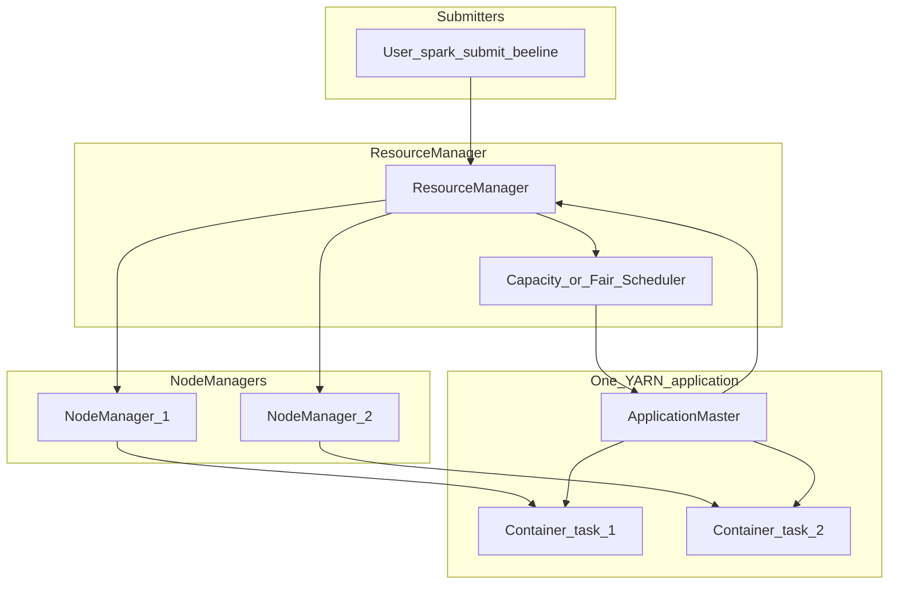

# Technical deep-dive — YARN (Module 03)

## Why this matters

When Hive compiles SQL to Tez, Spark joins meter readings with weather, or a MapReduce job counts rows, **YARN** allocates CPU and memory on the cluster. Data engineers need queues, container sizing, and log access to keep pipelines reliable; analysts feel YARN as **wait time in admission control** and queue priority; data scientists care that training jobs get enough executors without starving shared workloads. The grid-monitoring use case mixes short interactive SQL and longer Spark transforms — both compete for the same finite pool unless queues and limits are understood.

---

## Architecture



**Client** — submits an application (Jar, `spark-submit`, Hive-on-Tez). The first container is usually the **ApplicationMaster (AM)**.

**ResourceManager (RM)** — global scheduler; tracks cluster capacity, queues, and application lifecycle. Does not run user code.

**Scheduler** — **Capacity Scheduler** (common in CDP): hierarchical **queues** with capacity, max capacity, and ACLs. **Fair Scheduler** is an alternative where shares dominate.

**NodeManager (NM)** — agent on each worker; launches **containers** (bounded memory + vcores) on behalf of the AM.

**ApplicationMaster** — negotiates resources with the RM, requests containers, and monitors tasks (Tez AM for Hive, Spark driver/AM for Spark, MR AppMaster for MapReduce). One AM per YARN application.

---

## How it works internally

**Application vs job** — One YARN **application** may run many tasks (Tez vertices, Spark stages, MR maps/reduces). HiveServer2 often reuses a long-lived Tez session — several SQL statements share one YARN app.

**Container sizing** — Each container has `memory` and `vcores`. Undersized containers cause OOM kills; oversized containers waste cluster slots. Spark adds **executor** memory overhead (off-heap, PySpark Python workers).

**Placement** — Labels, node attributes, and queue **maximum-am-resource-percent** cap how many concurrent AMs run. **Dominant Resource Fairness** balances CPU and memory in Fair Scheduler.

**Log aggregation** — After completion, task logs may move to HDFS (`yarn logs -applicationId …`) so NMs can recycle local disk.

**Preemption** — Over-subscribed queues may lose containers to higher-priority queues (policy-dependent). Symptoms: straggling Spark stages or Tez vertex retries.

**History Server** — Completed app metadata and links to logs; pairs with Spark History Server for Spark UI after the fact.

**Engines on YARN**

| Engine | YARN role | Typical AM |
|--------|-----------|------------|
| MapReduce | Classic MR | MRAppMaster |
| Tez (Hive) | DAG of vertices | Tez AM |
| Spark | Executors as containers | Spark driver as AM (cluster mode) |

---

## Day-to-day usage by role

### Data engineers

- Submit with explicit **queue**: `-Dmapreduce.job.queuename=…`, Tez `hive.tez.queue.name`, Spark `spark.yarn.queue`.
- Right-size Spark: `executor-memory`, `executor-cores`, `num-executors` (or dynamic allocation).
- Kill runaway jobs: `yarn application -list`, `yarn application -kill <appId>`.
- Debug failures: AM logs first (container OOM, auth), then failed task logs via `yarn logs`.
- Separate **batch** and **interactive** queues so ad-hoc SQL does not block nightly loads.

### Data analysts

- Long queue times → check cluster load, your queue capacity, and concurrent heavy jobs (not “Impala is broken” if the wait is YARN).
- Hive/Tez: same HS2 session reuses containers — first query cold, later queries faster.

### Data scientists

- `spark-submit --deploy-mode cluster` keeps the driver on the cluster; **client mode** ties driver lifetime to the edge notebook session.
- Dynamic allocation scales executors for skewed joins on large meter datasets; cap max executors to avoid monopolizing the queue.

---

## Cheat sheet

```bash
# Kerberos then list your applications
export WORKSHOP_USER=<your_username>
kinit "${WORKSHOP_USER}"
yarn application -list -appStates RUNNING,ACCEPTED
```

```bash
# Application status and kill
yarn application -status <application_id>
yarn application -kill <application_id>
```

```bash
# Logs after finish or from running app
yarn logs -applicationId <application_id>
yarn logs -applicationId <application_id> -containerId <container_id>
```

```bash
# Queue and cluster capacity (trainer or admin)
yarn queue -status <queue_name>
yarn node -list -all
```

```bash
# Spark on YARN example queue and resources
spark-submit \
  --master yarn \
  --deploy-mode cluster \
  --queue default \
  --num-executors 4 \
  --executor-memory 4g \
  --executor-cores 2 \
  job.py
```

```bash
# Hive/Tez queue via Beeline session
# SET hive.tez.queue.name=default;
```

Useful **states**: `ACCEPTED` (waiting for AM container), `RUNNING`, `FINISHED`, `FAILED`, `KILLED`.

---

## Gotchas and best practices

| Gotcha | What to do |
|--------|------------|
| AM OOM on large DAG | Increase AM memory for Tez/Spark; reduce parallelism |
| “Container killed by YARN” | Task exceeded container memory — tune split size or memory |
| Wrong queue ACL | Submission fails or app stuck in ACCEPTED |
| Assuming one SQL = one YARN app | Tez session reuse blurs the mapping |
| Ignoring local disk on NM | Shuffle-heavy Spark/Tez needs spill space |
| Client-mode Spark notebook disconnect | Driver dies — prefer cluster mode for long training |

**Best practices:** name applications meaningfully (`spark.app.name`, MR job name); use queues aligned to SLA; monitor RM UI or Cloudera Manager YARN charts; cap concurrent heavy Spark jobs on shared pilots.

---

## Further reading

- Apache Hadoop YARN: [YARN Architecture](https://hadoop.apache.org/docs/current/hadoop-yarn/hadoop-yarn-site/YARN.html)
- Cloudera documentation: YARN tuning, Capacity Scheduler, log aggregation, and workload management
