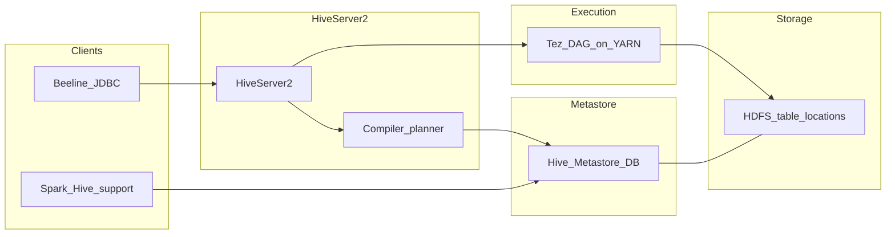

# Technical deep-dive — Hive (Module 04)

## Why this matters

Hive is the workshop’s primary **SQL metastore and batch engine** over HDFS: external CSV on `landisgyr`, partitioned staging, ORC/Parquet curated tables, and managed ACID for row-level changes. Data engineers define tables, partitions, file formats, and compaction; analysts run aggregations and joins in Beeline or Hue; data scientists consume stable table names from Spark or export curated features. The split between **Metastore schema** and **HDFS bytes** drives almost every ingestion bug (missing partition, double load, UPDATE on external tables).

---

## Architecture



**HiveServer2 (HS2)** — long-lived service; accepts JDBC/ODBC/Beeline sessions, compiles SQL to a physical plan (Tez DAG on CDP), and returns results.

**Hive Metastore (HMS)** — relational DB storing databases, tables, columns, partition keys, SerDe, storage handler, and **LOCATION**. Impala and Spark also read HMS for table definitions.

**Tez on YARN** — executes vertices (map-like/read, shuffle, reduce-like) as YARN containers. **LLAP** (where enabled) keeps long-lived daemons for interactive sub-second workloads — workshop labs often use Tez only.

**HDFS** — table `LOCATION` and partition directories (`dt=…`, `station_id=…`) hold data files. External tables leave files in place on `DROP TABLE`; managed tables delete data unless configured otherwise.

---

## How it works internally

**External vs managed**

| Aspect | External | Managed (non-ACID) | Managed ACID |
|--------|----------|-------------------|--------------|
| Data ownership | You / ingestion | Hive | Hive |
| `DROP TABLE` | Metadata only (default) | Deletes data dir | Deletes with deltas |
| `UPDATE`/`DELETE` | Not on plain external | Limited | Supported (transactions) |
| Typical use | Landing CSV, shared raw | Deprecated for new curated | Curated mutable tables |

**Schema on read** — SerDe parses bytes at query time; bad CSV rows become `NULL` without failing the query.

**Partitioning** — Partition columns become HDFS subdirectories. The optimizer **prunes** only when predicates reference partition columns (e.g. `dt = '2024-01-01'`). `MSCK REPAIR` discovers new folders; `ALTER TABLE ADD PARTITION` is explicit and cheap for pipelines.

**File formats** — **ORC** and **Parquet** are columnar: projection and predicate pushdown read fewer bytes. ORC integrates tightly with Hive (stripes, indexes); Parquet is common for Spark interchange. **CTAS** (`CREATE TABLE AS SELECT`) materializes curated layers from staging SQL.

**Statistics and CBO** — `ANALYZE TABLE … COMPUTE STATISTICS` feeds row counts and column stats to the **cost-based optimizer** (join order, map join hints). Stale stats → bad plans.

**ACID / transactions** — Inserts/updates/deletes write **delta files** (`delta_*`, delete deltas); readers merge base + deltas. **Compaction** (minor/major) merges small files and improves read performance — operational duty for mutable managed tables.

**Security** — Ranger Hive policies (column, row filter, mask) apply after authentication; SQL standard authorization may also apply depending on cluster config.

---

## Day-to-day usage by role

### Data engineers

- Register landing paths as **external** tables; never point production landing at `PURGE` behavior without review.
- Add partitions in jobs (`ALTER TABLE … ADD PARTITION` or dynamic partition insert) instead of relying on repair at scale.
- Convert staging to ORC/Parquet via CTAS or Spark write; keep CSV at the edge only.
- Schedule **compaction** and monitor ACID table file counts.
- Use **`INSERT OVERWRITE` partition** for idempotent daily loads on immutable file models; pair with Iceberg module for true row-level idempotency.

### Data analysts

- Always filter on **partition columns** for time-series meter data.
- Compare `COUNT(*)` vs `COUNT(measure_col)` to spot NULLs from bad CSV types.
- Use `EXPLAIN` / `EXPLAIN EXTENDED` to see Tez vertices — correlates with YARN apps.
- Understand empty string vs `NULL` in text tables — affects quality KPIs.

### Data scientists

- Spark **`spark.table("db.table")`** or `enableHiveSupport()` uses HMS names — same curated ORC as analysts.
- Feature pipelines: read curated ORC, write new managed or Iceberg tables; avoid mutating external CSV locations in place.

---

## Cheat sheet

```bash
export WORKSHOP_USER=<your_username>
export WORKSHOP_ROOT=/2026_cdp_workshop
kinit "${WORKSHOP_USER}"
```

```bash
# Beeline session with workshop variables
beeline -u "jdbc:hive2://<hs2-host>:10000/default;principal=hive/_HOST@REALM" \
  --hivevar ws_user="${WORKSHOP_USER}" \
  --hivevar workshop_root="${WORKSHOP_ROOT}"
```

```sql
-- External table on landing CSV (pattern from lab)
CREATE DATABASE IF NOT EXISTS ws_${hivevar:ws_user};
USE ws_${hivevar:ws_user};

CREATE EXTERNAL TABLE IF NOT EXISTS landisgyr_csv (
  ts_utc STRING,
  station_id STRING,
  current_a DOUBLE
)
ROW FORMAT DELIMITED FIELDS TERMINATED BY ','
STORED AS TEXTFILE
LOCATION '${hivevar:workshop_root}/data/landisgyr/';
```

```sql
-- Partition maintenance
ALTER TABLE meter_partitioned ADD PARTITION (dt='2024-01-02')
  LOCATION '${hivevar:workshop_root}/data/landisgyr/dt=2024-01-02/';
MSCK REPAIR TABLE meter_partitioned;
```

```sql
-- Stats for CBO
ANALYZE TABLE landisgyr_orc COMPUTE STATISTICS;
ANALYZE TABLE landisgyr_orc COMPUTE STATISTICS FOR COLUMNS;
```

```sql
-- Plan inspection
EXPLAIN EXTENDED
SELECT station_id, AVG(current_a)
FROM landisgyr_orc
WHERE dt = '2024-01-01'
GROUP BY station_id;
```

---

## Gotchas and best practices

| Gotcha | What to do |
|--------|------------|
| `UPDATE` on external table | Use managed ACID, Iceberg, or rewrite via `INSERT OVERWRITE` |
| `INSERT INTO` retry | Duplicates — prefer overwrite partition or Iceberg merge |
| New folder, no partition row | Query returns no rows until ADD PARTITION or REPAIR |
| Filter on non-partition column | Full scan of all `dt=` folders |
| Tiny ORC files | Batch inserts; compact |
| `DROP TABLE` on managed curated | Data loss — use external for shared raw |
| Hive and Impala metadata drift | `INVALIDATE METADATA` / `REFRESH` on Impala side after DDL |

**Best practices:** landing external + curated columnar; partition by date for meter time series; analyze stats after large loads; document SerDe and null handling in data contracts.

---

## Further reading

- Apache Hive: [LanguageManual](https://cwiki.apache.org/confluence/display/Hive/LanguageManual)
- Cloudera documentation: Hive on Tez, ACID tables, compaction, and Ranger Hive policies
