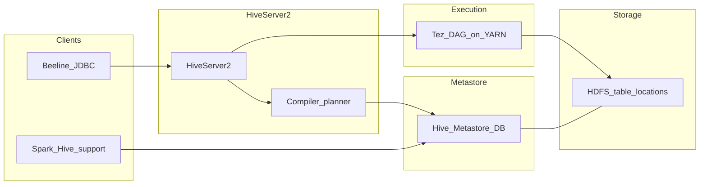

# Technical deep-dive — Hive (Module 04)

## Why this matters

Hive is the workshop’s primary **SQL metastore and batch engine** over HDFS: external CSV on `landisgyr`, partitioned staging, ORC/Parquet curated tables, and managed ACID for row-level changes. Data engineers define tables, partitions, file formats, and compaction; analysts run aggregations and joins in Beeline or Hue; data scientists consume stable table names from Spark or export curated features. The split between **Metastore schema** and **HDFS bytes** drives almost every ingestion bug (missing partition, double load, UPDATE on external tables).

---

## Architecture



**HiveServer2 (HS2)** — long-lived service; accepts JDBC/ODBC/Beeline sessions, compiles SQL to a physical plan (Tez DAG on CDP), and returns results.

**Hive Metastore (HMS)** — relational DB storing databases, tables, columns, partition keys, SerDe, storage handler, and **LOCATION**. Impala and Spark also read HMS for table definitions.

**Tez on YARN** — executes vertices (map-like/read, shuffle, reduce-like) as YARN containers. **LLAP** (where enabled) keeps long-lived daemons for interactive sub-second workloads — workshop labs often use Tez only.

**HDFS** — table `LOCATION` and partition directories (`dt=…`, `station_id=…`) hold data files. External tables leave files in place on `DROP TABLE`; managed tables delete data unless configured otherwise.

---

## How it works internally

**External vs managed**

| Aspect | External | Managed (non-ACID) | Managed ACID |
|--------|----------|-------------------|--------------|
| Data ownership | You / ingestion | Hive | Hive |
| `DROP TABLE` | Metadata only (default) | Deletes data dir | Deletes with deltas |
| `UPDATE`/`DELETE` | Not on plain external | Limited | Supported (transactions) |
| Typical use | Landing CSV, shared raw | Deprecated for new curated | Curated mutable tables |

**Schema on read** — SerDe parses bytes at query time; bad CSV rows become `NULL` without failing the query.

**Partitioning** — Partition columns become HDFS subdirectories. The optimizer **prunes** only when predicates reference partition columns (e.g. `dt = '2024-01-01'`). `MSCK REPAIR` discovers new folders; `ALTER TABLE ADD PARTITION` is explicit and cheap for pipelines.

**File formats** — **ORC** and **Parquet** are columnar: projection and predicate pushdown read fewer bytes. ORC integrates tightly with Hive (stripes, indexes); Parquet is common for Spark interchange. **CTAS** (`CREATE TABLE AS SELECT`) materializes curated layers from staging SQL.

**Statistics and CBO** — `ANALYZE TABLE … COMPUTE STATISTICS` feeds row counts and column stats to the **cost-based optimizer** (join order, map join hints). Stale stats → bad plans.

**ACID / transactions** — Inserts/updates/deletes write **delta files** (`delta_*`, delete deltas); readers merge base + deltas. **Compaction** (minor/major) merges small files and improves read performance — operational duty for mutable managed tables. Details in [ACID on HDFS](#acid-on-hdfs-base-delta-and-compaction).

**Security** — Ranger Hive policies (column, row filter, mask) apply after authentication; SQL standard authorization may also apply depending on cluster config.

---

## ORC internals

An ORC file is HDFS-immutable and self-describing. Layout, front to back:

```text
"ORC" magic
Stripe 1  ┬ index data   (per column, per 10,000 rows: min / max / sum / count, optional bloom filter)
          ├ row data     (one stream per column: PRESENT, DATA, LENGTH, DICTIONARY_DATA ...)
          └ stripe footer (stream locations, encodings)
Stripe 2 ... (default ~64 MB of data each)
File footer   (schema, row count, per-stripe offsets, file-level column statistics)
Postscript    (compression codec, footer length, version) — last bytes of the file
```

- **Columnar within stripes:** each column has its own streams, so `SELECT AVG(current_a)` reads the footer plus only that column's streams (projection). Rows are grouped in stripes so a row is never split across them.
- **Encodings (per column, before compression):** low-cardinality strings (`event_code`, `comm_status`) use **dictionary** encoding; integers and dictionary IDs use **run-length** (RLE) and delta encoding; a `PRESENT` bit stream handles NULLs. High-cardinality doubles (`current_a`) have little to exploit and stay large.
- **Compression (per stream, on top of encoding):** `ZLIB` is the Hive default (smaller, slower), `SNAPPY` is faster with larger files, `ZSTD` is available in newer versions, `NONE` is possible. Set per table: `TBLPROPERTIES ('orc.compress'='SNAPPY')`. The codec is stored in the postscript, so readers need no configuration.
- **Skipping with indexes (predicate pushdown):** the file footer holds min/max per stripe, and the stripe index holds min/max per 10,000-row group. For `WHERE station_id = 'TS-305'` the reader skips stripes and row groups whose range cannot match. This works best when data is **sorted or clustered** by the filter column — random order gives wide min/max ranges and little skipping. **Bloom filters** (`'orc.bloom.filter.columns'='station_id'`) help for equality lookups on unsorted columns.
- **Why small files hurt:** every file has its own footer and stripes. A 50 KB ORC file is mostly metadata, produces a tiny stripe, and costs a NameNode entry and a Tez task. Prefer few files of at least one stripe (hundreds of MB); compact or `INSERT OVERWRITE` after many small inserts.
- **ORC vs Parquet:**

  | | ORC | Parquet |
  |---|-----|---------|
  | Native fit | Hive (ACID, vectorized reader, LLAP cache) | Spark, Impala, wider ecosystem |
  | Layout | stripes → column streams | row groups → column chunks → pages |
  | Statistics | stripe + 10k-row-group indexes, optional bloom | row-group and page min/max, optional bloom |
  | ACID tables | Required (managed transactional tables are ORC) | Not supported for Hive ACID |
  | Choose when | Hive-centric, mutable managed tables | Shared by Spark/Impala/other engines, Iceberg default |

- **Inspect it:** `hive --orcfiledump <file>` prints footer, stripes, and column statistics; add `-d` to dump rows (also shows ACID hidden columns). Use `hdfs dfs -du -h` to compare sizes between formats.

---

## ACID on HDFS: base, delta, and compaction

HDFS files cannot be modified, so a transactional (managed, ORC) table never edits a file. Every write transaction adds new directories, and readers merge them using the transaction snapshot from the Metastore.

**Directory layout of a table (or partition):**

```text
landisgyr_managed/
  base_0000005_v0000123/                 # compacted full state as of write id 5
    bucket_00000
  delta_0000006_0000006_0000/            # INSERT, write id 6
    bucket_00000
  delete_delta_0000007_0000007_0000/     # DELETE (and the "delete half" of UPDATE), write id 7
    bucket_00000
  delta_0000007_0000007_0000/            # UPDATE = delete_delta + delta with the new row version
    bucket_00000
```

- Names encode **write id range** (`delta_<min>_<max>`), plus a statement id, and after compaction a `_v<visibility txn id>` suffix.
- `INSERT` → `delta_*`. `DELETE` → `delete_delta_*`. `UPDATE` → **both** (split update: delete old row version, insert new).
- Each file is a normal ORC file with the user columns wrapped in a hidden struct: `operation` (0 insert, 1 update, 2 delete), `originalTransaction`, `bucket`, `rowId`, `currentTransaction`, `row`. Look at them with `hive --orcfiledump -d <file>`. A row is identified by `(originalTransaction, bucket, rowId)`.
- **Read path:** the reader asks the Metastore for the valid write-id list, picks the newest `base` plus all `delta` / `delete_delta` directories above it, and anti-joins rows with a matching delete event. Dozens of deltas mean dozens of files to open and merge per query.
- **Aborted and open transactions:** their deltas exist on HDFS but are ignored by readers; the **cleaner** removes them later. So a directory listing is not the same as the committed table state.

**Compaction** (runs as a MapReduce/Tez job on YARN, started by the Metastore **Initiator**, executed by **Workers**, cleaned up by the **Cleaner**):

| Type | What it does | Trigger (defaults) | Result |
|------|--------------|--------------------|--------|
| **Minor** | Merges all deltas into one `delta` and all `delete_delta` into one `delete_delta`; keeps the base | more than 10 deltas (`hive.compactor.delta.num.threshold`) | fewer files; deleted rows are still physically present |
| **Major** | Rewrites base + deltas into a new `base_N_v…`, applies deletes | deltas larger than 10% of base (`hive.compactor.delta.pct.threshold`) | clean table; deleted rows physically removed |

- The **Cleaner** deletes the obsolete directories only after no running query can still read them, so for a while old and new directories coexist and disk usage peaks.
- Manual control: `ALTER TABLE t COMPACT 'minor'|'major' [AND WAIT]`, `SHOW COMPACTIONS` (states: initiated → working → ready for cleaning → succeeded / failed). Partitioned tables compact per partition.
- Requirements: compactor threads must be enabled on the Metastore (`hive.compactor.initiator.on`, `hive.compactor.worker.threads > 0`); a failed or disabled compactor shows up as ever-growing delta counts and slow queries.
- Streaming or per-row updates every second create thousands of deltas; consider batching, or move to Iceberg (module 07) for row-level changes with snapshot-based metadata.

**Lab link:** the managed-table sections of the lab show `base_`/`delta_`/`delete_delta_` folders and runs `SHOW COMPACTIONS` and `COMPACT 'major'`. A good trainer demo: list the folder before and after the `UPDATE`, run `orcfiledump -d` on a delta file, then compact and list again.

---

## Day-to-day usage by role

### Data engineers

- Register landing paths as **external** tables; never point production landing at `PURGE` behavior without review.
- Add partitions in jobs (`ALTER TABLE … ADD PARTITION` or dynamic partition insert) instead of relying on repair at scale.
- Convert staging to ORC/Parquet via CTAS or Spark write; keep CSV at the edge only.
- Schedule **compaction** and monitor ACID table file counts.
- Use **`INSERT OVERWRITE` partition** for idempotent daily loads on immutable file models; pair with Iceberg module for true row-level idempotency.

### Data analysts

- Always filter on **partition columns** for time-series meter data.
- Compare `COUNT(*)` vs `COUNT(measure_col)` to spot NULLs from bad CSV types.
- Use `EXPLAIN` / `EXPLAIN EXTENDED` to see Tez vertices — correlates with YARN apps.
- Understand empty string vs `NULL` in text tables — affects quality KPIs.

### Data scientists

- Spark **`spark.table("db.table")`** or `enableHiveSupport()` uses HMS names — same curated ORC as analysts.
- Feature pipelines: read curated ORC, write new managed or Iceberg tables; avoid mutating external CSV locations in place.

---

## Cheat sheet

```bash
export WORKSHOP_USER=<your_username>
export WORKSHOP_ROOT=/2026_cdp_workshop
kinit "${WORKSHOP_USER}"
```

```bash
# Beeline session with workshop variables
beeline -u "jdbc:hive2://<hs2-host>:10000/default;principal=hive/_HOST@REALM" \
  --hivevar ws_user="${WORKSHOP_USER}" \
  --hivevar workshop_root="${WORKSHOP_ROOT}"
```

```sql
-- External table on landing CSV (pattern from lab)
CREATE DATABASE IF NOT EXISTS ws_${hivevar:ws_user};
USE ws_${hivevar:ws_user};

CREATE EXTERNAL TABLE IF NOT EXISTS landisgyr_csv (
  ts_utc STRING,
  station_id STRING,
  current_a DOUBLE
)
ROW FORMAT DELIMITED FIELDS TERMINATED BY ','
STORED AS TEXTFILE
LOCATION '${hivevar:workshop_root}/data/landisgyr/';
```

```sql
-- Partition maintenance
ALTER TABLE meter_partitioned ADD PARTITION (dt='2024-01-02')
  LOCATION '${hivevar:workshop_root}/data/landisgyr/dt=2024-01-02/';
MSCK REPAIR TABLE meter_partitioned;
```

```sql
-- Stats for CBO
ANALYZE TABLE landisgyr_orc COMPUTE STATISTICS;
ANALYZE TABLE landisgyr_orc COMPUTE STATISTICS FOR COLUMNS;
```

```sql
-- Plan inspection
EXPLAIN EXTENDED
SELECT station_id, AVG(current_a)
FROM landisgyr_orc
WHERE dt = '2024-01-01'
GROUP BY station_id;
```

---

## Gotchas and best practices

| Gotcha | What to do |
|--------|------------|
| `UPDATE` on external table | Use managed ACID, Iceberg, or rewrite via `INSERT OVERWRITE` |
| `INSERT INTO` retry | Duplicates — prefer overwrite partition or Iceberg merge |
| New folder, no partition row | Query returns no rows until ADD PARTITION or REPAIR |
| Filter on non-partition column | Full scan of all `dt=` folders |
| Tiny ORC files | Batch inserts; compact |
| `DROP TABLE` on managed curated | Data loss — use external for shared raw |
| Hive and Impala metadata drift | `INVALIDATE METADATA` / `REFRESH` on Impala side after DDL |

**Best practices:** landing external + curated columnar; partition by date for meter time series; analyze stats after large loads; document SerDe and null handling in data contracts.

---

## Further reading

- Apache Hive: [LanguageManual](https://cwiki.apache.org/confluence/display/Hive/LanguageManual)
- Cloudera documentation: Hive on Tez, ACID tables, compaction, and Ranger Hive policies
