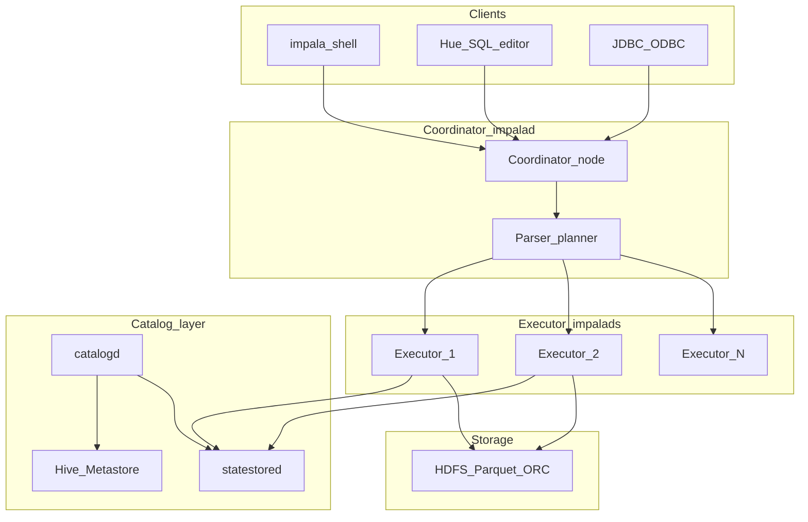

# Technical deep-dive — Impala (Module 06)

## Why this matters

Impala provides **low-latency SQL** over the same HDFS data and Hive Metastore tables analysts already know — ideal for exploring meter anomalies, weather joins, and price spikes during a workshop or pilot. Data engineers care about file layout, stats, and metadata refresh after loads; analysts live in Hue or `impala-shell`; data scientists use Impala for fast aggregates before exporting smaller samples to Python. Impala is **not** a batch ETL engine: it excels at interactive read-heavy workloads while Hive/Spark own complex writes.

---

## Architecture



**impalad** — daemon on each node; acts as **coordinator** (accepts queries, plans fragments) and/or **executor** (runs scan/join/aggr fragments). MPP: fragments run in parallel across the cluster.

**catalogd** — propagates **catalog metadata** (databases, tables, HDFS paths, file formats) to impalads. DDL (`CREATE`, `DROP`, `ALTER`) goes through catalogd.

**statestored** — pub/sub for **membership and runtime state** (which impalads are healthy, admission control, resource pool usage).

**Hive Metastore** — Impala reads table definitions from HMS; both must agree on location and format. After Hive/Spark DDL or bulk HDFS changes, Impala may need **`INVALIDATE METADATA`** or **`REFRESH`**.

**HDFS** — executors read Parquet/ORC/text directly; **runtime filters** and **column pruning** skip irrelevant data.

---

## How it works internally

**Query path** — SQL → parse/analyze → distributed plan (fragments) → scheduled on executors → results streamed to coordinator → client.

**Metadata caching** — impalads cache table/partition/file metadata for speed. Stale cache after external load → missing files or old row counts until invalidate/refresh.

| Command | When to use |
|---------|-------------|
| `REFRESH db.table` | New files in existing partitions (HDFS add) |
| `REFRESH db.table PARTITION (k=v)` | Single partition file change |
| `INVALIDATE METADATA db.table` | DDL change, new columns, location change |
| `INVALIDATE METADATA` | Broad catalog change (expensive) |

**Statistics** — **`COMPUTE STATS`** (and column stats) enable cardinality estimates, join order, and partition pruning. Run after large loads on curated tables.

**Admission control** — **resource pools** limit concurrent queries, memory, and queue depth. Heavy default pool usage causes **queued** queries — not the same as YARN waiting for Tez, but feels similar to users.

**File formats** — **Parquet** preferred for analytics (row groups, column stats). ORC supported. Text/CSV works for workshop external tables but scans full data without rich stats.

**DML limits** — Traditional **external** tables on plain HDFS files do not support Hive-style mutable semantics; **`UPDATE`/`DELETE`** on such tables fail or are unsupported — the lakehouse module addresses row-level change with Iceberg.

**Hive vs Impala (practical)**

| Topic | Hive (Tez) | Impala |
|-------|------------|--------|
| Latency | Seconds to minutes | Sub-second to seconds |
| Writes / ETL | Strong | Limited; prefer Spark/Hive/Iceberg |
| UDF ecosystem | Java UDF | Built-ins + limited UDF |
| Metadata | HMS | HMS + Impala cache |

---

## Day-to-day usage by role

### Data engineers

- After Spark or `hdfs dfs -put` into a partitioned table path, run **`REFRESH`** or invalidate affected partitions before declaring SLA to analysts.
- Schedule **`COMPUTE STATS`** on curated Parquet after daily load.
- Keep files **large and columnar**; avoid thousands of small CSV files for Impala-served dashboards.
- Use **Iceberg** (module 07) when analysts need mutable fact tables with Impala SQL.

### Data analysts

- Filter on **partition columns** (`dt`, `station_id`) — same pruning story as Hive.
- Use **`EXPLAIN`** or the profile tab in Hue to see scan bytes and join order.
- Compare Hive vs Impala timing on the same query to teach engine choice (batch vs interactive).

### Data scientists

- Aggregate in Impala (`GROUP BY`, window functions), **`CREATE TABLE … AS SELECT`** small samples to a personal DB for Python.
- Do not rely on Impala for heavy feature pipelines — export curated tables or read Parquet with Spark.

---

## Cheat sheet

```bash
export WORKSHOP_USER=<your_username>
kinit "${WORKSHOP_USER}"
impala-shell --kerberos
```

```sql
-- Session setup (workshop pattern)
USE ws_${WORKSHOP_USER};
SHOW TABLES;
```

```sql
-- Interactive query on external or curated table
SELECT station_id, AVG(current_a) AS avg_a
FROM landisgyr_csv
WHERE station_id IS NOT NULL
GROUP BY station_id
ORDER BY avg_a DESC
LIMIT 20;
```

```sql
-- After new files landed in HDFS for an existing table
REFRESH landisgyr_csv;
COMPUTE STATS landisgyr_csv;
```

```sql
-- After Hive changed schema or location
INVALIDATE METADATA landisgyr_csv;
```

```bash
# Query profile from shell
# SET EXPLAIN_LEVEL=VERBOSE;
# then run query; or use PROFILE after query in impala-shell
```

---

## Gotchas and best practices

| Gotcha | What to do |
|--------|------------|
| “Table not found” after Hive `CREATE` | `INVALIDATE METADATA` |
| Query sees old files | `REFRESH` not invalidate |
| Full cluster invalidate during class | Scope to table/partition |
| No stats | Bad join plans — `COMPUTE STATS` |
| UPDATE on external CSV | Expected failure — use Iceberg |
| Unicode / bad CSV types | Same NULL behavior as Hive |
| Many concurrent Hue users | Tune admission pools |

**Best practices:** Parquet curated layer for Impala-facing dashboards; refresh/stats as part of load checklist; use resource pools to protect interactive users from batch contention.

---

## Further reading

- Apache Impala documentation: [Architecture overview](https://impala.apache.org/docs/build/html/topics/impala_components.html)
- Cloudera documentation: Impala performance, admission control, and metadata operations
