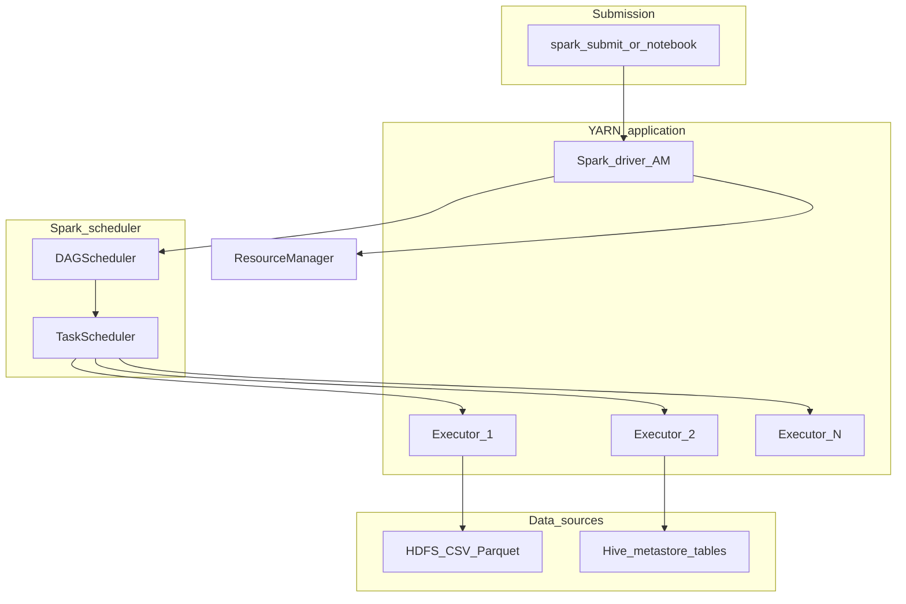

# Technical deep-dive — Spark on YARN (Module 06)

## Why this matters

Spark is the workshop engine for **distributed cleansing and joins**: meter readings aligned with operator weather, written to Parquet under a personal curated path and registered in Hive. Data engineers own `spark-submit`, resource requests, and output layout; analysts may consume Spark-produced tables via SQL; data scientists use PySpark for feature engineering and experimentation at scale. Spark’s lazy DAG model explains why a small code change can trigger a full shuffle over the entire grid pilot dataset.

---

## Architecture



**Driver** — runs the user program, builds the **DAG** of stages, schedules tasks, and holds the SparkContext. In **cluster mode** on YARN, the driver runs in a container on the cluster (AM). In **client mode**, the driver stays on the edge node.

**Executors** — JVM processes on worker nodes; run tasks, cache partitions, and shuffle read/write. PySpark runs Python workers alongside JVM executors.

**DAGScheduler / TaskScheduler** — cut the DAG at **shuffle boundaries** (each shuffle → new stage). Tasks are parallel units within a stage.

**HDFS and HMS** — `spark.read.csv`, `parquet`, or `spark.table("db.t")` pull bytes from HDFS using Hadoop FileSystem + Kerberos; Hive support resolves table paths via Metastore.

---

## How it works internally

**Lazy evaluation** — Transformations (`filter`, `join`, `select`) build a plan; **actions** (`count`, `collect`, `write`) trigger execution. Use this for debugging with `explain()` before heavy writes.

**Partitions** — RDD/DataFrame **partitions** map to parallel tasks. Too few → underutilized cluster; too many → task overhead. `repartition(n)` shuffles; `coalesce(n)` narrows without full shuffle (when reducing).

**Shuffles** — Joins, `groupBy`, `distinct`, and `repartition` exchange data across the network. Shuffles dominate runtime and disk spill. **Broadcast hash join** sends a small table to all executors when one side fits `spark.sql.autoBroadcastJoinThreshold`.

**Adaptive Query Execution (AQE)** — runtime coalescing of partitions, skew join handling, and switching join strategies (Spark 3.x+) — reduces manual tuning for skewed station keys.

**Caching** — `cache()` / `persist()` keeps partitions in executor memory/disk for iterative ML; unpersist when done to free memory.

**File formats** — **Parquet** columnar output matches Hive/Impala curated layers; specify compression (`snappy`, `zstd`). Avoid writing many tiny files — `coalesce` or `repartition` before write, or run a compaction job.

**Hive integration** — `spark.sql.catalogImplementation=hive` and warehouse dir align with HMS; `saveAsTable` / `insertInto` register metadata. Workshop lab writes Parquet then creates an **external** table for Impala/Hive reuse.

---

## Day-to-day usage by role

### Data engineers

- Standardize **`spark-submit`** with `--master yarn`, `--deploy-mode cluster`, queue, and memory flags.
- Set **`spark.yarn.principal`** / keytab for unattended jobs; human `kinit` for ad-hoc runs.
- Idempotent curated loads: overwrite partition or Iceberg merge (see module 07).
- Monitor **Spark UI** (active) and **History Server** (finished) for stage skew and spill.
- Tune **`spark.executor.memoryOverhead`** for PySpark or large strings.

### Data analysts

- Prefer SQL on curated Hive/Impala tables produced by Spark unless you need Python transforms.
- If counts “look wrong,” ask whether Spark job finished and table was refreshed in Impala.

### Data scientists

- Use **DataFrame API** or **`spark.sql`** for reproducible pipelines; avoid `collect()` on large meter datasets — sample with `limit` or write to temp table.
- Fix **random seed** and snapshot input paths (or Iceberg snapshot id) for experiment reproducibility.
- **`ml` pipelines** benefit from caching training DataFrames only after feature column pruning.

---

## Cheat sheet

```bash
export WORKSHOP_USER=<your_username>
export WORKSHOP_ROOT="${WORKSHOP_ROOT:-/2026_cdp_workshop}"
kinit "${WORKSHOP_USER}"
```

```bash
# PySpark on YARN (pattern from lab)
spark-submit \
  --master yarn \
  --deploy-mode cluster \
  --name "ws_${WORKSHOP_USER}_meter_weather" \
  --num-executors 4 \
  --executor-memory 4g \
  --executor-cores 2 \
  --conf spark.sql.shuffle.partitions=200 \
  cleanse_join.py
```

```python
# Read workshop CSV from HDFS
from pyspark.sql import SparkSession

spark = SparkSession.builder.appName("workshop").enableHiveSupport().getOrCreate()
root = "/2026_cdp_workshop"

meters = spark.read.option("header", True).csv(f"{root}/data/landisgyr/*.csv")
weather = spark.read.option("header", True).csv(f"{root}/data/operator_weather/*.csv")
```

```python
# Join and write curated Parquet
import os

ws_user = os.environ["WORKSHOP_USER"]
curated = meters.join(weather, ["ts_utc", "station_id"], "left")
out = f"/user/{ws_user}/curated/meter_weather"
curated.write.mode("overwrite").parquet(out)
```

```bash
# Check YARN app from submission output
yarn application -list | grep ws_
yarn logs -applicationId <application_id> | tail -100
```

Useful **configs** (set in submit or `spark-defaults.conf`):

| Property | Purpose |
|----------|---------|
| `spark.sql.shuffle.partitions` | Parallelism after shuffle |
| `spark.executor.memoryOverhead` | Off-heap / Python overhead |
| `spark.dynamicAllocation.enabled` | Scale executors with load |
| `spark.yarn.queue` | YARN queue name |

---

## Gotchas and best practices

| Gotcha | What to do |
|--------|------------|
| Driver OOM on `collect()` | Never pull full grid history to driver |
| Skew on hot `station_id` | Salting, AQE skew join, or broadcast if tiny |
| Small Parquet files | Repartition before write; target 128–256 MB objects |
| Client mode notebook drop | Use cluster mode for long jobs |
| Kerberos expiry mid-job | Keytab or delegation tokens for multi-hour runs |
| Case-sensitive column names | Quote or normalize in CSV ingest |
| Hive partition not visible | `MSCK REPAIR` or register partition after Spark write |

**Best practices:** name apps for traceability; write to user or curated namespace then save a table at the default location (no custom `LOCATION`, so no extra Ranger URL policy); log row counts and null rates as job metrics; align shuffle partitions with ~128 MB task input where possible.

---

## Further reading

- Apache Spark: [Scheduling, shuffle, and tuning guide](https://spark.apache.org/docs/latest/tuning.html)
- Cloudera documentation: Running Spark on YARN, Spark 3, and integration with Hive Metastore
