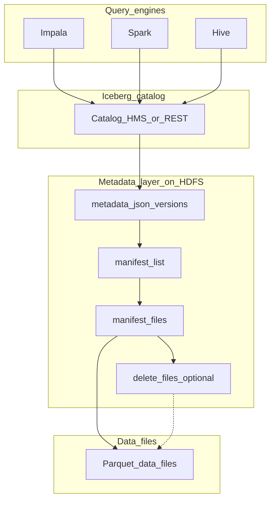

# Technical deep-dive — Lakehouse with Apache Iceberg (Module 07)

## Why this matters

Grid monitoring pipelines need **idempotent loads**, **row-level corrections** (bad meter read, late-arriving weather), and **auditable history** without hand-rolled HDFS delete lists. Iceberg adds a **transactional table format** on top of Parquet (or ORC) in HDFS or object storage: snapshots, time travel, `MERGE`, and safe concurrent writers. Data engineers implement SCD-style updates and compaction; analysts query current snapshot in Impala/Hue; data scientists pin **snapshot IDs** for reproducible training sets. The workshop contrasts manual overwrite partitions (Hive external) with Iceberg’s metadata-driven commits.

---

## Architecture



**Catalog** — maps **table identifier** → current **metadata file pointer**. In CDP workshops this is often **Hive Metastore** (`spark.sql.catalogImplementation`, Impala `CREATE TABLE … STORED BY ICEBERG`) or a REST catalog in cloud deployments.

**metadata.json** — atomic table state: schema, partition spec, sort order, **snapshot list**, and which manifest list is current. Each commit writes a new metadata.json and swaps the pointer — **atomic publish**.

**Manifest list → manifests** — manifests list **data files** (path, partition, metrics) and optionally **delete files** for row-level deletes (v2 format).

**Data files** — immutable Parquet objects; changes create new files plus metadata entries rather than editing bytes in place.

**Engines** — Impala, Spark, and Hive share the same snapshot if they use the same catalog and Iceberg version compatibility — **engine interop** is a lakehouse selling point.

---

## How it works internally

**Snapshots** — Each commit (append, overwrite, delete, schema change) creates a **snapshot** with a unique id and timestamp. Queries default to **current snapshot**; **`FOR SYSTEM_TIME AS OF`** / **`FOR VERSION AS OF`** read history (**time travel**).

**Snapshot isolation** — Readers pin a snapshot at query start; writers commit a new snapshot without locking readers on old files. Orphan files may accumulate until expiration.

**Row-level DML**

| Operation | Mechanism (simplified) |
|-----------|-------------------------|
| `INSERT` | New data files + new snapshot |
| `DELETE` | Delete files (position/equality) or rewrite (copy-on-write) |
| `UPDATE` | Often delete + insert per row batch |
| `MERGE` | Match source to target; insert/update/delete branches |

**Copy-on-write (COW) vs merge-on-read (MOR)** — COW rewrites data files on update/delete — simpler reads, heavier writes. MOR writes **delete files** quickly; reads merge base + deletes — needs **compaction** for read performance.

**Hidden partitioning** — Partition values derived from source columns (e.g. `days(ts_utc)`) without brittle `dt=` path rules in SQL; **partition evolution** can change spec with new snapshots.

**Schema evolution** — Add/drop/rename columns with metadata compatibility; old snapshots retain old schema for time travel.

**Idempotent loads** — **`MERGE`** on natural key (`station_id`, `ts_utc`) replaces hand-tuned `INSERT OVERWRITE` + staging directories. Workshop lab compares manual idempotency vs Iceberg commits.

**Maintenance**

- **`expire_snapshots`** — remove old snapshot metadata; orphan old files if unreferenced.
- **`rewrite_data_files` / compaction** — merge small files; apply delete files into new base files.
- **`remove_orphan_files`** — cleanup after failed commits (use with care).

---

## Day-to-day usage by role

### Data engineers

- Model **keys** for `MERGE` (meter id + timestamp + quality flag).
- Choose **write mode** and target file size (Spark `write-options`, Iceberg `write.target-file-size-bytes`).
- Automate **expire_snapshots** and compaction on curated fact tables.
- After failed job, use **rollback** to last good snapshot before re-running load.
- Document **catalog** and warehouse path for DR (`metadata/` and `data/` under table location).

### Data analysts

- Query current data normally in Impala; use time travel for “what did we report last Tuesday?”
- Understand **`MERGE`** outcomes — duplicates disappear vs Hive external double `INSERT`.

### Data scientists

- Record **`snapshot_id`** (or timestamp) with each model training run for reproducibility.
- Sample with `FOR VERSION AS OF` to align features and labels before a late correction landed.

---

## Cheat sheet

```bash
export WORKSHOP_USER=<your_username>
export WORKSHOP_ROOT=/2026_cdp_workshop
kinit "${WORKSHOP_USER}"
```

```sql
-- Iceberg table (Impala pattern; exact STORED BY syntax varies by CDP version)
CREATE TABLE ws_${WORKSHOP_USER}.meters_iceberg (
  ts_utc TIMESTAMP,
  station_id STRING,
  current_a DOUBLE
)
STORED AS ICEBERG
LOCATION '/user/${WORKSHOP_USER}/iceberg/meters';
```

```sql
-- Idempotent upsert from staging
MERGE INTO ws_${WORKSHOP_USER}.meters_iceberg t
USING ws_${WORKSHOP_USER}.meters_staging s
ON t.station_id = s.station_id AND t.ts_utc = s.ts_utc
WHEN MATCHED THEN UPDATE SET current_a = s.current_a
WHEN NOT MATCHED THEN INSERT *;
```

```sql
-- Time travel (syntax may vary slightly by engine)
SELECT station_id, current_a
FROM ws_${WORKSHOP_USER}.meters_iceberg
FOR SYSTEM_TIME AS OF '2024-06-01 00:00:00'
WHERE station_id = 'ST001';
```

```sql
-- Inspect snapshots (Impala/Hive Iceberg procedures or metadata tables)
-- SELECT * FROM ws_${WORKSHOP_USER}.meters_iceberg.snapshots;
```

```bash
# HDFS layout behind the table (trainer demo)
hdfs dfs -ls "/user/${WORKSHOP_USER}/iceberg/meters/metadata"
hdfs dfs -ls "/user/${WORKSHOP_USER}/iceberg/meters/data"
```

Spark (conceptual):

```python
spark.sql("""
  CALL catalog.system.expire_snapshots(
    table => 'ws_user.meters_iceberg',
    older_than => TIMESTAMP '2024-01-01 00:00:00',
    retain_last => 5
  )
""")
```

---

## Gotchas and best practices

| Gotcha | What to do |
|--------|------------|
| Mixed engines, mixed Iceberg versions | Align CDP version matrix; test MERGE in each engine you use |
| Small file churn from frequent MERGE | Schedule compaction |
| Time travel disk cost | `expire_snapshots` + orphan cleanup policy |
| Assuming external Hive UPDATE works | Migrate mutable facts to Iceberg |
| Concurrent writers same partition | Iceberg serializes commits; retry on conflict |
| Reading without catalog refresh | Impala may show an old snapshot after a Spark or Hive write; run `REFRESH <table>` (or rely on automatic metadata sync if enabled) |

**Best practices:** Iceberg for curated mutable facts; keep raw landing as external CSV/Parquet; MERGE for idempotency; snapshot retention policy documented; monitor metadata file count and manifest size.

---

## Further reading

- Apache Iceberg: [Table spec and spec evolution](https://iceberg.apache.org/spec/)
- Cloudera documentation: Iceberg on CDP (Impala, Hive, Spark integration and maintenance procedures)
