# Oozie in Hue — hands-on tour

Run sections in order. Sections 0–5 use the Hue web UI only (URL and login from your handout). Section 6 is the last exercise: there you use a terminal on the edge node and the `oozie` command. Menu names can differ slightly between Hue versions; the screenshots show the workshop cluster.

**Oozie** is the scheduler of the platform. A **workflow** is a graph of actions (shell script, Hive query, Spark job, HDFS operation). A **coordinator** starts a workflow on a schedule or when data arrives. Hue gives you editors for both. They do not run anything themselves: they **write XML files to HDFS** and submit them to the Oozie server.

In sections 1–4 you build three things and, after each, look at the XML that Hue generated. **Do not edit the XML** — reading it is the point. In section 6 you turn it around: you write two small XML files yourself, put them on HDFS and start them with the `oozie` command. Larger pipelines by hand are the topic of module [11-advanced-oozie](../../11-advanced-oozie/README.md).

| Section | You build | You look at |
|---------|-----------|-------------|
| 0 | Nothing — find your way around | Menus, Job Browser |
| 1 | Workflow `hello-wf` (shell + fs action) | `workflow.xml` |
| 2 | Break it on purpose | Failed action, kill node |
| 3 | Time-based schedule | `coordinator.xml`, nominal time |
| 4 | Hive load triggered by data | Dataset, done-flag, Hive action, daily partition |
| 5 | Clean up | — |
| 6 | Exercise: CSV to external table (Spark) to managed table (Hive), by hand | `oozie` command, `spark3` and `hive2` actions, parameters, deployment to HDFS |

Names in the lab contain your user name so that your jobs are easy to find in the shared Oozie server. `<your_user>` below is your `WORKSHOP_USER` (the short name you use with `kinit`). The lab only needs one output folder, `/user/<your_user>/oozie_lab`, which the workflow itself creates.

---

## 0. Orient — log in and find the editors

**Goal:** Know where workflows, schedules and running jobs live in Hue.

1. Open Hue and log in with your user.
2. In the left menu, open **Scheduler**. It has three entries: **Workflow**, **Schedule** and **Bundle**. Below them are **Documents**, **Storage Browser** (HDFS files), **Tables**, **Jobs** and **Importer**.

   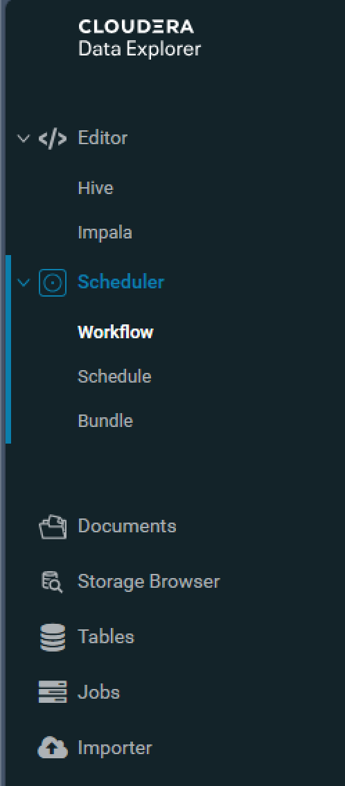
3. Open **Jobs** (the Job Browser). Besides the general **Jobs** tab it has the tabs **Workflows**, **Schedules** (coordinators), **Bundles** and **SLAs**. Type `user:<your_user>` in the filter field to see only your jobs. Everything Oozie starts shows up here, also its launchers (type *Oozie Launcher*).

   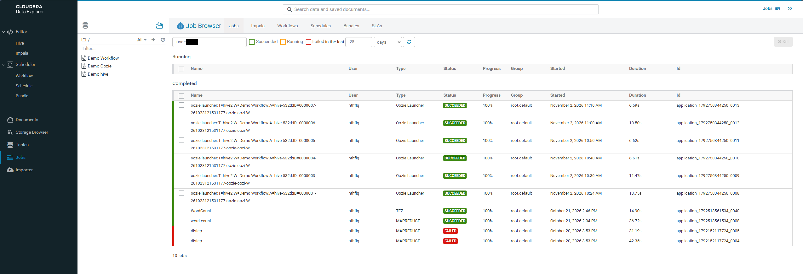

**Check:** Which three kinds of Oozie jobs does the Job Browser list? *(Workflows, coordinators — shown as "Schedules" — and bundles.)*

---

## 1. Create a workflow

**Goal:** Build a two-step workflow, run it, follow it down to YARN, and then read the XML behind it.

### 1.1 Build it

1. Open the **Workflow** editor (**Scheduler → Workflow**). An empty canvas with a **Start** and an **End** node appears; the palette of actions is the row of icons at the top.
2. Click the title and name the workflow `hello-wf-<your_user>`.
3. Drag an **Fs** (HDFS) action onto the canvas, between start and end.
   - Add one **Create directory** operation with the path `/user/<your_user>/oozie_lab`. The folder does not exist yet; the action creates it.
   - Name the action `make_dir`.
4. Drag a **Shell** action behind it.
   - Command: `echo`
   - Arguments: `hello` and `world`, one argument per line
   - Name the action `say_hello`.
5. Look at the canvas: the flow runs from top to bottom: the flag is the **Start** node, then your two actions, then the **End** node (circle). The grey square below the End node is the **Kill** node, which Hue added for you. The canvas draws no error arrows; every action sends its error to the Kill node by default. You check this in step 6.

   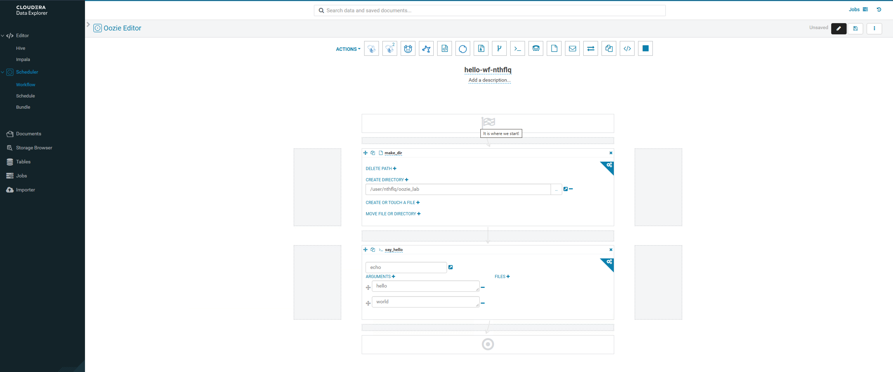
6. Open the **Transitions** tab of the action `make_dir` (open the action settings with the blue gear icon in the action's top right corner, then choose the tab). **OK** points to the next action, **KO** to the Kill node. Do not change them.

   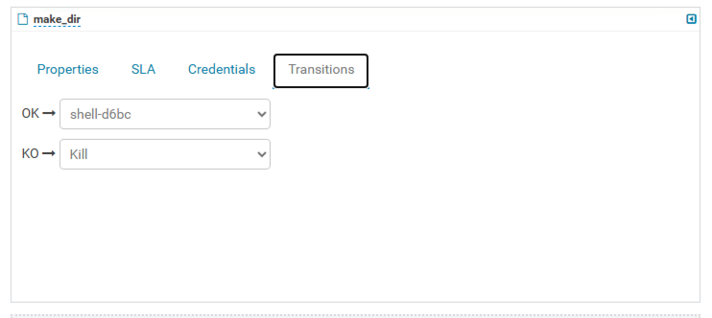
7. **Save** the workflow.

### 1.2 Run it and follow the job

1. In the workflow editor click **Submit** (play icon) and confirm the small window that appears. Do not change anything in it; Hue fills in the parameters for you.
2. Hue opens the **Job Browser** with your workflow. Refresh until the status is **SUCCEEDED**. The **Graph** tab shows the same flow as the editor; each action is green when it has finished.

   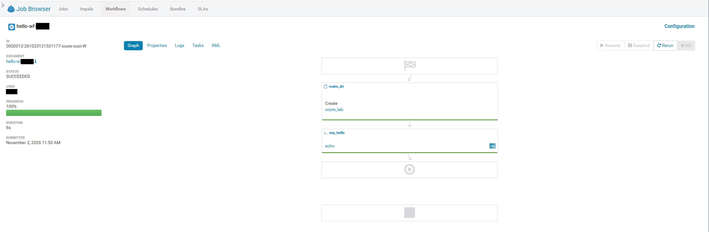
3. Look at the left side of the page: job ID, status, progress, duration and submit time. The ID ends in `-oozie-oozi-W`: `W` stands for workflow.
4. Open the **Logs** tab and find the line of the Fs action (`make_dir`). Server and user name are shown here as placeholders:
   ```text
      2026-11-02 11:50:55,814 INFO THREAD[CallableQueue-11] org.apache.oozie.action.hadoop.FsActionExecutor: SERVER[<oozie-server>] USER[<your_user>] GROUP[-] TOKEN[] APP[hello-wf-<your_user>] JOB[0000012-261023121531177-oozie-oozi-W] ACTION[0000012-261023121531177-oozie-oozi-W@fs-5b32] Creating directory [hdfs://nameservice1/user/<your_user>/oozie_lab]
   ```

      `FsActionExecutor` runs inside the Oozie server. There is no YARN application and no MapReduce job for this action.
5. Go back to the **Graph** tab and click the shell action. Its **Properties** show `externalId`, the YARN application of this action. `data` holds the captured output (`hello=world`).

   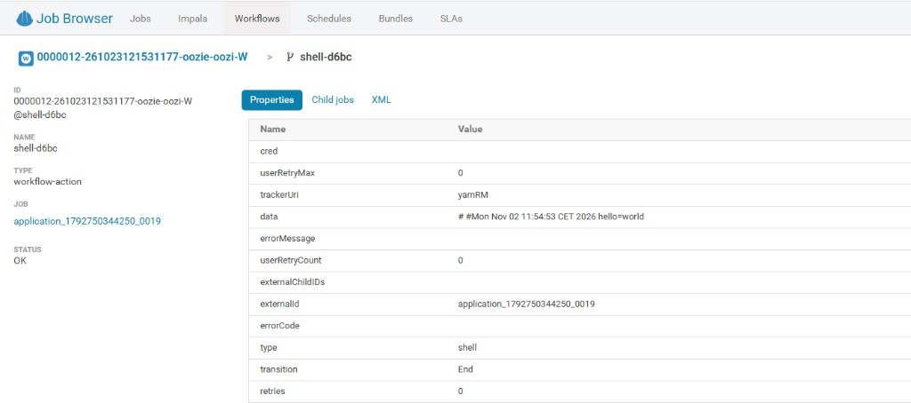
6. Follow the application link to YARN and open its log. The output of the command is in the log as `hello world`.

An `echo` is a real process, so it needs a container. Oozie starts a small **launcher** application on YARN for the action, and the launcher runs the command. That is why the shell action has an `externalId` and the Fs action has none.

### 1.3 Look at the XML

Now the technical details. In the job page open the **XML** tab. It shows the `workflow.xml` that Hue generated and Oozie ran. Do not edit it.

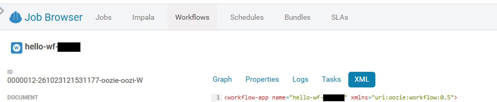

The file looks like this (this is the real content from the workshop cluster, only your user name differs):

```xml
<workflow-app name="hello-wf-<your_user>" xmlns="uri:oozie:workflow:0.5">
    <start to="fs-5b32"/>
    <kill name="Kill">
        <message>Action failed, error message[${wf:errorMessage(wf:lastErrorNode())}]</message>
    </kill>
    <action name="fs-5b32">
        <fs>
              <mkdir path='${nameNode}/user/<your_user>/oozie_lab'/>
        </fs>
        <ok to="shell-d6bc"/>
        <error to="Kill"/>
    </action>
    <action name="shell-d6bc">
        <shell xmlns="uri:oozie:shell-action:0.1">
            <job-tracker>${jobTracker}</job-tracker>
            <name-node>${nameNode}</name-node>
            <exec>echo</exec>
              <argument>hello</argument>
              <argument>world</argument>
              <capture-output/>
        </shell>
        <ok to="End"/>
        <error to="Kill"/>
    </action>
    <end name="End"/>
</workflow-app>
```

Match what you clicked with what you read:

| In the UI | In the XML |
|-----------|-----------|
| Start node | `<start to="fs-5b32"/>` — the first action |
| Action | `<action name="...">`. Hue generates the name (`fs-5b32`, `shell-d6bc`); the names `make_dir` and `say_hello` you typed are labels in the editor and the graph only |
| Order of the actions on the canvas | `<ok to="...">` — the next node on success |
| Kill node (grey square) | `<error to="Kill"/>` in every action, and `<kill>` with a message |
| End node | `<end name="End"/>` |
| Fs operation | `<fs><mkdir path="..."/></fs>` |
| Command and arguments | `<exec>` and `<argument>` |

Things to notice:

- `${nameNode}` and `${jobTracker}` are **variables**. Hue passes them when it submits the workflow.
- The `xmlns` values are the schema versions of the workflow and of the action type.
- `${wf:errorMessage(...)}` in the kill node is an **EL function**: it inserts the error message of the failed action.
- `<capture-output/>` keeps the output of the command for later nodes. Hue adds it by default; it is the `hello=world` you saw in the shell action's `data`.

**Check:** Which element decides where the workflow goes when the `fs-5b32` action fails? *(*`<error to="Kill"/>` *inside that action.)*

---

## 2. Break it

**Goal:** Make a workflow fail on purpose and see the kill node.

A `mkdir` on a folder that already exists is not an error, so running the workflow again would simply succeed. Add a step that fails:

1. Open the workflow and drag a third **Shell** action behind `say_hello`. Name it `fail_on_purpose`, use the command `ls` and the single argument `/does/not/exist`. Save and submit.
2. In the Job Browser the workflow ends as **KILLED**. In the **Graph** tab the first two actions are green and `fail_on_purpose` is red. Click it to see its error message. The kill node uses that message in its own text, through `wf:errorMessage(...)`.

   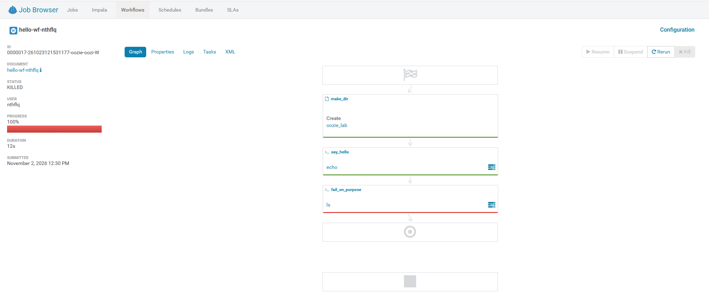
3. Look at the XML tab: there is a third `<action>`, and `shell-d6bc` now has `<ok to="...">` pointing to it instead of `End`. The first two actions ran again and succeeded; Oozie does not undo them.
4. Remove `fail_on_purpose` again (the **x** in the top right corner of the action) and save, so that the workflow succeeds in the next sections.

**Check:** What are the two end states that a workflow can have? *(SUCCEEDED through the* `end` *node and KILLED through a* `kill` *node.)*

---

## 3. Create a time-based schedule

**Goal:** Start the workflow from a coordinator every few minutes, and read `coordinator.xml`.

A **coordinator** wraps a workflow. It knows *when* to start it (a frequency, between a start and an end time). Each start is a **coordinator action** with a **nominal time**: the time the run was *planned* for, which can differ from the time it actually started.

To make each run create its own folder, give the path a variable first. In the workflow editor, change the `make_dir` path to:

```
/user/<your_user>/oozie_lab/${wf_date}
```

Save. Hue asks for a value of `wf_date` when you submit manually; the coordinator will fill it in.

### 3.1 Build it

1. Open the **Schedule** editor (**Scheduler → Schedule**).
2. Name it `every-5-min-<your_user>`.
3. Under **Which workflow to schedule?** choose `hello-wf-<your_user>`.
4. Under **How often?** tick **Advanced syntax** and enter the crontab expression `*/5 * * `* * (every 5 minutes).
5. Set **From** to the current time (a few minutes ahead of now is fine) and **To** 20 minutes later. Leave the time zone as it is.
6. In the **Parameters** section, set `wf_date` to the coordinator's date function. If the **Parameter** list does not offer it, type:
   ```
     ${coord:formatTime(coord:nominalTime(), 'yyyyMMddHHmm')}
   ```
7. **Save** and **Submit**.

   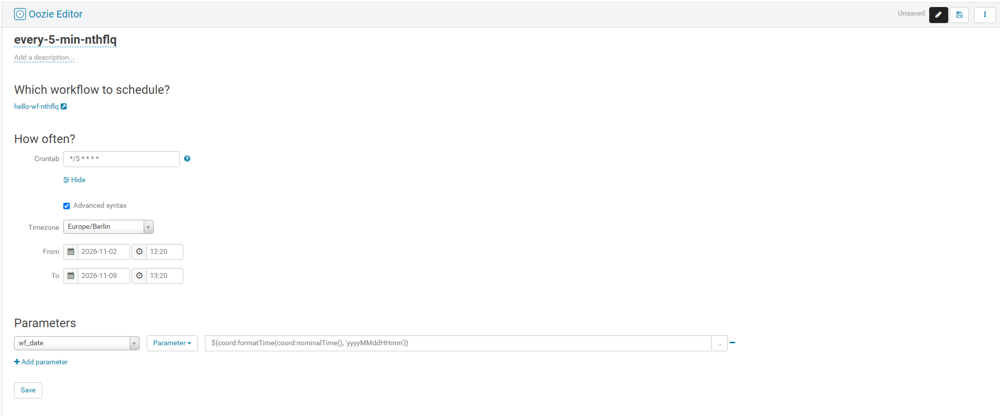

### 3.2 Look at the XML

In the Job Browser open the **Schedules** tab, click your coordinator and switch to its **XML** tab. It shows the `coordinator.xml`.

The file looks like this:

```xml
<coordinator-app name="every-5-min-<your_user>"
  frequency="*/5 * * * *"
  start="${start_date}" end="${end_date}" timezone="Europe/Berlin"
  xmlns="uri:oozie:coordinator:0.2"
  >
  <controls>
    <execution>FIFO</execution>
  </controls>
  <action>
    <workflow>
      <app-path>${wf_application_path}</app-path>
      <configuration>
        <property>
            <name>wf_date</name>
            <value>${coord:formatTime(coord:nominalTime(), 'yyyyMMddHHmm')}</value>
        </property>
        <property>
            <name>oozie.use.system.libpath</name>
            <value>True</value>
        </property>
        <property>
            <name>start_date</name>
            <value>${start_date}</value>
        </property>
        <property>
            <name>end_date</name>
            <value>${end_date}</value>
        </property>
      </configuration>
   </workflow>
  </action>
</coordinator-app>
```

Read it from top to bottom:

| In the XML | Meaning |
|------------|---------|
| `frequency` | How often an action is created. Here the crontab expression `*/5 * * * *`, every 5 minutes |
| `start`, `end` | The window. Oozie creates one action per interval inside it |
| `<execution>` | In which order waiting actions run; `FIFO` is first in, first out |
| `<app-path>` | The workflow to start (the folder with `workflow.xml`) |
| `<property>` in `<configuration>` | Parameters handed to the workflow for this run |

The variables `${start_date}`, `${end_date}` and `${wf_application_path}` come from the properties Hue submitted with the schedule. Look for them in the **Configuration** of the job.

### 3.3 Watch it run

In the Job Browser open the **Schedules** tab and click your coordinator. The **Tasks** tab lists one row per interval, with the nominal time, the status, and for started runs the external id of the workflow.

- **WAITING**: the nominal time has not been reached yet. **READY**: the action is created and waits to start. Then **RUNNING** and **SUCCEEDED**.
- Wait until at least two actions have **SUCCEEDED**. Look in `/user/<your_user>/oozie_lab`: one folder per run, named after the nominal time.

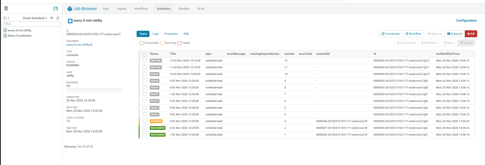

**Check:** What happens if you set **Start** one hour in the *past* instead? *(Oozie creates an action for every missed interval; this is catch-up. The nominal times are in the past, the actions all start immediately, subject to concurrency.)*

Kill the schedule when you have seen enough: in the Job Browser select it and click **Kill**.

---

## 4. Load data when it arrives

**Goal:** Start a Hive job as soon as data has landed, and load it into the partition of the day.

A coordinator can wait for a **dataset**: a folder that contains a **done-flag** file (by convention an empty file `_SUCCESS`). As long as the flag is missing, the action waits in state **WAITING**. When it appears, the workflow starts. The flag is how a producer says "the data in this folder is complete".

The schedule does not check the folder once. At midnight Oozie creates the action *for that day*, and the action then waits and checks the dataset again and again until the flag appears. So the schedule says **which day** an action is for, and the dataset says **when it may start**. If the file arrives at 14:00, the action starts at 14:00.

The pipeline has three steps:

1. Files arrive in one landing folder in your home directory: `/user/<your_user>/oozie_lab/landing`, followed by the flag `_SUCCESS`.
2. The workflow adds the partition of the day to a Hive table.
3. The workflow loads the files of the landing folder into that partition. Loading moves them, so the folder is empty again for the next day.

The table lives in the default warehouse location of Hive, not in the landing folder.

### 4.1 Create the table

Open **Editor → Hive**. Run this once (`${ws_user}` is the input field that Hue shows below the editor; enter your user name):

```sql
CREATE DATABASE IF NOT EXISTS ${ws_user};

CREATE EXTERNAL TABLE IF NOT EXISTS ${ws_user}.landing_meter (
  ts_utc STRING, station_id STRING, device_id STRING, phase STRING,
  active_power_kw DOUBLE, reactive_power_kvar DOUBLE, voltage_v DOUBLE,
  current_a DOUBLE, power_factor DOUBLE, frequency_hz DOUBLE,
  transformer_load_pct DOUBLE, quality_flag STRING, event_code STRING,
  comm_status STRING
)
PARTITIONED BY (dt STRING)
ROW FORMAT DELIMITED FIELDS TERMINATED BY ','
STORED AS TEXTFILE
TBLPROPERTIES ('skip.header.line.count'='1', 'external.table.purge'='true');
```

The table has no `LOCATION`, so Hive puts it in the default warehouse folder. You do **not** add partitions or load data yourself. The workflow does that when the data arrives.

### 4.2 Create the workflow

1. In the **Storage Browser** create the file `/user/<your_user>/oozie_lab/load_partition.hql` (**New → File**), open it for editing and enter:
   ```sql
    ALTER TABLE ${ws_user}.landing_meter ADD IF NOT EXISTS PARTITION (dt='${day}');
    LOAD DATA INPATH '${landing_dir}' INTO TABLE ${ws_user}.landing_meter PARTITION (dt='${day}');
   ```

    These are the two steps the workflow runs for each day. `${landing_dir}` is the landing folder; the coordinator will provide it. `LOAD DATA INPATH` **moves** the files out of the landing folder into the partition.
2. Open **Scheduler → Workflow** and create `load-landing-wf-<your_user>`. Drag a **Hive** (HiveServer2) action onto the canvas, name it `load_partition` and choose the file as its script.
3. Add three parameters, one per line:
   - `ws_user=${wf:user()}`
   - `day=${wf_date}`
   - `landing_dir=${landing_dir}`

    `wf:user()` is the user who runs the workflow; `wf_date` and `landing_dir` come from the coordinator.
4. In the **Credentials** tab of the action, tick **hive2**. On a Kerberos cluster Oozie needs it to log in to HiveServer2.
5. **Save**.

   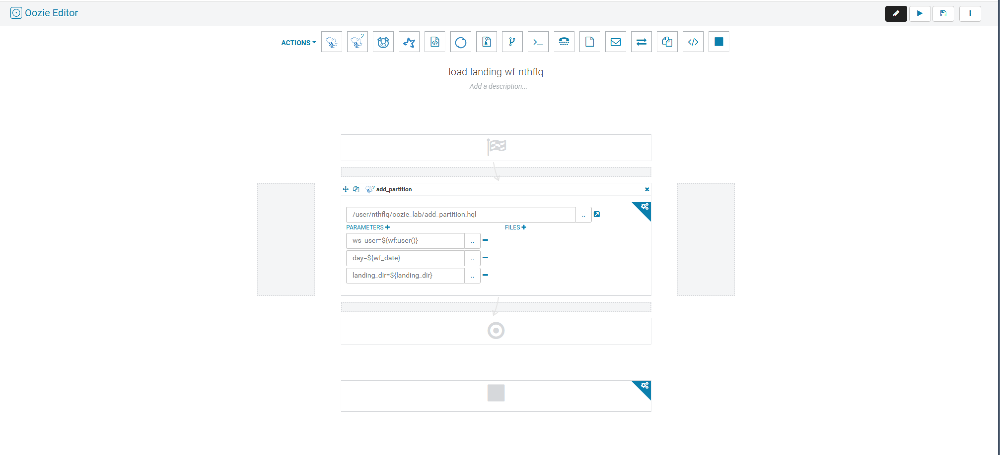

### 4.3 Create the schedule

1. Open **Scheduler → Schedule** and name it `on-landing-<your_user>`.
2. Choose the workflow `load-landing-wf-<your_user>`.
3. Tick **Advanced syntax** and set the crontab to ``0 0 * * *`` (daily at midnight), with **From** today 00:00 and **To** a few days later. A day is the natural unit: one landing folder per day.
4. The **Parameters** section now lists `wf_date` and `landing_dir`, the two variables of the workflow. Set `wf_date` to `${coord:formatTime(coord:nominalTime(), 'yyyyMMdd')}`.
5. For `landing_dir` change the type of the value from **Parameter** to **Input Path** (the button next to the value). Hue creates the dataset for you, so there is no name to enter. Fill in:
   - Path: `/user/<your_user>/oozie_lab/landing` (with your own user name). Hue shows the result at the right (`Will convert to ...`) and puts `${nameNode}` in front of it.
   - Tick **Done flag** and enter `_SUCCESS`.
   - Leave **Same frequency**, **Same start** and **Same timezone** ticked, and **Instance** on **Default**. The path has no date, so the frequency does not change which folder is checked.

    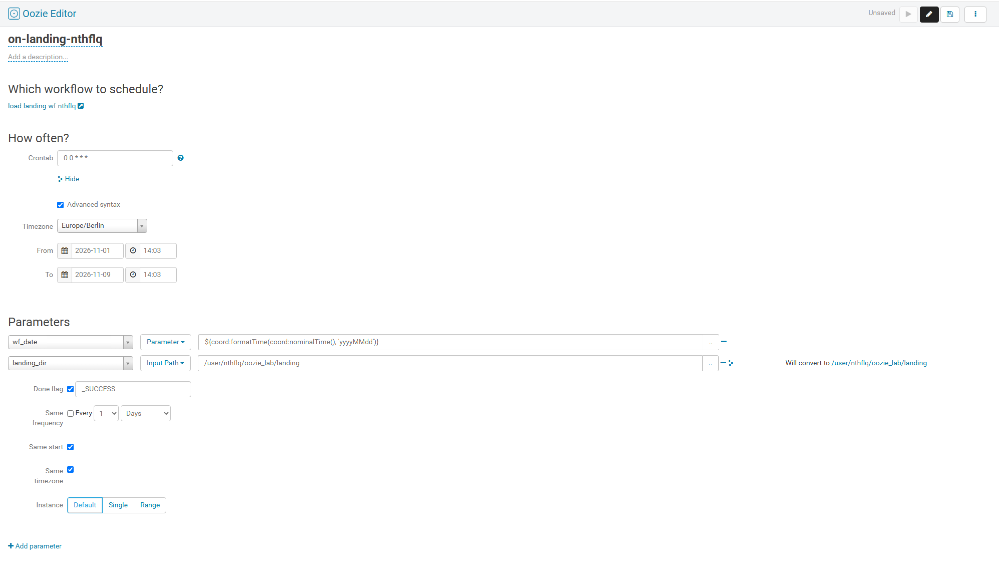
6. **Save** and **Submit**.

### 4.4 Look at the XML

Open the **XML** tab of the new coordinator in the Job Browser. Compared with the time-based one there are new blocks: `<datasets>`, `<input-events>` and one more property. Hue names the dataset after the parameter, here `landing_dir`:

```xml
<coordinator-app name="on-landing-<your_user>"
  frequency="0 0 * * *"
  start="${start_date}" end="${end_date}" timezone="Europe/Berlin"
  xmlns="uri:oozie:coordinator:0.2"
  >
  <controls>
    <execution>FIFO</execution>
  </controls>
  <datasets>
    <dataset name="landing_dir" frequency="${coord:days(1)}"
             initial-instance="${start_date}" timezone="Europe/Berlin">
      <uri-template>${nameNode}/user/<your_user>/oozie_lab/landing</uri-template>
      <done-flag>_SUCCESS</done-flag>
    </dataset>
  </datasets>
  <input-events>
    <data-in name="landing_dir" dataset="landing_dir">
    <instance>${coord:current(0)}</instance>
    </data-in>
  </input-events>
  <action>
    <workflow>
      <app-path>${wf_application_path}</app-path>
      <configuration>
          <property>
            <name>landing_dir</name>
            <value>${coord:dataIn('landing_dir')}</value>
          </property>
        <property>
            <name>wf_date</name>
            <value>${coord:formatTime(coord:nominalTime(), &#x27;yyyyMMdd&#x27;)}</value>
        </property>
        <property>
            <name>oozie.use.system.libpath</name>
            <value>True</value>
        </property>
        <property>
            <name>start_date</name>
            <value>${start_date}</value>
        </property>
        <property>
            <name>end_date</name>
            <value>${end_date}</value>
        </property>
      </configuration>
   </workflow>
  </action>
</coordinator-app>
```

- `<dataset>` describes *where* the data lives and which file marks it complete. The path has no date in it: it is the same folder every day. Its `frequency` is `${coord:days(1)}` (from **Same frequency**), even though the schedule itself uses a crontab.
- `<data-in>` says: this coordinator action needs the instance of the dataset that belongs to its own nominal time (`coord:current(0)`).
- The first `<property>` of the action, `landing_dir`, gets its value from `${coord:dataIn('landing_dir')}`: the full path of the dataset instance. This is how the folder reaches your `LOAD DATA` statement.

**Check:** Why is `_SUCCESS` better than "the folder exists"? *(A producer creates the folder first and fills it afterwards; the flag is written last, so the consumer never reads half-written data.)*

### 4.5 Let the data arrive

1. In the Job Browser open the **Schedules** tab and your coordinator. All actions are **WAITING**. The column `missingDependencies` shows what Oozie waits for: `.../oozie_lab/landing/_SUCCESS`.

   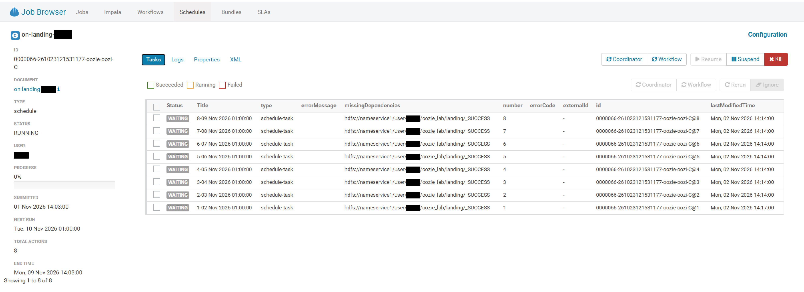

2. In the **Storage Browser** open `/user/<your_user>/oozie_lab` and create the folder `landing`. Then go to the workshop folder (`/2026_cdp_workshop/data/grid_measurements`, or the root your trainer named), select `sample-grid-measurements.csv` and use **Actions → Copy** to copy it into the `landing` folder. The actions keep waiting: the flag is still missing.

   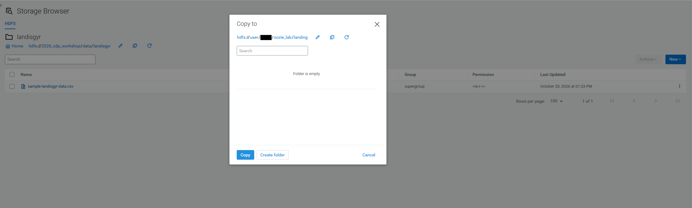

3. Now create an empty file `_SUCCESS` in the `landing` folder (**New → File**).
4. Refresh the coordinator. The first action turns **SUCCEEDED** and has started your workflow. The other actions are still **WAITING**: the Hive job moved the files, and the flag with them, so there is nothing left to wait for until the next file arrives.

   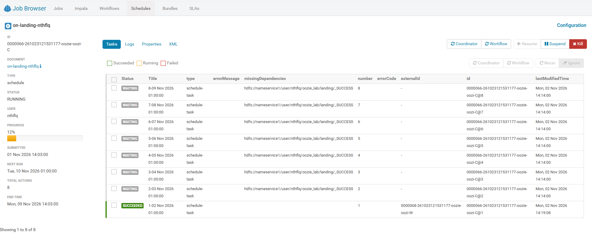

5. In **Editor → Hive** check the result:

   ```sql
   SHOW PARTITIONS ${ws_user}.landing_meter;
   SELECT dt, COUNT(*) FROM ${ws_user}.landing_meter GROUP BY dt;
   ```

   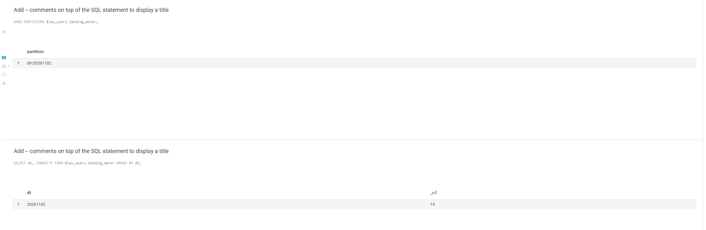

**Check:** In which state is the coordinator action as long as `_SUCCESS` is missing, and what is its *nominal time* when it finally starts? *(WAITING; the nominal time stays the day the action was planned for, not the time the file arrived.)*

---

## 5. Clean up

1. In the Job Browser kill your running coordinators (`every-5-min-<your_user>`, `on-landing-<your_user>`), if they are still running.
2. In **Editor → Hive** run `DROP TABLE ${ws_user}.landing_meter;`. The table has `external.table.purge`, so this also deletes its data.
3. Delete the folders you created if you want a clean home directory:

   Storage Browser → `/user/<your_user>/oozie_lab` → select → **Delete** (with **Skip Trash**).
4. The workflows and schedules stay in your Hue documents; delete them from the editors if you like.

---

## 6. Exercise — the same thing by hand, with the `oozie` command

**Goal:** Write a workflow with a `spark3` and a `hive2` action yourself, deploy the XML to HDFS and run it from the command line.

Hue does three things for you: it writes `workflow.xml`, it copies the files to HDFS and it submits the job. Here you do all three yourself. The pipeline has two steps:

1. A **Spark** job reads the CSV files of a folder, lets Spark **infer the schema** from the data, and saves the result as an **external table**.
2. A **Hive** script loads that table into a **managed table**.

Nothing is fixed in the XML. The workflow takes everything from parameters, so you can run it for any folder and any table name:

| Parameter | Meaning | First run |
|-----------|---------|-----------|
| `csvDir` | HDFS folder with the CSV files (with a header line) | `${WORKSHOP_ROOT}/data/grid_measurements` |
| `database` | Hive database for both tables | your user name |
| `extTable` | External table, written by Spark | `oozie_csv_ext` |
| `managedTable` | Managed table, written by Hive | `oozie_csv_managed` |

The `oozie` command talks to the Oozie server and replaces the **Submit** button and the Job Browser of Hue. You keep a *working folder* on the edge node (the files you edit) and an *application folder* on HDFS (the files Oozie runs): Oozie never reads from the edge node while a job runs.

### 6.1 Set up the terminal

Open a terminal on the edge node. First your Kerberos ticket (own block, because `kinit` asks for your password):

```bash
export WORKSHOP_USER="${WORKSHOP_USER:-$(whoami)}"   # default: your Linux login; change if your Kerberos name differs
kinit "${WORKSHOP_USER}"
```

Then the paths. `OOZIE_URL` is the Oozie server URL from your handout; the `oozie` command reads it automatically:

```bash
# Workshop data, the application folder on HDFS, the working folder on the edge node
export WORKSHOP_ROOT="${WORKSHOP_ROOT:-/2026_cdp_workshop}"   # adjust if needed
export CLI_HDFS="/user/${WORKSHOP_USER}/oozie_lab_cli/csv-load"
export CLI_LOCAL="${HOME}/oozie-lab-cli"

# Oozie server
export OOZIE_URL="<oozie-url-from-your-handout>"   # for example https://<host>:11443/oozie
```

Create the working folder and the application folder. The Python script goes into a `lib` subfolder, as in a Spark action by convention:

```bash
# Edge node: where you edit the files
mkdir -p "${CLI_LOCAL}"

# HDFS: where Oozie reads the application
hdfs dfs -mkdir -p "${CLI_HDFS}/lib"
```

The XML needs the addresses of four services. You already used all of them through Hue; read the values there:

| Value | Where you find it |
|-------|-------------------|
| NameNode | `hdfs getconf` (command below) |
| `resourceManager` | Job Browser → your workflow from section 1 → **Configuration** tab → value of `jobTracker` |
| HiveServer2 URL and principal | Job Browser → `load-landing-wf-<your_user>` (section 4) → **XML** tab → the `<credential>` block: values of `hive2.jdbc.url` and `hive2.server.principal` |
| Hive Metastore URI and principal | `hive-site.xml` (command below): `hive.metastore.uris` and `hive.metastore.kerberos.principal` |

```bash
# NameNode URI of the cluster
export NAME_NODE=$(hdfs getconf -confKey fs.defaultFS)
echo "${NAME_NODE}"

# Metastore URI and principal (the value is on the line after the name)
grep -A1 -E 'hive.metastore.uris|hive.metastore.kerberos.principal' /etc/hive/conf/hive-site.xml
```

Keep the values at hand for section 6.3.

### 6.2 Write the application

The application has three files. Start with the Spark script. It reads the folder, infers the schema, and saves the data as a table without a `LOCATION`: like in the Spark lab, Spark puts the files in the default external warehouse folder of your database, so the table is **external**.

```bash
cd "${CLI_LOCAL}"
vim csv_to_table.py
```

Content of the file (press `i` in `vim` first, paste, then `Esc` and `:wq`):

```python
#!/usr/bin/env python3
"""Read CSV files with an inferred schema and save them as an external table."""
import sys

from pyspark.sql import SparkSession


def main() -> None:
    if len(sys.argv) != 4:
        print("Usage: csv_to_table.py <csv_dir> <database> <table>", file=sys.stderr)
        sys.exit(2)
    csv_dir, database, table = sys.argv[1:4]

    spark = SparkSession.builder.appName("csv-to-external-table").enableHiveSupport().getOrCreate()

    # header line gives the column names, inferSchema reads the data once to guess the types
    df = spark.read.option("header", True).option("inferSchema", True).csv(csv_dir)
    df.printSchema()

    # no LOCATION: the table lands in the default external warehouse folder
    spark.sql(f"CREATE DATABASE IF NOT EXISTS {database}")
    df.write.mode("overwrite").format("parquet").saveAsTable(f"{database}.{table}")
    spark.stop()


if __name__ == "__main__":
    main()
```

Now the Hive script. It reads the external table and creates the managed table from it. It drops the table first, so you can run the workflow again and again:

```bash
vim load_managed.q
```

Content of the file:

```sql
-- Variables from the Oozie hive2 action: DB, EXT_TABLE, MANAGED_TABLE.
-- Safe to run twice: the managed table is dropped and created again.

DROP TABLE IF EXISTS ${DB}.${MANAGED_TABLE};

CREATE TABLE ${DB}.${MANAGED_TABLE} STORED AS ORC AS
SELECT * FROM ${DB}.${EXT_TABLE};
```

Last, the workflow. Read it from top to bottom before you type it:

- The two `credential` blocks come first. The Spark job talks to the **Hive Metastore** (credential type `hcat`), the Hive script to **HiveServer2** (type `hive2`). Each action names the credential it needs with `cred="..."`.
- Nothing is hard-coded: every `${...}` comes from the properties file you write in section 6.3.
- `<file>` ships `hive-site.xml` to the Spark driver, so that it finds the Metastore.
- The `param` lines of the Hive action become the Hive variables `${DB}`, `${EXT_TABLE}` and `${MANAGED_TABLE}`; the `arg` lines of the Spark action become `sys.argv`.

```bash
vim workflow.xml
```

Content of the file (paste it unchanged: Oozie fills in the `${...}` expressions, not you):

```xml
<workflow-app name="csv-load-wf" xmlns="uri:oozie:workflow:1.0">

  <credentials>
    <credential name="hcat-creds" type="hcat">
      <property>
        <name>hcat.metastore.uri</name>
        <value>${metastoreUri}</value>
      </property>
      <property>
        <name>hcat.metastore.principal</name>
        <value>${metastorePrincipal}</value>
      </property>
    </credential>
    <credential name="hs2-creds" type="hive2">
      <property>
        <name>hive2.server.principal</name>
        <value>${jdbcPrincipal}</value>
      </property>
      <property>
        <name>hive2.jdbc.url</name>
        <value>${jdbcURL}</value>
      </property>
    </credential>
  </credentials>

  <start to="csv-to-table"/>

  <!-- Step 1: Spark reads the CSV folder and writes the external table -->
  <action name="csv-to-table" cred="hcat-creds">
    <spark3 xmlns="uri:oozie:spark3-action:1.0">
      <resource-manager>${resourceManager}</resource-manager>
      <name-node>${nameNode}</name-node>
      <master>yarn</master>
      <mode>cluster</mode>
      <name>csv-to-external-table</name>
      <jar>${wf:appPath()}/lib/csv_to_table.py</jar>
      <spark-opts>--num-executors 1 --executor-memory 1g --driver-memory 1g</spark-opts>
      <arg>${csvDir}</arg>
      <arg>${database}</arg>
      <arg>${extTable}</arg>
      <file>${wf:appPath()}/hive-site.xml#hive-site.xml</file>
    </spark3>
    <ok to="load-managed"/>
    <error to="fail"/>
  </action>

  <!-- Step 2: Hive loads the external table into a managed table -->
  <action name="load-managed" cred="hs2-creds">
    <hive2 xmlns="uri:oozie:hive2-action:1.0">
      <resource-manager>${resourceManager}</resource-manager>
      <name-node>${nameNode}</name-node>
      <jdbc-url>${jdbcURL}</jdbc-url>
      <script>load_managed.q</script>
      <param>DB=${database}</param>
      <param>EXT_TABLE=${extTable}</param>
      <param>MANAGED_TABLE=${managedTable}</param>
    </hive2>
    <ok to="end"/>
    <error to="fail"/>
  </action>

  <kill name="fail">
    <message>Action failed: ${wf:errorMessage(wf:lastErrorNode())}</message>
  </kill>

  <end name="end"/>
</workflow-app>
```

### 6.3 Deploy and write the job properties

Let the Oozie server check the XML against its schema, then copy the application to HDFS. This is the **deployment**: whatever is in `${CLI_HDFS}` when you start the job is what runs.

```bash
# Syntax check by the Oozie server
oozie validate workflow.xml

# Workflow and Hive script into the application folder, the Python script into lib
hdfs dfs -put -f workflow.xml load_managed.q "${CLI_HDFS}/"
hdfs dfs -put -f csv_to_table.py "${CLI_HDFS}/lib/"
```

Add the Hive client configuration for the Spark driver and check the folder:

```bash
# Hive client configuration for the Spark driver
hdfs dfs -put -f /etc/hive/conf/hive-site.xml "${CLI_HDFS}/"

# You should see workflow.xml, load_managed.q, hive-site.xml and lib/csv_to_table.py
hdfs dfs -ls -R "${CLI_HDFS}"
```

The **job properties** stay on the edge node. They point Oozie at the application folder and fill every `${...}` variable of the workflow:

```bash
vim csv-load.properties
```

Content of the file. Replace the placeholders in angle brackets with the values from section 6.1 and your user name:

```properties
nameNode=<name-node>
resourceManager=<value-of-jobTracker>
oozie.use.system.libpath=true
oozie.wf.application.path=${nameNode}/user/<your_user>/oozie_lab_cli/csv-load

jdbcURL=<hive2.jdbc.url>
jdbcPrincipal=<hive2.server.principal>
metastoreUri=<hive.metastore.uris>
metastorePrincipal=<hive.metastore.kerberos.principal>

csvDir=${nameNode}/2026_cdp_workshop/data/grid_measurements
database=<your_user>
extTable=oozie_csv_ext
managedTable=oozie_csv_managed
```

`oozie.use.system.libpath=true` switches on the ShareLib: the cluster jars that the Spark and Hive actions need. Hue did this for you too.

### 6.4 Run it

Start the job. The command submits and starts it in one step and prints the job ID (it ends with `-W`):

```bash
oozie job -config csv-load.properties -run
```

```bash
export WF_ID="<job-id-from-the-output>"
oozie job -info "${WF_ID}"
```

Repeat `-info` until the status is `SUCCEEDED`. Below the job header you see one row per node: `csv-to-table` first, then `load-managed`. The **Ext ID** column is the YARN application of the launcher of that action, the same value as in the Hue Job Browser. Spark starts its own application in addition, as you saw in section 1 for the shell action.

Look at the tables in Beeline. You never wrote a column list: the types come from the CSV data.

```bash
# Column names from the CSV header, types guessed by Spark
beeline -e "DESCRIBE ${WORKSHOP_USER}.oozie_csv_ext"

# Both tables must have the same number of rows
beeline -e "SELECT COUNT(*) FROM ${WORKSHOP_USER}.oozie_csv_ext"
beeline -e "SELECT COUNT(*) FROM ${WORKSHOP_USER}.oozie_csv_managed"
```

```bash
# Find Table Type (EXTERNAL_TABLE or MANAGED_TABLE), Location and the transactional property
beeline -e "DESCRIBE FORMATTED ${WORKSHOP_USER}.oozie_csv_ext"
beeline -e "DESCRIBE FORMATTED ${WORKSHOP_USER}.oozie_csv_managed"
```

Now look at the job in Hue: the Job Browser lists `csv-load-wf` under **Workflows**, with the graph of your two actions, and its **XML** tab shows the file you typed. Jobs started from the command line and from the editors are the same kind of job for Oozie.

### 6.5 Change the parameters

The point of the parameters: run the same deployed application again with other values, without touching the XML. `-D` on the command line beats the value in the properties file. Write into a second pair of tables:

```bash
oozie job -config csv-load.properties -D extTable=oozie_csv_ext_2 -D managedTable=oozie_csv_managed_2 -run
```

```bash
export WF_ID="<job-id-from-the-output>"
oozie job -info "${WF_ID}"
```

When it is `SUCCEEDED`, list the tables of your database. You should see four `oozie_csv_*` tables now:

```bash
beeline -e "SHOW TABLES IN ${WORKSHOP_USER} LIKE 'oozie_csv*'"
```

Now point `csvDir` at a folder that does not exist:

> 🔴 **Failure case — an error is expected here.** Run it, wait for the job to end and read where it stopped.

```bash
# FAILURE CASE: expected to end KILLED, the Spark action cannot read the folder
oozie job -config csv-load.properties -D csvDir="${NAME_NODE}${WORKSHOP_ROOT}/data/does_not_exist" -run
```

```bash
export WF_ID="<job-id-from-the-output>"
oozie job -info "${WF_ID}"
```

The job ends `KILLED`. The row of `csv-to-table` shows the error, `load-managed` does not appear: the `<error to="fail"/>` transition went straight to the kill node. The message of the kill node is `Action failed: ...`. For the real reason, look at the log of the Spark application: take the **Ext ID** of the `csv-to-table` row and read it as in the YARN lab (`yarn logs -applicationId <ext-id>`), or look at what the server did with `oozie job -log "${WF_ID}"`.

Compare with what Hue wrote in sections 1–4:

| Hue | Your file |
|-----|-----------|
| Names such as `shell-d6bc` | Names you chose: `csv-to-table`, `load-managed` |
| Values written into the XML or asked in the submit dialog | Parameters from `csv-load.properties`, overridable with `-D` |
| Schema versions of the editor (`0.5`, `0.1`) | The newer `1.0` schemas |
| One copy of the files in a Hue workspace folder | You decide the folder and update it with `hdfs dfs -put -f` |

**Check question 1:** The Spark action carries `cred="hcat-creds"`, the Hive action `cred="hs2-creds"`. Why does each action need its own credential, and what does the credential give the launcher?

**Check question 2:** Why does Spark write the **external** table and Hive the **managed** one, and not the other way round?

### 6.6 Clean up

Kill the job if it is still running (`oozie job -kill "${WF_ID}"`). Then remove the tables of both runs and the application folder:

```bash
# First run: purge makes the external table delete its files, then drop both tables
beeline -e "ALTER TABLE ${WORKSHOP_USER}.oozie_csv_ext SET TBLPROPERTIES ('external.table.purge'='true'); DROP TABLE ${WORKSHOP_USER}.oozie_csv_ext; DROP TABLE ${WORKSHOP_USER}.oozie_csv_managed"

# Second run (the tables with the suffix _2)
beeline -e "ALTER TABLE ${WORKSHOP_USER}.oozie_csv_ext_2 SET TBLPROPERTIES ('external.table.purge'='true'); DROP TABLE ${WORKSHOP_USER}.oozie_csv_ext_2; DROP TABLE ${WORKSHOP_USER}.oozie_csv_managed_2"

# Application folder on HDFS
hdfs dfs -rm -r -skipTrash "/user/${WORKSHOP_USER}/oozie_lab_cli"
```

---

## Self-check

You can answer yes to all of these:

- I can name the three kinds of jobs in the Job Browser.
- I found `workflow.xml` and `coordinator.xml` in the Storage Browser and can say which UI field produced which element.
- I know what a kill node is and saw a workflow end as **KILLED**.
- I can explain frequency, nominal time and catch-up.
- I can explain dataset, done-flag and input event.
- I found the launcher of an action on YARN or in its log.
- I can deploy an application folder to HDFS, start it with `oozie job -config ... -run` and override a parameter with `-D`.
- I can explain why the `spark3` and the `hive2` action each need a credential.

---

## Stretch — fork and join

1. Copy the workflow (**Save as** `fork-wf-<your_user>`).
2. Drag a **Fork** onto the canvas so that `say_hello` and a second shell action `say_bye` (`echo bye`) run in parallel. Hue adds the matching **Join**.
3. Save and submit. In the Job Browser both actions run at the same time.
4. Open the new XML and find `<fork>` with two `<path start="..."/>` elements and the `<join>` node. In the Job Browser, open the workflow graph.


**Question:** What happens if one branch fails? *(The join is never reached; the failed action goes to the kill node and the workflow is KILLED. Module 11 shows how to rerun only the failed part.)*

---

## What Hue generated, and what it did not

Reading the XML shows what the UI can and cannot do. In module [11-advanced-oozie](../../11-advanced-oozie/README.md) you write the same files by hand and add what the editors do not offer:

- Whole pipelines of `hive2` and `spark3` actions (you wrote one pair in section 6), including a coordinator for them
- **Decision** nodes with a named failure path
- **Rerun** of only the failed actions
- Applications kept in Git and deployed with a script, instead of folders generated by Hue
