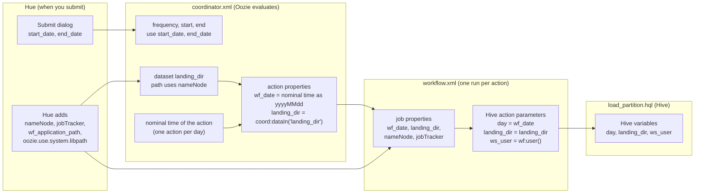

# Deep dive — Oozie in Hue (trainer)

Background for questions from the lab. Not needed to run the lab.

## Fs action vs. shell action

The log line in lab section 1.2 comes from `FsActionExecutor`, running in a `CallableQueue` thread **of the Oozie server**. An fs action (mkdir, delete, move, chmod, touchz) is a plain HDFS call made by the server itself. No launcher, no YARN application, no MapReduce job.

Shell, Hive/Hive2, Spark, Sqoop, Java and similar actions start a **launcher** application on YARN. The launcher runs the command in a container. That is why the shell action has an external id and appears in the YARN part of the Job Browser, and the fs action does not.

## `capture-output`

- `<capture-output/>` in a shell (or java, ssh) action tells Oozie to keep the standard output of the command as the action's data.
- The output must be in Java **properties** format: one `key=value` per line. Maximum size is 2 KB by default (`oozie.action.max.output.data`); a larger output fails the action.
- A later node reads it with `${wf:actionData('<action-name>')['<key>']}`, for example in a decision node (`${wf:actionData('count')['rows'] > 0}`) or as an argument of the next action.
- In the lab the command prints `hello world`. A properties parser reads this as key `hello`, value `world`. Nothing uses it, so it is harmless.
- Without `capture-output`, standard output only goes to the launcher log on YARN.
- Hue adds `<capture-output/>` to every shell action it creates. Leave it out when no later step needs a value; output that is not `key=value` or too large only creates a way for the action to fail.

## What Hue generates

- Action names (`fs-5b32`, `shell-d6bc`) are generated. The names typed in the editor are labels and are not in the XML.
- Older schema versions are written (`workflow:0.5`, `shell-action:0.1`, `<job-tracker>`), so `${jobTracker}` is the variable name, not `resourceManager`.
- Every action gets `<error to="Kill"/>` and a shared `<kill>` node. Transitions can be changed per action (Transitions tab).
- Hue stores each workflow in its own workspace folder on HDFS and submits it from there. Participants do not need the path; the XML tab of the job shows what ran.

## `mkdir` and idempotence

Oozie's fs `mkdir` on an existing folder succeeds. `delete` of a missing path also succeeds. `move` of a missing source fails. That is why the break-it step in the lab uses the shell action.

## Daily coordinator with a dataset: why not poll every 5 minutes?

A coordinator with a daily frequency creates **one action per day** at the nominal time. That action goes to **WAITING** and Oozie checks the dataset input again and again (about once a minute) until the done-flag exists or the action times out. A file that arrives late is therefore not missed; the action starts when the flag appears and keeps the nominal time of its day.

- **Timeout:** set by `<timeout>` in the coordinator controls (in minutes; `-1` = wait forever). Without it Oozie uses its server default (I believe 7 days; check on the cluster). After the timeout the action ends as TIMEDOUT, and that is the place to alert.
- **Throttle and concurrency:** many waiting days can pile up (`throttle`, default 12 waiting actions). `concurrency` only limits actions that run at the same time.
- **Polling every 5 minutes** is the alternative pattern: a time-based coordinator starts a workflow every 5 minutes, and the workflow checks for the file itself (decision node). It needs extra care for idempotence (what if the file is processed twice?) and gives no per-day view in the Job Browser. The dataset pattern is the Oozie way and the better fit for "one load per day".

## How parameters and variables travel (lab section 4)

Everything of the form `${...}` is replaced by someone at some point. The question is who, and when. The diagram follows the Hive load of section 4 from the submit dialog down to the Hive script.

| Name | Defined | Replaced by | When |
|------|---------|-------------|------|
| `start_date`, `end_date` | Submit dialog of the schedule | Oozie, in `coordinator.xml` | When the coordinator is submitted |
| `nameNode`, `jobTracker` | Added by Hue at submit | Oozie, in the dataset path and in `workflow.xml` | At submit, and again for every workflow run |
| `wf_date` | `<property>` of the coordinator action, built from the nominal time | Oozie, coordinator side | When the action is created, once per day |
| `landing_dir` | `<property>` of the coordinator action, value `coord:dataIn(...)` | Oozie, coordinator side | When the action starts (input found) |
| `wf:user()` | Written in the workflow | Oozie, workflow side | When the Hive action starts |
| `day`, `landing_dir`, `ws_user` | `<param>` of the Hive action | **Hive**, as variables in the script text | When the script runs |
| `ws_user` in the Hive editor | Input field of the Hue editor | **Hue** itself (not Oozie) | When you press run in the editor |

Rules of thumb:

- A workflow cannot see a name that nobody passes. The names in the workflow (`${wf_date}`, `${landing_dir}`) must be defined as properties by whoever starts it: Hue for a manual run, the coordinator for a scheduled run. That is why the schedule editor lists the variables of the workflow.
- The coordinator has its own functions (`coord:nominalTime()`, `coord:dataIn()`) and the workflow has its own (`wf:user()`, `wf:errorMessage()`). They are not interchangeable.
- Each step is a hand-over: coordinator property, workflow job property, Hive action parameter, Hive variable. If a value is empty in the script, check each hand-over in this order (Properties and XML tabs of the job).
- `${user.name}` did not work in the dataset path (error `E1004: Expression language evaluation error`). The expression was evaluated while the dataset was resolved at submit time. Use the literal user name there.
