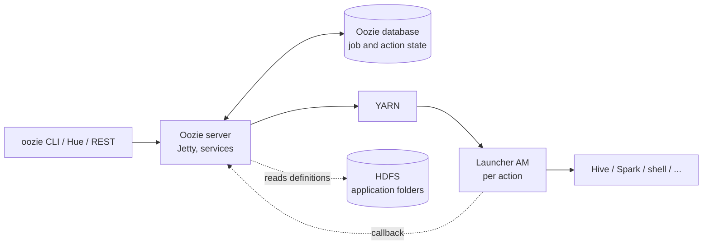

# Deep dive — how Oozie works

Background for the trainer. Not needed to run the lab. Facts are from the Apache Oozie 5.x documentation and the Cloudera Runtime 7.1.x documentation (sources at the end). CDP Private Cloud Base 7.1.9 ships Oozie based on Apache **5.1.0** with Cloudera changes.

> **Status:** Apache Oozie was retired to the Apache Attic in 2025. Cloudera continues to ship and support its own Oozie build in Runtime. See [section 8](#8-oozie-today-and-what-comes-after) before you present Oozie as a strategic choice.

## 1. What Oozie is — and is not

Oozie is a **workflow and coordination service** for Hadoop. It stores job definitions and states, decides what runs next, and submits the actual work to YARN. It does not process data.

| Oozie does | Oozie does not |
|------------|----------------|
| Run a DAG of actions in order, with forks, joins and decisions | Run Hive, Spark or shell code inside its own process |
| Start workflows by time (frequency) and by data availability | Replace a stream processor; it is batch and polling-based |
| Retry, rerun, suspend, resume, kill, record the history | Share state between actions except small captured output |
| Authenticate as the user (proxy user, delegation tokens) | Provide a rich UI; Hue and the web UI show state, XML is the source of truth |

## 2. Architecture

- **Server.** A web application (embedded Jetty since Oozie 5.0, Tomcat before). Internally a set of **services** with a command queue: submit and start commands, a status/recovery service, and for coordinators a **materialization** service that creates actions ahead of time (default look-ahead 3600 s) and an **input check** that polls for data (default re-check every 60 s).
- **Database.** All job and action state. Derby only for tests; MySQL, PostgreSQL or Oracle in production. Back up the database, not the server.
- **Launcher.** For each action the server submits a small YARN application. Since Oozie 5.0 the launcher is a plain **YARN ApplicationMaster**; before, it was a map-only MapReduce job. The launcher runs the action client (Beeline, `spark-submit`, the shell script), captures output and reports back by callback (and the server polls as a fallback). `fs`, `decision`, `fork`/`join` nodes are handled inside the server and need no launcher.
- **Consequence for sizing:** a long-running action holds a launcher container for its whole duration. A Spark action needs the launcher **and** the Spark application. See the starvation pitfall in [notes.md](notes.md).
- **HDFS.** Applications are folders (`workflow.xml`, `lib/`, scripts). The server reads them at submit and start time.

## 3. The three application types

| Type | Defined in | Purpose | Key properties |
|------|------------|---------|----------------|
| **Workflow** | `workflow.xml` | DAG of actions (start → … → end/kill) | `oozie.wf.application.path` |
| **Coordinator** | `coordinator.xml` | Starts workflows by time and/or data availability | `oozie.coord.application.path`, `start`, `end`, frequency |
| **Bundle** | `bundle.xml` | Groups coordinators, one switch for all | `oozie.bundle.application.path` |

Parameterization everywhere: `${name}` is replaced from the job properties (`job.properties` or `-D`), from the coordinator action configuration, or by an EL function. Precedence for a value: `-D` on the command line beats the `-config` file; the coordinator passes its job properties down to the workflow and the action configuration overrides them.

## 4. Workflow: nodes and actions

**Control nodes:** `start`, `end`, `kill` (ends the workflow as `KILLED` with a message), `decision` (switch/case/default), `fork` and `join` (parallel paths; a path that goes to `kill` kills the workflow).

**Action nodes** always have `ok` and `error` transitions. Actions run **asynchronously**: Oozie starts them and is notified when they finish (except `fs`, `email` and some others executed synchronously).

| Action | Runs | Notes |
|--------|------|-------|
| `shell` | A script in a container | `file` ships the script, `capture-output` makes key=value output available to later nodes |
| `hive2` | Beeline against HiveServer2 | Preferred Hive action; needs a **hive2 credential** on Kerberos clusters |
| `hive` | Hive CLI against the metastore | Deprecated with HiveServer2-based CDP clusters; migrate to `hive2` |
| `spark` / `spark3` | `spark-submit` | In CDP 7.1.9 Spark 2 actions are deprecated and disabled by default; `spark3` uses `resource-manager`, `master` (`yarn`) and `mode` (`cluster`/`client`) |
| `java` | A `main` class | Good for custom code, often used for quality checks |
| `map-reduce`, `pig` | MapReduce / Pig job | Legacy; still supported |
| `sqoop`, `distcp` | Sqoop 1 import/export, HDFS copy | JDBC drivers for Sqoop through ShareLib/`oozie.libpath` |
| `fs` | HDFS operations (`mkdir`, `delete`, `move`, `chmod`, `touchz`, …) | Executed by the server; not atomic as a whole |
| `sub-workflow` | Another workflow as one node | Reuse; can run in the same or a different application path |
| `ssh` | Command on a remote host | Rarely used; shell action is usually better |
| `email` | Mail via SMTP | Needs SMTP configuration in Oozie |

**`prepare`** blocks (delete/mkdir before the action) make reruns safe. **`global`** sets `resource-manager`, `name-node`, `job-xml` and `configuration` once for all actions.

**Useful EL functions:** `wf:id()`, `wf:name()`, `wf:user()`, `wf:appPath()`, `wf:errorMessage(node)`, `wf:lastErrorNode()`, `wf:actionData('node')['key']` (captured output), `fs:exists()`, `fs:fileSize()`, `fs:dirSize()`, `fs:isDir()`, `timestamp()`, `concat()`, `trim()`, `urlEncode()`.

**Rerun semantics.** A workflow in `SUCCEEDED`, `FAILED` or `KILLED` can be rerun: `oozie.wf.rerun.failnodes=true` re-executes from the nodes that did not succeed; `oozie.wf.rerun.skip.nodes=a,b` skips named nodes. The job keeps its ID and the run counter increases. Rerun uses the configuration you pass, so a corrected property takes effect.

## 5. Coordinator: time, data and the nominal time

- **Frequency, start, end, timezone.** `frequency="${coord:minutes(5)}"`, `${coord:hours(1)}`, `${coord:days(1)}`, `${coord:months(1)}`, or cron syntax since Oozie 4.x. Frequencies faster than **5 minutes** are rejected by default (`oozie.service.coord.check.maximum.frequency`).
- **Nominal time.** Each action belongs to a slot: `coord:nominalTime()` is the slot, not the clock. Actions with a nominal time in the past (start in the past, downtime) are run as **catch-up**. Use nominal time to name outputs and partitions.
- **Controls.**

  | Control | Meaning |
  |---------|---------|
  | `timeout` | Minutes an action may wait in `WAITING` for its input before it becomes `TIMEDOUT` (`-1` = never) |
  | `concurrency` | Maximum number of simultaneously running actions of this coordinator |
  | `throttle` | Maximum number of actions waiting for input at the same time |
  | `execution` | `FIFO` (oldest first, default), `LIFO`, `LAST_ONLY` (skip older slots), `NONE` (run all waiting, ignore the order) |

- **Datasets.** A dataset is a series of folders (`uri-template` with `${YEAR}${MONTH}${DAY}${HOUR}${MINUTE}`), a `frequency`, an `initial-instance` and a `done-flag`: file name that marks an instance complete (default `_SUCCESS`; an **empty** `<done-flag/>` means the folder itself is enough).
- **Events.** `input-events` / `data-in` name the instances an action needs (`coord:current(0)`, `coord:current(-1)`, `${coord:latest(0)}` for "newest available", ranges like `coord:current(-23)` to `coord:current(0)` for the last 24 hours). The action stays `WAITING` until all exist. `coord:dataIn()` and `coord:dataOut()` hand the resolved paths to the workflow. `output-events` declare what the action produces, so a downstream coordinator can depend on it.
- **Status.** Coordinator job: `PREP` → `RUNNING` → `SUCCEEDED`, or `RUNNINGWITHERROR` / `DONEWITHERROR` when some actions did not succeed, `SUSPENDED`, `KILLED`. Action: `WAITING` → `READY` → `SUBMITTED` → `RUNNING` → `SUCCEEDED` (or `FAILED`, `KILLED`, `TIMEDOUT`, `SKIPPED`, `IGNORED`).
- **Rerun** of actions by number (`-action 1-3`) or nominal date (`-date`), with `-refresh` to re-materialize input.
- **SLA.** The `sla:info` element on workflow or coordinator actions records expected start/end and duration; Oozie sends JMS events and Hue/CM can alert on misses.

Oozie coordinators are the reason many teams stay with Oozie: data-driven triggers with nominal times are built in. Their limits: only HDFS-style folders and `_SUCCESS` as a trigger (no other event source), no dependencies between coordinators except through data, polling rather than events.

## 6. Security on a Kerberos cluster

- Clients authenticate to Oozie with Kerberos (SPNEGO). The server then runs the action **as the user** via **proxy user** (`doAs`); the Oozie service principal must be allowed to impersonate (`hadoop.proxyuser.oozie.*`).
- Actions get **delegation tokens**, not tickets. HDFS and YARN tokens are automatic. For other services the workflow declares a **credential**: `hcat` (Hive Metastore), `hive2` (HiveServer2), `hbase`. The server fetches the token with its own identity on behalf of the user. The credential classes are mapped in `oozie.credentials.credentialclasses`.
- Filesystem credentials for S3/ABFS are configured by property (`oozie.action.credentials.filesystem`) or in Cloudera Manager; Hue cannot define user-specific ones, they go into the XML.
- Production schedules should run under a **service account**, not a person: the job runs as the submitter, and a person's account may be disabled or lose rights.
- Authorization by Ranger applies to the end user because the action runs as that user. Oozie has its own job ACLs (`oozie.service.AuthorizationService`) for who may view or manage jobs.

## 7. CDP specifics

- **Runtime.** CDP Private Cloud Base 7.1.x: Oozie 5.1.0 (Cloudera build), managed by Cloudera Manager, state in an external database, HA with several servers behind a load balancer.
- **ShareLib.** HDFS folder `/user/oozie/share/lib/lib_<timestamp>/` with a sub-folder per action type (`oozie`, `hive2`, `spark3`, `sqoop`, `distcp`, …). Enabled per job with `oozie.use.system.libpath=true`; `oozie.libpath` adds your own jar folder; `oozie.action.sharelib.for.<action>` selects folders. Install/redeploy with Cloudera Manager (**Oozie → Actions → Install Oozie ShareLib**); `oozie admin -sharelibupdate` reloads after adding jars. CM also offers **Update the Spark3 ShareLib** after a Spark 3 parcel change.
- **Spark 3.** Spark actions (Spark 2) are deprecated and disabled by default. Use `<spark3 xmlns="uri:oozie:spark3-action:1.0">`; `job-tracker` is replaced by `resource-manager`. Runtime and CDS parcel versions must be aligned.
- **Hue.** The Workflow/Schedule editors generate XML and properties for Oozie; the Job Browser shows workflows, coordinators and bundles.
- **Client configuration.** Oozie injects the cluster client configs into action containers only if the workflow does not bring its own file of the same name.

## 8. Oozie today and what comes after

- **The Apache project is retired.** The ASF Board terminated Apache Oozie in February 2025 because of inactivity; the move to the Apache Attic was completed in April 2025. The last Apache release is 5.2.1 (February 2021); the board minutes mention an unbuildable CI and unanswered security reports. There is no upstream community to fix defects or CVEs.
- **Cloudera still ships Oozie.** Oozie is part of Cloudera Runtime (the 7.3.1 release notes carry Oozie deprecation notices, the 7.3.2 documentation still describes ShareLib and Oozie configuration). Fixes come from Cloudera's own build and its support lifecycle (7.3.1 until December 2026, 7.3.2 until March 2032 according to the support lifecycle page). Check the Runtime release notes of your exact version for further Oozie deprecations; Spark 2 actions, for example, are disabled in 7.1.9 and no longer available from 7.3.1.
- **Consequence for the customer:** Oozie works and is supported on the platform, but it is a dead end for new investment. Ask for each workflow: migrate, keep, or retire.
- **Direction.** For new pipelines on CDP, Cloudera positions **Cloudera Data Engineering (CDE)** with embedded **Apache Airflow** (jobs as DAGs, Spark jobs as first-class objects). Cloudera offers an **`oozie2cde` migration API** that converts Oozie workflows to CDE Spark and Airflow jobs, and documents manual migration for hand-written workflows (copy `workflow.xml`, `job.properties`, jars; update endpoints; replace the legacy `hive` action by `hive2`). Google's `oozie-to-airflow` is a generic converter for plain Oozie 1.0 XML, with manual follow-up for EL functions and complex actions.
- **What migrates easily:** linear workflows of shell/Spark/Hive actions with a time schedule.
- **What needs design:** data-triggered coordinators (replace with Airflow sensors, or with events from the producing job), `fork`/`join` graphs with `decision` nodes (become task dependencies and branching operators), SLA definitions, and everything that depends on nominal time and dataset instances (becomes the Airflow logical date and data intervals).
- **Why teach Oozie anyway:** the concepts carry over — idempotent tasks, parameterized runs, a logical run date, retries, rerun of a slice, a trigger that waits for data, alerting. The customer's existing platform runs Oozie; understanding it is needed for the migration decision.

## 9. Sources

- Apache retirement: [Apache Attic — Oozie](https://attic.apache.org/projects/oozie.html), [ASF board minutes (Oozie)](https://whimsy.apache.org/board/minutes/Oozie.html)
- Cloudera: [Support Lifecycle Policy](https://www.cloudera.com/services-and-support/support-lifecycle-policy.html), [Deprecation notices for Oozie (7.3.1)](https://docs.cloudera.com/runtime/7.3.1/public-release-notes/topics/rt-deprecated-oozie.html)
- Apache Oozie 5.2.1 documentation: [Workflow specification](https://oozie.apache.org/docs/5.2.1/WorkflowFunctionalSpec.html), [Coordinator specification](https://oozie.apache.org/docs/5.2.1/CoordinatorFunctionalSpec.html), [Shell action](https://oozie.apache.org/docs/5.2.1/DG_ShellActionExtension.html), [Hive 2 action](https://oozie.apache.org/docs/5.2.1/DG_Hive2ActionExtension.html), [Email action](https://oozie.apache.org/docs/5.2.1/DG_EmailActionExtension.html)
- [Action authentication and credentials (Oozie 5.1.0)](https://oozie.apache.org/docs/5.1.0/DG_ActionAuthentication.html)
- [Apache Oozie 5.0.0 announcement](https://news.apache.org/foundation/entry/the-apache-software-foundation-announces32) (launcher on YARN AM, Jetty) and [launcher configuration (5.0.0)](https://oozie.apache.org/docs/5.0.0/AG_Install.html)
- [`oozie-default.xml`](https://github.com/apache/oozie/blob/master/core/src/main/resources/oozie-default.xml) (coordinator defaults: minimum frequency, materialization window, input check interval)
- [Oozie command line tool](https://oozie.apache.org/docs/4.1.0/DG_CommandLineTool.html)
- Cloudera: [Configuring Oozie for Managing Hadoop Jobs (7.1.9)](https://docs.cloudera.com/cdp-private-cloud-base/7.1.9/configuring-oozie/index.html), [Spark 3 support in Oozie](https://docs.cloudera.com/cdp-private-cloud-base/7.1.9/configuring-oozie/topics/oozie-spark3-support.html), [Differences between Spark and Spark 3 actions](https://docs.cloudera.com/cdp-private-cloud-base/7.1.9/configuring-oozie/topics/oozie-difference-between-spark-spark3.html), [Credentials for token delegation](https://docs.cloudera.com/cdp-private-cloud-base/7.3.2/configuring-oozie/topics/oozie-credentials-token-delegation.html), [Redeploying the ShareLib](https://docs.cloudera.com/cdp-private-cloud-base/7.3.2/configuring-oozie/topics/oozie-redeploying-the-oozie-sharelib.html)
- Cloudera: [Migrating Oozie workflows created outside Hue](https://docs.cloudera.com/cdp-public-cloud/cloud/cdppc-data-migration/topics/cdp-saas-oozie-workflows-non-hue-based-migration.html), [Getting started with CDE Airflow (oozie2cde)](https://docs.cloudera.com/cdp-private-cloud-upgrade/latest/cdppvc-data-migration-spark/topics/cdp-migration-spark-cde-airflow-overview.html)
- [GoogleCloudPlatform/oozie-to-airflow](https://github.com/GoogleCloudPlatform/oozie-to-airflow)
