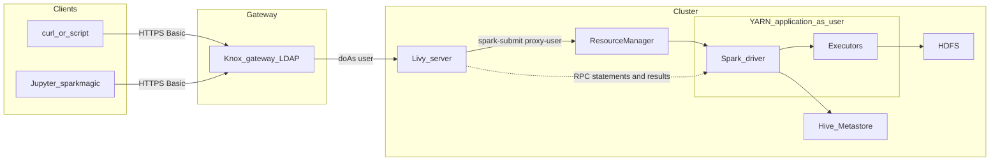
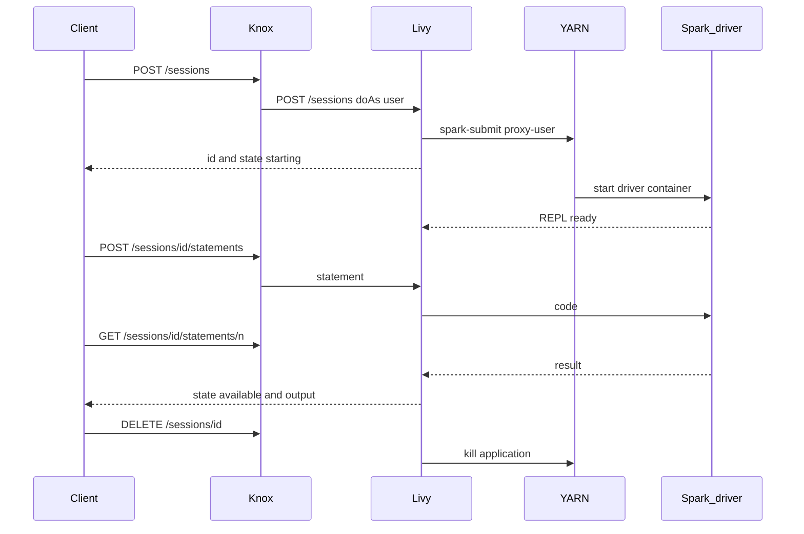

# Technical deep-dive — Spark via Livy (Module 09)

## Why this matters

Data scientists and engineers want to work in notebooks and tools on their own machines, while the data and the compute stay in the governed cluster. Handing out edge-node shells, Spark clients and Kerberos configuration to every laptop does not scale and is a security burden. **Apache Livy** turns Spark into a **service**: a REST API in front of YARN. Combined with Knox and LDAP, an analyst needs only a URL and a login. Scheduled systems outside the cluster network can start batch jobs with a single HTTPS call. The price is a new moving part with its own limits (sessions, timeouts, capacity) that data engineers must understand.

---

## Architecture

**Knox** terminates TLS, checks the LDAP login (HTTP Basic), applies topology authorization, and forwards the request to Livy with the authenticated user as `doAs`. Clients never see Kerberos.

**Livy server** keeps a table of sessions and batches. For each one it runs `spark-submit` (as the proxy user, in YARN cluster mode) and tracks the application. For interactive sessions the driver runs a small REPL; Livy sends statements to it over an RPC connection and returns the result as JSON.

**Driver and executors** run in YARN containers under the participant's identity. HDFS and Hive Metastore access (and Ranger policies) therefore apply to the participant, not to a shared service account.

## Request flow of a session

---

## How it works internally

**Sessions** — `kind: pyspark` starts a Python REPL in the driver. Each statement is executed in the same interpreter, so variables, DataFrames, temp views and cached data survive between statements. States: `starting → idle ⇄ busy`, then `shutting_down`/`dead`/`error`/`killed`. Statements have their own states: `waiting → running → available` (or `error`, `cancelled`).

**Batches** — `POST /batches` runs a file with arguments, like `spark-submit`. States: `starting → running → success` or `dead`/`killed`. Livy's batch log is the output of the submission process; the program's own stdout is in the YARN logs.

**Asynchronous API** — Starting a session or sending a statement returns at once; clients **poll** state endpoints. Notebook frontends (`sparkmagic`) and the `Livy` class in the fallback notebook hide the polling.

**Results are JSON** — Statement output is text (`text/plain`) or JSON data. `sparkmagic` fetches DataFrames for `-o` by converting a limited sample to JSON. Never move large tables through Livy: write them to HDFS or a table and read them with a proper engine.

**Resources** — Each session is a full Spark application. Idle sessions hold their containers unless dynamic allocation is on (the driver and at least the minimum executors stay). Session name, owner and application id are visible to every user who can list sessions.

**Lifetime** — Livy removes sessions after `livy.server.session.timeout` of idleness, and optionally after a client heartbeat timeout. Closing a notebook does not delete the session.

## Authentication and identity

| Hop | Mechanism |
|-----|-----------|
| Client → Knox | HTTPS, HTTP Basic with LDAP user and password (the lab); alternatives are Kerberos/SPNEGO directly on Livy or JWT tokens in other deployments |
| Knox → Livy | Knox user plus `doAs=<ldap user>`; Livy accepts it only from users in `livy.superusers` |
| Livy → YARN/Spark | Livy's own Kerberos identity plus `--proxy-user <ldap user>`; needs `hadoop.proxyuser.livy.*` |
| Spark → HDFS/HMS | the proxy user; Ranger policies apply to that user |

Without impersonation, every job would run as the `livy` service user: files in HDFS would belong to it and Ranger could not tell users apart — that is why the lab asks you to read `owner` and `getpass.getuser()`.

**CSRF header:** `POST` and `DELETE` need `X-Requested-By`; without it Livy answers `400`.

## Livy vs other options

| Option | Strength | Limit |
|--------|----------|-------|
| `pyspark3` / `spark-submit` on the edge node | Full control, Kerberos, all Spark options | Needs a shell and a client on a cluster-attached machine |
| **Livy session** | Notebook from anywhere, shared cluster resources, state across statements | Holds containers, JSON transport for results, one more service |
| **Livy batch** | One HTTPS call from schedulers and applications outside the cluster | No streaming progress, debugging via YARN logs |
| Hue Spark editor | Zero install for analysts | Less control, same Livy underneath |
| CML / other notebook services | Managed workbench, data science libraries | Different product and licence |
| Oozie `spark3` action | Cluster-internal orchestration (modules 08, 11) | Cluster-attached, workflow XML |

---

## Troubleshooting patterns

| Symptom | Likely cause | First check |
|---------|--------------|-------------|
| `401` | Wrong LDAP login or lockout | Knox audit log, user name case |
| `403` | Knox topology authorization | Topology file, group of the user |
| `400` on POST/DELETE | Missing `X-Requested-By` | Request headers |
| Session stuck in `starting` | YARN queue full or ACCEPTED | `yarn application -list`, queue capacity |
| Session `dead` right away | Resource request above limits, no queue permission | `GET /sessions/<id>/log` |
| Statement `error` | User code | `ename`/`evalue` in output |
| Files owned by `livy` | Impersonation off | `owner`, `proxyUser` in session |
| Table creation fails | No Hive context or Ranger policy | session `conf`, Ranger policies on `{USER}` |

## Common failure modes in production

| Failure | Cause | Mitigation |
|---------|-------|------------|
| Cluster full of idle sessions | Notebooks left open | Short session timeout, heartbeat timeout, per-user limits, cleanup job |
| Lost state after Livy restart | Session recovery off | `livy.server.recovery.mode` and a state store (ZooKeeper) |
| Large `collect`/`-o` result kills the notebook | JSON transport of big data | Sample with `limit`, write to HDFS/tables instead |
| Driver memory too small | Session defaults | Per-session `driverMemory`, or `%%configure` in `sparkmagic` |
| Credentials in notebooks | Password pasted into cells | `getpass`, config files with mode 600, tokens where available |
| Batch silently fails | Only the Livy log is read | Always check the YARN application state and `yarn logs` |
