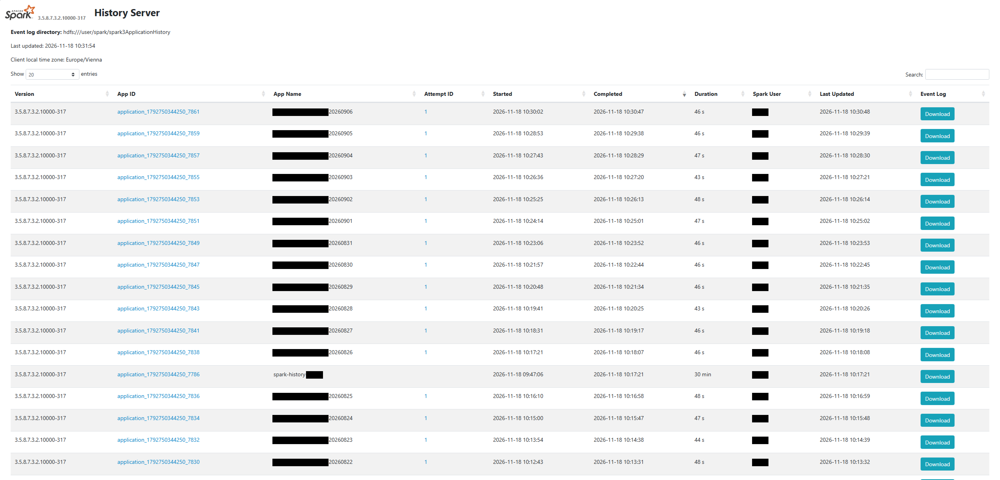
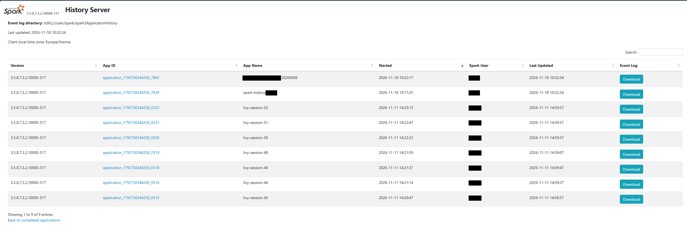
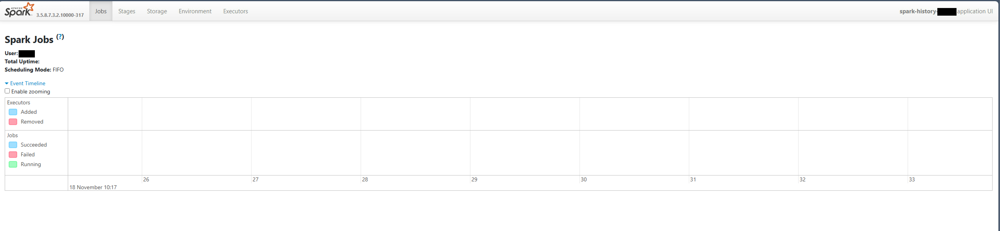
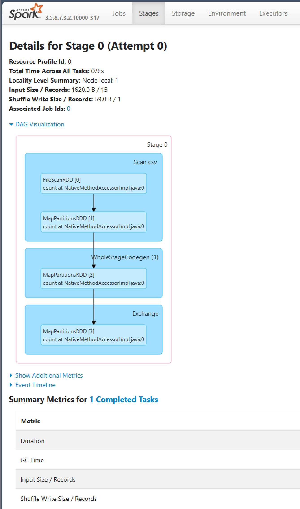
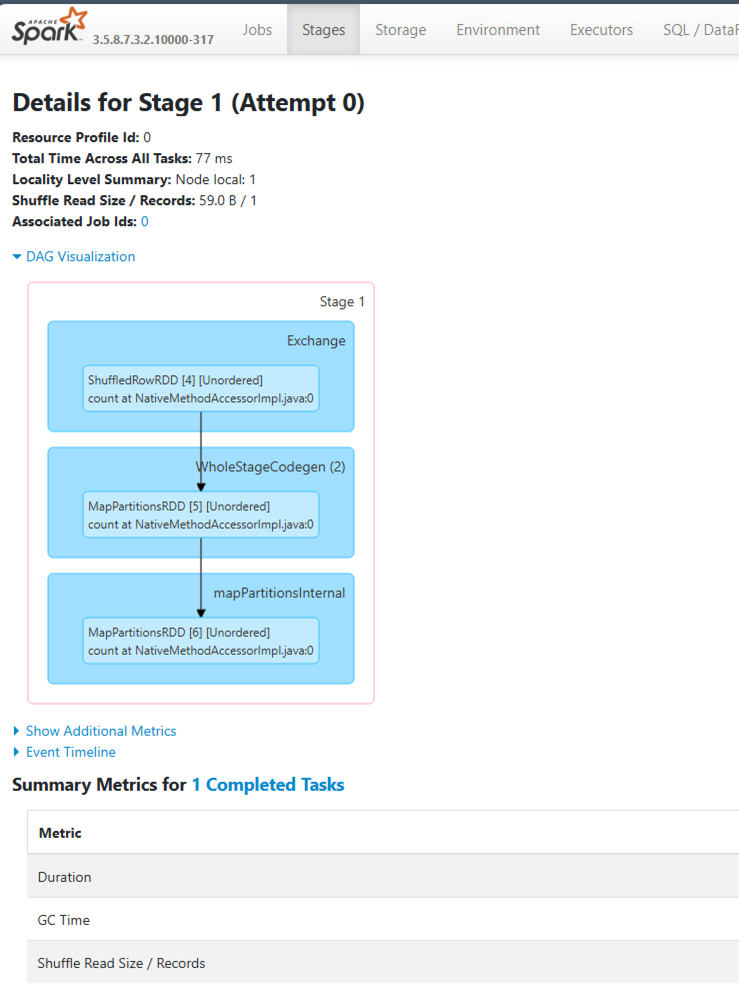
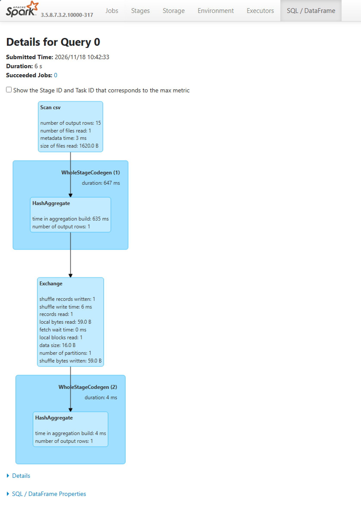
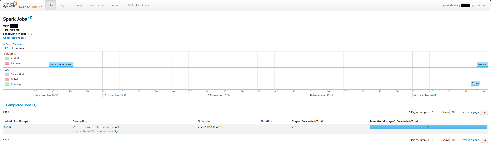

# Spark History Server hands-on lab

Run sections in order. You start **one** Spark application, keep it open, and run nine small steps in it. After every step you switch to the Spark History Server, find what that step left behind, and read the numbers. Adjust `WORKSHOP_ROOT` if your cluster uses a different workshop path.

You need two windows side by side: the place where you type Spark code (a terminal with `pyspark3`, or a Jupyter notebook) and a browser tab with the History Server.

| Part | Sections | What you do |
|------|----------|-------------|
| **A. Orient** | 0 | Start the application, open the History Server, learn what each tab is for |
| **B. Steps** | 1–9 | One step per section; each ends with a look into the UI |
| **C. Wrap-up** | 10 | End the application and read it as a *completed* application |

**Two ways to run the code.** Every Python block in this lab is the same in both ways:

- **Edge node:** type or paste the blocks into `pyspark3` (the `>>>` prompt).
- **Laptop notebook:** run them as cells of [notebooks/spark_history_sparkmagic.ipynb](notebooks/spark_history_sparkmagic.ipynb) through Livy and `sparkmagic`. Set up Jupyter as in [module 09, section 6](../../09-basics-livy/lab/lab_basics_livy.md). The notebook holds the same code with a short version of the UI hints; this document explains the UI in full.

The only block that differs is the one that sets paths (section 0.1). The History Server looks the same for both.

**Pasting into `pyspark3`:** after you paste a function (`def ...`) or a loop (`for ...`), press Enter once more so the shell closes it. Inside brackets `( )` the lab never leaves empty lines.

**Screenshots:** the pictures show how the UI looks; your own screen should look similar. A note marked `SCREENSHOT` names a picture that is still missing (file name in [images/](images/)).

---

# Part A — Orient

## 0. Start the application and open the History Server

**Goal:** Have a running Spark application, find it in the History Server, and learn what each of its tabs is for.

### 0.1 Start the application

Edge node route: set your Kerberos identity and paths once. `WORKSHOP_USER` is the short name you use with `kinit`.

```bash
export WORKSHOP_USER="${WORKSHOP_USER:-$(whoami)}"   # default: your Linux login; change if your Kerberos name differs
kinit "${WORKSHOP_USER}"
```

The `kinit` asks for your password, so it has its own block. Then set the rest:

```bash
export WORKSHOP_ROOT="${WORKSHOP_ROOT:-/2026_cdp_workshop}"   # adjust if needed
export WORKSHOP_HOME="/user/${WORKSHOP_USER}"   # your HDFS home; the lab writes one folder below it
export HADOOP_CONF_DIR=/etc/hadoop/conf   # must be set before pyspark3, otherwise the shell prints many warnings

# the only input file of this lab
export METER_CSV="${WORKSHOP_ROOT}/data/grid_measurements/sample-grid-measurements.csv"
```

Start the shell. The `--name` is what you will search for in the History Server:

```bash
pyspark3 --name "spark-history-${WORKSHOP_USER}"
```

Notebook route: open the notebook, run the connection cells at the top (they create a Livy session named `<you>-spark-history-<time>`), and continue below.

Wait for the `>>>` prompt (or the idle session), then read the paths into Python. Use the first block in `pyspark3`, the second one in the notebook (the cluster session does not see your shell variables).

**Edge node (`pyspark3`):**

```python
# paths and user come from the exports of the terminal that started pyspark3
import os
workshop_user = os.environ["WORKSHOP_USER"]
workshop_home = os.environ["WORKSHOP_HOME"]
meter_csv     = os.environ["METER_CSV"]
out_path      = f"{workshop_home}/spark-history-out"
print(workshop_user, out_path)
```

**Notebook (Livy session):**

```python
import getpass

workshop_root = "/2026_cdp_workshop"          # change only if your handout says otherwise
workshop_user = getpass.getuser()             # the session runs as you
workshop_home = "/user/" + workshop_user
meter_csv     = workshop_root + "/data/grid_measurements/sample-grid-measurements.csv"
out_path      = workshop_home + "/spark-history-out"
print(workshop_user, out_path)
```

Print the identity of your application. You will compare these values with the History Server in a moment:

```python
sc = spark.sparkContext
print("application id  :", sc.applicationId)
print("application name:", sc.appName)
print("live UI         :", sc.uiWebUrl)
print("event log dir   :", sc.getConf().get("spark.eventLog.dir", "(not set)"))
```

The **application id** (`application_<number>_<number>`) is the key for everything that follows: it is the YARN application, the folder name of the event log, and the row in the History Server. The **event log dir** is where Spark writes a JSON line for every event (job started, task finished, ...) while your application runs.

Now set two SQL settings for this lab and print four settings that shape what you will see in the UI. **Adaptive query execution** (AQE) re-plans a query at runtime after every shuffle. That is very useful in production, but it splits jobs, skips stages and merges tasks, which hides the basic structure you want to learn here. So you switch it off (the stretch at the end turns it on again). You also set 8 shuffle partitions: the default of 200 would give 200 mostly empty tasks for this small data.

```python
# plain plans for the lab: no adaptive execution, 8 shuffle partitions
spark.conf.set("spark.sql.adaptive.enabled", "false")
spark.conf.set("spark.sql.shuffle.partitions", "8")
```

Print the four settings and note the values:

```python
# a core setting: not set explicitly, so Spark's default (4 attempts per task) applies
print("spark.task.maxFailures =", spark.sparkContext.getConf().get("spark.task.maxFailures", "4 (Spark default)"))

# SQL settings always have a value, the default if nobody changed them
for key in ["spark.sql.adaptive.enabled", "spark.sql.shuffle.partitions",
            "spark.sql.autoBroadcastJoinThreshold"]:
    print(key, "=", spark.conf.get(key))
```

You should see `adaptive.enabled = false` and `shuffle.partitions = 8`.

### 0.2 Open the History Server and find your application

Open the **Spark History Server** (URL from your handout, or Cloudera Manager → Spark 3 → *Spark3 History Server Web UI*). The start page lists applications.



Your application is **not** in the default list: it is still running, and the default list shows only completed applications. Click **Show incomplete applications** at the bottom, and search for your user name or `spark-history`.



Read the columns:

- **App ID / App Name:** the application id you printed, and the name you passed with `--name` (notebook: the Livy session name).
- **Started / Completed / Duration:** `Completed` stays empty while the application runs.
- **Spark User:** you. Filter by it when the list is long.
- **Event Log:** a download link of the raw JSON file. The History Server **rebuilds every page from this file**; it does not talk to your application.

Click the **App ID** to open the application. The first page is the **Jobs** tab, still empty: you have not run an action yet.



**If your application is missing:** wait about 10 seconds and reload (the History Server rescans the event log directory periodically), check that **Show incomplete applications** is on, and compare the id with the one you printed. Ask your instructor if it is still missing after a minute.

**The live UI shows the same pages.** While the application runs, the ResourceManager (YARN UI) links to the Spark UI itself (`application_...` → *ApplicationMaster*). The History Server pages are identical; it just keeps them after the application has ended. In this lab you stay in the History Server.

### 0.3 A map of the UI

Keep this in mind while you work. Each tab answers one question:

- **Jobs:** one row per **job**, usually one per **action** you ran (`count`, `show`, `collect`, `write`, ...). *Which of my actions was slow? Which one failed?*
- **Stages:** one row per **stage**, the parts a job is cut into at every shuffle. *Where does the time go? Which stage moves the most data?*
- **Storage:** every cached DataFrame. *What is cached, how big, how much of it?*
- **Environment:** every configuration value of this application. *Which settings explain what I see?*
- **Executors:** the driver and the executor containers. *Who did the work, how much GC, which logs?*
- **SQL / DataFrame:** one row per DataFrame or SQL query with its **plan as a graph**. *What exactly did Spark run for this line of code?* (Older Spark versions call this tab **SQL**.)

The chain from your code to a number is always the same: **code line → query (SQL / DataFrame tab) → job → stage → task**.

---

# Part B — Nine steps, nine footprints

## 1. A job, its stages and its tasks, and how to find your code

**Goal:** Read one complete job from the Jobs tab down to a single task, and see why you need a label to find *your* code in the UI.

### 1.1 Run an action without any preparation

Define the CSV reader with an explicit schema. Reading is **lazy**: this runs no job.

```python
meter_schema = (
    "ts_utc STRING, station_id STRING, device_id STRING, phase STRING, "
    "active_power_kw DOUBLE, reactive_power_kvar DOUBLE, voltage_v DOUBLE, "
    "current_a DOUBLE, power_factor DOUBLE, frequency_hz DOUBLE, "
    "transformer_load_pct DOUBLE, quality_flag STRING, event_code STRING, "
    "comm_status STRING")
meter = spark.read.option("header", True).schema(meter_schema).csv(meter_csv)
```

Now trigger an action. Do not label anything yet: this is what you get when you just type code.

```python
print(meter.count())
```

You should see **15** rows. Reload the History Server (wait about 10 seconds if the job is missing).

> **SCREENSHOT** `images/04a-jobs-tab-unlabelled.png`: the Jobs tab with the single row for your `count()`: Job Id `0`, the description `count at NativeMethodAccessorImpl.java:0`, its duration, stages (succeeded/total) and tasks (progress bar), and the event timeline above.
<!--  -->

**Look at (Jobs tab):**

- The **Description** is `count at NativeMethodAccessorImpl.java:0`. That is Spark's **call site**: the place in the *Spark* code that started the job. `NativeMethodAccessorImpl` is the bridge from Python to Java; it is never a line of your code. Every `count()` reads exactly like this, and a `show()` differs only in the method name.
- There is no job group: the **Job Id** is just `0`.
- With one job it is easy to guess that it is yours. With thirty jobs from many cells it is not: **which job belongs to which line of your code?** Keep this question in mind; you will answer it in section 1.3.
- **Stages: succeeded/total** and **Tasks: succeeded/total**: you ran one `count()`, yet the job has **two stages**. You will see why in a moment.
- Expand **Event Timeline**: each bar is a job; the green markers show when executors were added. Executors start on demand, so your first job often includes the wait for containers.

### 1.2 Read the two stages

Open the **Stages** tab. The `count()` has two completed stages, **0** and **1**. Click the description of stage 0 to open its **stage page**, then do the same for stage 1.

 

*Left: stage 0. Right: stage 1.*

**Look at (stage 0, left):**

- **Input Size / Records: 1620.0 B / 15.** The stage reads the CSV file: 15 records. **Shuffle Write Size / Records: 59.0 B / 1.** It writes just **one record**: the partial count of its single partition.
- **DAG Visualization**, read from top to bottom: `Scan csv` (the file is read), `WholeStageCodegen (1)` (the partial count, compiled into one function) and, at the bottom, **`Exchange`**. The `Exchange` is where the stage writes its shuffle files. It is the end of the stage.
- **Summary Metrics for 1 Completed Tasks:** the stage ran **one task**. A task is the unit of work on one **partition** of the data. The 15-row file is tiny, so it is one partition. With a single task min, median and max are equal. From section 4 on they differ, and that is where you spot problems.

**Look at (stage 1, right):**

- **Shuffle Read Size / Records: 59.0 B / 1.** This is exactly what stage 0 wrote. There is **no Input**: the stage does not read a file, it reads the shuffle files of stage 0.
- **DAG Visualization:** it starts with **`Exchange`** (`ShuffledRowRDD`: the data arrives from stage 0), then `WholeStageCodegen (2)` (the final sum of the partial counts) and `mapPartitionsInternal` (the result goes to the driver).
- **Total Time Across All Tasks:** 0.9 s for stage 0 against 77 ms for stage 1. Reading and parsing the file is the real work, adding up one number is not.

**What you learn from the two pages together:**

- One action, one job, but **two stages**. Stage 0 counts per partition, stage 1 sums the partial counts. Spark needs two stages because the partial counts must be brought together in one place. That move of data is a **shuffle**, and **every shuffle starts a new stage**.
- You recognize the boundary in the UI: **Shuffle Write** at the end of one stage, the same amount as **Shuffle Read** at the start of the next one. In the DAG it is the `Exchange` box, once at the bottom of the first stage and once at the top of the second.
- Both pages show **Associated Job Ids: 0**. The stage belongs to the job; the job id and the stage ids are separate counters, so job 3 can contain stages 5 and 6.

**The same shuffle in the SQL / DataFrame tab.** Open the **SQL / DataFrame** tab and click the query of your `count()` (query 0). It shows the *plan* of the job as a graph, with the row counts Spark measured:



- `Scan csv`: **15 output rows**, 1 file read, 1620 B read.
- `HashAggregate` in `WholeStageCodegen (1)`: **1 output row**, the partial count. This is stage 0.
- `Exchange`: **shuffle records written: 1**, shuffle bytes written 59 B, number of partitions 1. This is the stage boundary; the numbers are the same ones you saw as Shuffle Write and Shuffle Read.
- `HashAggregate` in `WholeStageCodegen (2)`: **1 output row**, the final sum. This is stage 1.

The stage pages show how the work ran (tasks, time, bytes); the plan shows what Spark decided to do. In section 3 you will compare this graph with the `explain()` output of your own code.

With adaptive execution **on** (the cluster default) the same `count()` would show up as two jobs and a skipped stage: Spark runs stage 0 as a job of its own, looks at the shuffle size, and then runs the rest. You switched it off in section 0 to keep one action = one job. The stretch shows the difference.

### 1.3 Label your code so you can find it in the UI

Spark names jobs after the place in the Spark source that started them. In PySpark that never points at *your* line, as you have just seen. So from now on every step gets a **label**. Two small functions do it: `step()` puts a label on every job that follows, and `jobs()` prints the job ids a step has started, so you can look for exactly those numbers in the UI.

```python
from pyspark.sql import functions as F

# the ledger remembers what each step was about
ledger = {}
```

```python
def step(key, text):
    # every job started after this call is labelled "<key>: <text>" in the UI
    spark.sparkContext.setJobGroup(key, f"{key}: {text}")
    ledger[key] = text
```

```python
def jobs(key):
    # the job ids this step has started so far: compare them with the Jobs tab
    ids = sorted(spark.sparkContext.statusTracker().getJobIdsForGroup(key))
    print(f"{key} - {ledger[key]}: job ids {ids}")
```

Run the **same** `count()` again, now with a label, and ask which job ids the step has started:

```python
step("S1", "read csv with explicit schema, count")
print(meter.count())
jobs("S1")
```

You should see **15** and one job id (`[1]`). Reload the History Server.



**Look at (Jobs tab):**

- Both rows come from the same `count()`. The call site (`count at NativeMethodAccessorImpl.java:0`) is identical, so **only your label** tells them apart.
- The new row has your label in the **Description**, the job group in brackets in the **Job Id** column (`1 (S1)`), and the id your code printed. The stages of this job carry the label too: open the **Stages** tab.
- The second job is usually **faster** than the first: the executors were already running.

From now on you find three things everywhere in the UI: the label in the **Description** column (`S2: ...`), the **job ids** your code printed, and the **stage and task counts** that you can predict from your code (for example `getNumPartitions()`).

**Check question:** Why does a `count()` over 15 rows run as two stages and not one? And without your label, how would you find the job of one particular cell in an application with fifty jobs?

---

## 2. A job you did not ask for

**Goal:** Find a job that Spark started on its own.

Read the same file again, this time with `inferSchema` instead of a schema. You do not call any action here:

```python
step("S2", "read csv with inferSchema")
meter_inferred = (spark.read.option("header", True)
    .option("inferSchema", True).csv(meter_csv))
jobs("S2")
```

Compare with section 1: the list of job ids is **not empty**, although you ran no action. Spark has to read the whole file once to guess the column types, and it does that inside `.csv(...)`. Look at the schema it found:

```python
meter_inferred.printSchema()
jobs("S2")
```


**Look at:**

- Find the `S2` row in the Jobs tab and its stage: it has **Input** (the file is read in full) but no result you ever see.
- Click the stage, open **+details** under the stage description: the call site there reads like `csv at NativeMethodAccessorImpl.java:0`. This is the call site you saw on the unlabelled job in section 1.

On 15 rows this costs milliseconds; on a landing folder with thousands of files it is a full extra pass over the data. That is why the labs use explicit schemas.

**Check question:** Which line of your code started the extra job: the `.csv(...)` or `printSchema()`? How do you know from the printed job ids?

---

## 3. Narrow transformations: one stage, and the plan

**Goal:** Connect a few lines of DataFrame code to a plan graph and to a single-stage job.

Describe the cleansing with three transformations. The second `jobs()` call shows nothing happens until an action:

```python
step("S3", "filter, new column, show")
meter_ok = (meter
    .withColumn("ts_utc", F.to_timestamp("ts_utc"))
    .filter(F.col("quality_flag") == "OK")
    .withColumn("power_w", F.col("active_power_kw") * 1000))
jobs("S3")
```

Print the plan Spark has made, then run the action. `explain()` prints a **text** version of the plan; keep it visible, you will find the same node names in the UI:

```python
# the plan first (no job), then the action
meter_ok.explain()
meter_ok.select("ts_utc", "station_id", "active_power_kw", "power_w").show(5, False)
jobs("S3")
```

You should see five rows (the first five of the 12 `OK` readings) and a new job id.

Open the **SQL / DataFrame** tab.

> **SCREENSHOT** `images/08-sql-tab-s3-plan.png`: the SQL / DataFrame query list on the left (one row per query, with its job ids) and the plan graph of the S3 query.
<!--  -->

**Look at:**

- The **query list** has one row per query with **Duration** and **Job IDs** (links). This is the bridge: from a query to the job(s) it started.
- Click the query. The **plan graph** reads from bottom to top: `Scan csv` → `Filter` → `Project` → `CollectLimit`. These are the nodes of the `explain()` output above, with real numbers added: **number of output rows** per node (the scan reads the 15 rows, or fewer if the filter was pushed into the scan, see `PushedFilters`; the last node outputs 5).
- Click **Details** under the graph: the text there is the `explain()` output (the physical plan, with the scan's `ReadSchema`, `PushedFilters` and file location).
- Back in the Jobs tab: this job has **one stage**, no `Exchange`. `filter`, `withColumn` and `select` are *narrow* transformations (every output row comes from exactly one input row, no data moves between partitions), so they never start a new stage.

**Check question:** `meter_ok` was defined before the `explain()`. Why is there no job for the `filter`?

---

## 4. Tasks follow partitions

**Goal:** Create data that is big enough to give the UI metrics meaning, and see that tasks = partitions.

The sample CSVs have 15 rows, too little for any interesting metric. From here on you generate 5 million readings for three transformer stations inside Spark (no file, no HDFS). Station `TS-101` gets 70 % of the rows, `TS-204` 20 % and `TS-305` 10 %, and every row has a timestamp between 08:00 and 12:00 on 2026-01-15. The generator is split into **8 partitions**:

```python
step("S4", "build readings_big: 5 million generated rows, 8 partitions")
n_rows = 5_000_000
base_ts = F.lit("2026-01-15 08:00:00").cast("timestamp").cast("long")
readings_big = (spark.range(0, n_rows, 1, 8)
    .withColumn("station_id", F.when(F.col("id") % 10 < 7, "TS-101")
                               .when(F.col("id") % 10 < 9, "TS-204")
                               .otherwise("TS-305"))
    .withColumn("ts_utc", (base_ts + F.col("id") % 14400).cast("timestamp"))
    .withColumn("active_power_kw", 150 + (F.col("id") % 97) * 0.9)
    .withColumn("quality_flag", F.when(F.col("id") % 50 == 0, "WARN").otherwise("OK")))
print("partitions:", readings_big.rdd.getNumPartitions())
```

You should see `partitions: 8`. Nothing has run yet. Count the rows:

```python
print(readings_big.count())
jobs("S4")
```

You should see **5000000**.

> **SCREENSHOT** `images/09-stage-tasks-s4.png`: the stage page of the first S4 stage with eight tasks in the task table and the Summary Metrics (similar durations).
<!--  -->

**Look at:**

- Open the S4 job and its first stage: the task table has **8 tasks**, one per partition. This is how you tie a UI number back to code: you chose `8` in `spark.range(0, n_rows, 1, 8)`.
- **Summary Metrics:** the eight tasks produce equal slices of the range, so min, median and max **Duration** are close to each other. Keep this picture: it is what *healthy* looks like.
- **Input Size / Records** is empty for this stage: the data is generated, not read from a file.
- The second stage of the job has **one task** (summing eight partial counts).

**Check question:** How many tasks would the first stage have if you wrote `spark.range(0, n_rows, 1, 16)`? And what would change in the Summary Metrics?

---

## 5. A shuffle starts a new stage

**Goal:** Find the stage boundary created by `groupBy` and read the shuffle columns.

Average power and number of readings per station and hour. Print the plan before you run it:

```python
step("S5", "shuffle: average power per station and hour")
hourly = (readings_big
    .withColumn("hour_utc", F.date_trunc("hour", F.col("ts_utc")))
    .groupBy("station_id", "hour_utc")
    .agg(F.avg("active_power_kw").alias("avg_power_kw"),
         F.count(F.lit(1)).alias("n")))
hourly.explain()
```

In the plan find `HashAggregate` twice with an `Exchange hashpartitioning(station_id, hour_utc, ...)` in between. **Every `Exchange` is a stage boundary**: the stage below it ends by writing shuffle files, the stage above it starts by reading them. Run it and bring the 12 result rows (3 stations x 4 hours) to the driver:

```python
rows = hourly.collect()
print(len(rows), "result rows")
jobs("S5")
```

> **SCREENSHOT** `images/10-stages-tab-s5.png`: the Stages tab with the two stages of S5, showing Shuffle Write on the first and Shuffle Read on the second stage.
<!--  -->

**Look at (Stages tab):**

- The `Exchange` separates two stages. The first stage has **8 tasks** (your 8 partitions), the second has **8 tasks** too: the 8 shuffle partitions you set in section 0.
- **Shuffle columns:** the first stage shows **Shuffle Write**, the second shows **Shuffle Read**. Compare the **record counts**: the first stage processed 5,000,000 rows, but it writes only a few dozen. Spark aggregated *within* each partition first (the first `HashAggregate` is the *partial* one) and shuffles only the partial results. That is why a `groupBy` on few keys is cheap even for huge inputs.
- Find the stage that reads the shuffle and open it. Only 12 different keys (3 stations x 4 hours) are spread over 8 tasks, so the **Shuffle Read Records** differ: some tasks get several keys, a few get none. With the default of 200 shuffle partitions, 188 more tasks would start and almost all would be empty. Adaptive execution exists to merge such tiny partitions at runtime.

Open the **Stages** tab and sort by **Duration**: this is the quickest way to find the slowest stage of a whole application.

**Check question:** The first stage reads 5 million rows. Why is its Shuffle Write only a few dozen records?

---

## 6. Broadcast join or sort-merge join

**Goal:** Compare two joins that give the same answer but have different plans, and recognize **skew**.

A join needs matching keys in one place. Spark has two main ways to get them there: *broadcast* the small table to every executor (no shuffle of the big one), or *shuffle both tables* by the join key and merge them. First the default. The tiny station table is built by hand:

```python
step("S6a", "join with station_ref, broadcast")
station_ref = spark.createDataFrame(
    [("TS-101", "Nord"), ("TS-204", "Sued"), ("TS-305", "West")],
    ["station_id", "region"])
q_broadcast = (readings_big.join(station_ref, "station_id")
    .groupBy("region").count())
q_broadcast.explain()
```

Find `BroadcastExchange` and `BroadcastHashJoin` in the plan. There is no `Exchange` on the big side for the join itself (the only shuffle is the `groupBy` at the end). Run it:

```python
print(q_broadcast.collect())
jobs("S6a")
```

You should see 3.5 million readings for `Nord` (`TS-101`), 1.0 million for `Sued` and 0.5 million for `West`. Now the same question with the `merge` hint, which forces a sort-merge join:

```python
step("S6b", "join with station_ref, sort-merge (hint)")
q_merge = (readings_big.join(station_ref.hint("merge"), "station_id")
    .groupBy("region").count())
q_merge.explain()
```

Find `SortMergeJoin`, two `Sort` nodes and **two** `Exchange hashpartitioning(station_id, ...)`, one for each side. Run it and note the job ids:

```python
print(q_merge.collect())
jobs("S6b")
```

> **SCREENSHOT** `images/11-sql-plan-broadcast.png`: the plan graph of the S6a query (BroadcastExchange and BroadcastHashJoin).
<!--  -->

> **SCREENSHOT** `images/12-sql-plan-sortmerge.png`: the plan graph of the S6b query (two Exchanges, two Sorts, SortMergeJoin).
<!--  -->

**Look at (SQL / DataFrame tab):** open both queries one after the other. The broadcast plan has fewer nodes and fewer exchanges. In the sort-merge plan the exchange on the big side shows **shuffle records written** of about **5,000,000**: *every row* is shuffled. In the **Jobs** tab look up the ledger ids of `S6a` and `S6b`: how many stages does each variant need, and how much **Shuffle Write** does the sort-merge variant produce (tens of MB, against a few KB in section 5)? You may also see jobs labelled `broadcast exchange` in the Jobs tab: Spark starts them itself to build the broadcast table, they are not in your ledger.

> **SCREENSHOT** `images/13-stage-skew-s6b.png`: the stage page of the S6b stage that reads the shuffle of the big side, with Summary Metrics showing a maximum far above the median for Duration and Shuffle Read Size / Records, and the task table sorted by duration.
<!--  -->

**Look at (skew):** open the stage after the shuffle in the sort-merge job. Only three station keys exist, so at most three tasks receive data, and they do **not** receive equal shares: `TS-101` holds 70 % of the rows. In **Summary Metrics**, compare **max** with **median** for **Shuffle Read Size / Records** and for **Duration**. In the task table sort by **Duration** (click the header): at most three tasks hold data: the largest about 3.5 million records (`TS-101`), the others about 1.0 and 0.5 million (two stations in the same task add up), and the remaining tasks are empty. This is **data skew**: the stage is as slow as its slowest task, while the other executors wait. A max that is many times the median is the signature to look for in real applications.

**Check question:** The broadcast variant needs no shuffle for the join. Why can it not be used when *both* tables are large?

---

## 7. Cache and the Storage tab

**Goal:** Find a cached DataFrame and see how the second action gets cheaper.

Keep the readings with quality flag `OK` in memory. `cache()` is lazy too: nothing is stored until an action reads the data.

```python
step("S7", "cache readings_ok, two actions")
readings_ok = readings_big.filter(F.col("quality_flag") == "OK").cache()
jobs("S7")
```

The first action below fills the cache (it has to compute everything), the second one reads from it:

```python
# the first action fills the cache, the second one reads from it
print(readings_ok.count())
print(readings_ok.groupBy("station_id").count().collect())
jobs("S7")
```

You should see about 4.9 million readings and three station counts, and two or more job ids.

> **SCREENSHOT** `images/14-storage-tab.png`: the Storage tab with one entry (RDD name, storage level, cached partitions, fraction cached, size in memory, size on disk).
<!--  -->

**Look at (Storage tab):**

- One entry for `readings_ok`. It has no variable name; its name is built from the plan of the DataFrame. **Cached Partitions** is 8 (your partitions), **Fraction Cached** should be 100 %, and **Size in Memory** shows how much space 4.9 million rows take in the columnar cache. A fraction below 100 % or a **Size on Disk** above 0 means the executors did not have enough memory for all of it.
- Click the entry: a table shows which executor holds which partition.
- Compare the two S7 queries in the **SQL / DataFrame** tab: the second query has an `InMemoryTableScan` node instead of the range generator, and its first stage is **much shorter** than in the first query (compare the durations in the Jobs tab).

Release the memory and reload the Storage tab. The entry disappears:

```python
_ = readings_ok.unpersist()
```

**Check question:** If you had skipped `cache()`, what would the second action have done?

---

## 8. Write Parquet: tasks, files and output metrics

**Goal:** Relate the output columns of a write stage to the files on HDFS and to partition pruning on the read side.

Write the readings as Parquet, one folder per station (the curated layer pattern from the Spark basics lab). The cache was released, so Spark computes the data again:

```python
step("S8", "write parquet partitioned by station_id, read back")
readings_ok.write.mode("overwrite").partitionBy("station_id").parquet(out_path)
jobs("S8")
```

Open the S8 job. In the stage page of the write stage the task table has an **Output Size / Records** column: the records per task add up to about 4.9 million. In the **SQL / DataFrame** tab the write is a query too: the top node is `InsertIntoHadoopFsRelationCommand` (the command), with metrics such as **number of written files** and **written output**.

> **SCREENSHOT** `images/15-sql-write-metrics.png`: the S8 write query in the SQL tab with the node metrics (number of written files, written output, number of output rows).
<!--  -->

Compare with the files. In a **second terminal** on the edge node (valid ticket, same `WORKSHOP_HOME`), or from your handout's HDFS UI:

```bash
# one directory per station
hdfs dfs -ls "${WORKSHOP_HOME}/spark-history-out"

# the part files of one station
hdfs dfs -ls "${WORKSHOP_HOME}/spark-history-out/station_id=TS-305"
```

You should see one `station_id=...` directory per station, and several Parquet part files in each of them. The number of written files in the UI equals the number of files you count.

Now read the data back and ask for one station only:

```python
# read it back: a different scan node, and only one station directory is needed
back = spark.read.parquet(out_path)
one_station = back.filter(F.col("station_id") == "TS-305")
one_station.explain()
print(one_station.count())
jobs("S8")
```

You should see about 0.5 million rows. In the plan find `FileScan parquet` with `PartitionFilters: [..., (station_id = TS-305)]`: Spark skips the other station folders entirely. In the SQL tab compare **number of files read** and **size of files read** of this scan with the number of files you listed.

**Check question:** The stage has 8 tasks and there are 3 stations. How many part files does Spark write, and why?

---

## 9. A failing job

**Goal:** Read a failure in the History Server: failed job, failed stage, task attempts, error and logs.

> 🔴 **Failure case — an error is expected here.** A Python function raises an error on one specific row. You run it, read the message, and then find the failure in the UI. Your application stays alive.

First define the function and the label. It fails for the id `4242`, which lives in the first of four partitions:

```python
step("S9", "FAILURE CASE: python udf raises on one row")

def risky(x):
    # one bad row, like a corrupt reading
    if x == 4242:
        raise ValueError(f"bad reading with id {x}")
    return float(x)

risky_udf = F.udf(risky, "double")
```

Run the failing action. Nothing is wrong with your Spark session; one task cannot finish:

```python
# FAILURE CASE: expected to fail with "Job aborted due to stage failure ... bad reading with id 4242"
(spark.range(0, 100000, 1, 4)
    .select(risky_udf("id").alias("v"))
    .agg(F.sum("v"))
    .collect())
```

You should get a long error that ends with `Job aborted due to stage failure: Task 0 in stage ... failed 4 times` and `ValueError: bad reading with id 4242`. (In the notebook the cell turns red.) Print the job ids of the step, then reload the History Server:

```python
jobs("S9")
```

> **SCREENSHOT** `images/16-jobs-tab-failed.png`: the Jobs tab with the section *Failed Jobs* (the S9 job, with its failure reason in the status column).
<!--  -->

**Look at (Jobs tab):** the job is listed under **Failed Jobs**. Open the **Stages** tab: the stage is listed under **Failed Stages**, with a short reason. Click the stage.

> **SCREENSHOT** `images/17-failed-task-attempts.png`: the stage page with the task table: task index 0 with attempts 0, 1, 2, 3 all FAILED and the Errors column with the ValueError, the other three tasks SUCCESS or KILLED.
<!--  -->

**Look at (stage page):**

- **Task table:** task index **0** appears **four times** with **Attempt** 0, 1, 2, 3 and status `FAILED`. Spark retries a failed task up to `spark.task.maxFailures` times (the value you printed in section 0), and then aborts the job. The other tasks of the stage are `SUCCESS` or `KILLED`.
- **Errors column:** the exception text of each attempt. For Python code you find `PythonException` with the Python traceback, ending in your `ValueError`. The traceback names your function `risky`: here the UI points straight into your code.
- **Executor ID / Logs:** the **stderr** and **stdout** links open the log of the container that ran the attempt. After the application has ended you get the same logs with `yarn logs -applicationId <application-id>` (log aggregation).
- In the **Stages** tab the stage is under **Failed Stages**; in the **SQL / DataFrame** tab the query has status `FAILED`.

Run a normal action to confirm the application survived. The failed job does not affect your other steps:

```python
print(spark.range(10).count())
```

**Check question:** Why did Spark run the failing task four times instead of failing at the first error? Would a retry help if the data itself is bad?

---

# Part C — Wrap-up

## 10. End the application and read it as completed

**Goal:** See the difference between a running (incomplete) and a finished application, and read the application-wide tabs.

Before you end the application, print the ledger: it lists every step and its job ids, in the order of the Jobs tab. This is your key to the history.

```python
for key in ledger:
    jobs(key)
print("application id:", sc.applicationId)
```

Compare it with the Jobs tab of your application: every id belongs to the step with the same label. Press Enter once more after the loop. Then end the application:

- **`pyspark3`:** `exit()` or Ctrl-D.
- **Notebook:** run the last cell, `%spark delete -s spark_history`. Closing the notebook alone does not stop the application.

Reload the History Server, open the **default** list (without *Show incomplete applications*): your application is there now, with a **Completed** time and a **Duration**. The Spark driver wrote its last events when it stopped, and the History Server marks the log as finished.

> **SCREENSHOT** `images/18-history-completed.png`: the default application list with your application now completed (Completed and Duration filled in).
<!--  -->

Open the application and go through the application-wide tabs.

**Jobs.** The event timeline now ends with executors *removed*. Scan the list: which of your steps was the most expensive? Compare duration and the number of tasks, not only the number of jobs.

**Executors.** The driver and every executor of your application, **dead** now. Executors are started and removed on demand (dynamic allocation), so you may see more executors than at the beginning.

> **SCREENSHOT** `images/19-executors-tab.png`: the Executors tab: the summary row (Active / Dead / Total) and one row per executor with cores, task time (GC time), input, shuffle read, shuffle write and logs.
<!--  -->

Read per executor: **Task Time (GC Time)** (GC above about 10 % of the task time is highlighted in red: the executor was short of memory), **Input**, **Shuffle Read / Write** (how the work was spread) and the **stdout / stderr** links.

**Environment.** Use the search box (`spark.eventLog`, `spark.sql.adaptive`, `spark.sql.shuffle.partitions`, `spark.dynamicAllocation`). The tab shows the settings the application **started** with: the two values you changed at runtime in section 0 are not changed there (typically `adaptive` true and 200 partitions). The plans in the SQL / DataFrame tab show what really applied (no `AdaptiveSparkPlan` node).

> **SCREENSHOT** `images/20-environment-tab.png`: the Environment tab with the Spark Properties table filtered for `eventLog` or `adaptive`.
<!--  -->

The tab also lists system properties and the classpath: the same page answers "why did this application behave this way?" long after it ended.

**Storage** is empty again: the cache dies with the application, as do the variables in your session.

Fill in the table for the steps below, from the UI (one example is given). Compare with a neighbour:

| Step | Job ids (from the ledger) | Stages | Tasks | The number that tells the story |
|------|---------------------------|--------|-------|---------------------------------|
| S1 count | | 2 | | Input records |
| S5 shuffle | | | | Shuffle Write records |
| S6b sort-merge | | | | max vs median Shuffle Read |
| S7 cache | | | | Fraction Cached |
| S9 failure | | | | Attempt 0–3 |

**Check question:** Your colleague sends you only an application id for a job that ran last night. List the pages you would open, in order, to find out whether it was slow, and why.

---

## Stretch (optional)

- Switch adaptive execution on again with `spark.conf.set("spark.sql.adaptive.enabled", "true")` and run sections 1 and 5 once more with new step labels. Compare the number of **jobs** (one `count()` becomes two), the **skipped stage** and the number of tasks of the shuffle-reading stage (with 8 shuffle partitions: usually fewer). The plans now start with `AdaptiveSparkPlan`. Switch it off again afterwards.
- Compare `readings_big.repartition(2)` and `readings_big.repartition(64)` followed by a `count()`: how do **tasks**, **task duration** and **scheduler delay** change?
- Download the **Event Log** of your application from the application list (or from HDFS as in the Spark basics lab) and find `SparkListenerJobStart`, `SparkListenerStageCompleted` and `SparkListenerTaskEnd` lines: the History Server pages are built from these.
- Build the query of section 6a again after `spark.conf.set("spark.sql.autoBroadcastJoinThreshold", "-1")`: the plan switches to `SortMergeJoin` without any hint. Reset it with the value you printed in section 0.

Remove the output of section 8 when you are done:

```bash
# delete the Parquet folder of the lab
hdfs dfs -rm -r -f "${WORKSHOP_HOME}/spark-history-out"
```

This lab has no `check.sh`: you are finished when the ledger matches the Jobs tab, your application is listed as completed, and you can name for each tab the question it answers.

---
*The generation of these labs was supported by AI.*
