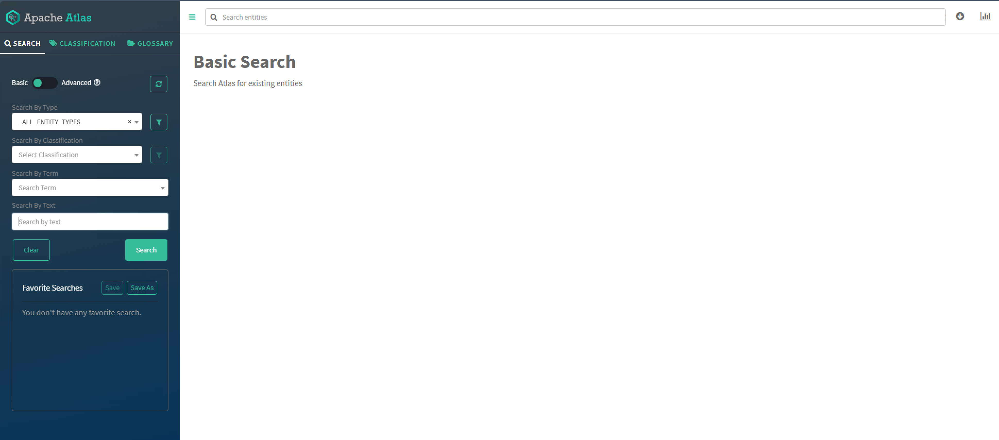
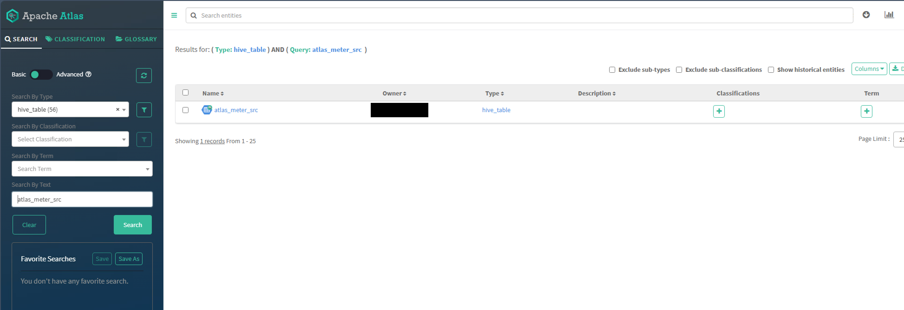
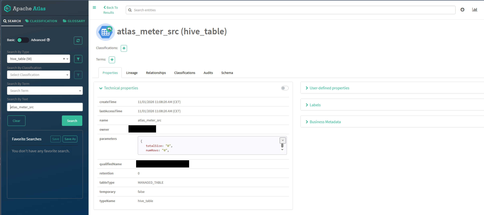
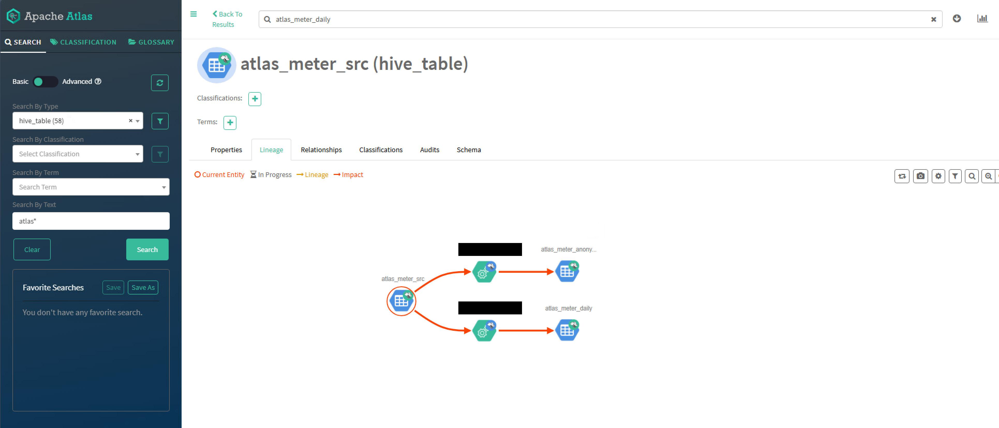
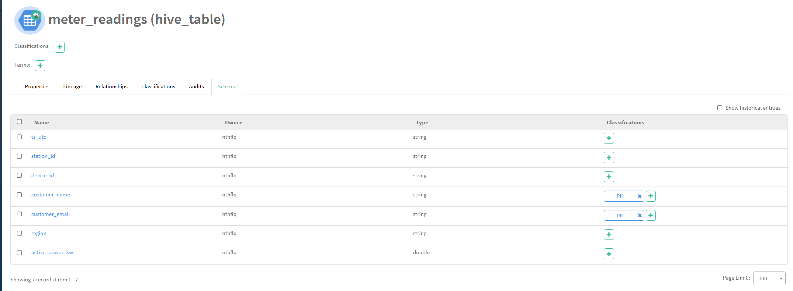
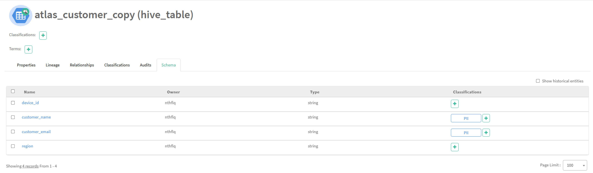
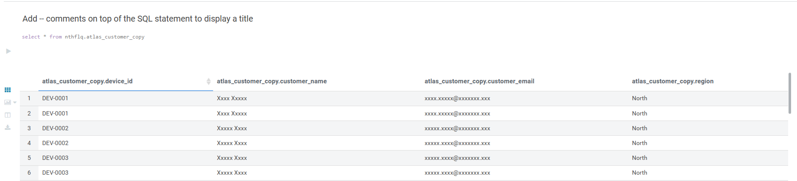
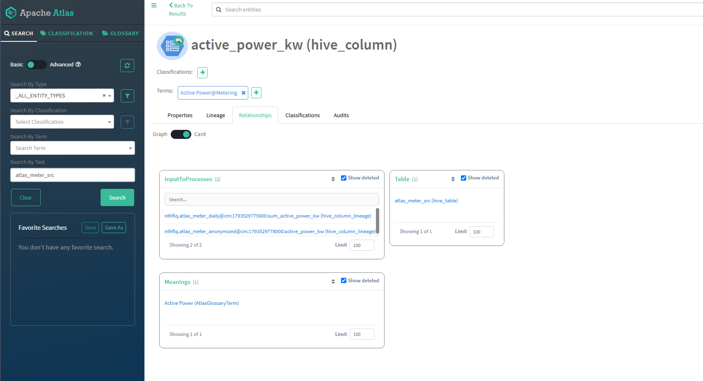
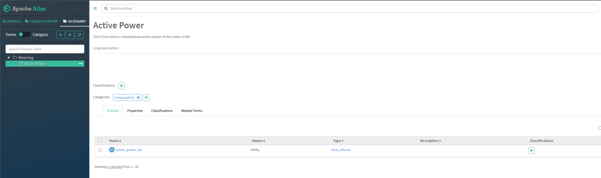

# Atlas UI hands-on lab

Run sections 1–7 in order. You need **Hue** (Hive editor) and **Atlas** (both open from the Knox home page, the same place you open Hue). All SQL runs in **Hue → Editor → Hive**.

The lab SQL uses the placeholder `${ws_user}` — Hue shows an input field for it; type your short username (same as for `kinit`).

This lab reads the shared table `cdp_workshop.meter_readings` (the same table the Ranger module uses) and builds its own managed tables in your personal database from it. It needs no files on HDFS and no custom table locations.

---

## 0. Orient — Atlas and the Hive hook

**Goal:** Know why tables appear in Atlas without you opening Atlas first.

When Hive creates or changes a table, the **Hive Atlas hook** publishes metadata events (via Kafka) into **Atlas**. Atlas stores **metadata and lineage**, not the table data in HDFS.

Open Atlas from the Knox home page. Note the **Search** bar and the **Classifications** and **Glossary** areas in the navigation — you use them in sections 2, 5, 6, and 7.



---

## 1. Create a source table

**Goal:** Create a managed table from the shared meter data that Atlas can catalog.

The trainer prepared the shared table `cdp_workshop.meter_readings` (30 rows, 4 stations). Copy the measurement columns into your own database with a **CTAS**. The new table is **managed**, so Hive picks the storage location itself:

```sql
CREATE DATABASE IF NOT EXISTS ${ws_user};
USE ${ws_user};

CREATE TABLE IF NOT EXISTS atlas_meter_src AS
SELECT ts_utc, station_id, device_id, active_power_kw
FROM cdp_workshop.meter_readings;
```

Confirm in Hue. Run each statement on its own (select it, then run) so each result is shown separately:

```sql
-- Expected: one row with the value 30
SELECT COUNT(*) FROM atlas_meter_src;
```

```sql
-- Expected: four columns: ts_utc, station_id, device_id, active_power_kw
DESCRIBE atlas_meter_src;
```

---

## 2. Find the table in Atlas

**Goal:** Search for the `hive_table` entity `atlas_meter_src` and read its metadata.

Atlas has three ways to search. Try the first two on your table; the third is a quick look (about one minute each):

| Search | Where | Use it for | Try this |
|--------|-------|------------|----------|
| **Search bar** (free text) | Top of the page | "I know a word, find it anywhere" — names, descriptions, owners, locations; ranked results; `*` is a wildcard | `atlas_meter_src` |
| **Basic Search** | Left panel | Browse and filter: pick a type, classification, or term, then add attribute filters (`=`, `contains`, `begins_with`, dates) | Type `hive_table`, enter `atlas_meter_src` in the search field |
| **Advanced Search** | Left panel, switch from Basic | Exact, SQL-like queries: relationships, deleted entities, aggregates | `from hive_table where name = "atlas_meter_src" select name, owner, createTime` |

Rule of thumb: bar to find, Basic to browse and filter, Advanced to ask precise questions (and the heaviest on the server). On a shared Atlas, every participant has an `atlas_meter_src` table in their own database. In the results, open the `hive_table` hit whose qualified name starts with **your** database (`<your_username>.atlas_meter_src@...`).

Walk through:

- **Properties** — owner, create time, table type, HDFS location.
- **Schema** — column names and types match Hive.

If the entity is missing, wait up to one minute and refresh search. The hook is asynchronous.



> **Screenshot fallback:** In Atlas, use **Search**, type `atlas_meter_src`, and open the hit with type `hive_table`. The qualified name should include your Hive database and table name. You should see at least one result before opening the detail page.



> **Screenshot fallback:** On the entity page, open **Properties** and confirm **owner**, **create time**, and a **location** under the warehouse. Open **Schema** and confirm `ts_utc`, `station_id`, `device_id`, and `active_power_kw`.

**Check question:** Does Atlas store the meter readings themselves, or only metadata about the table?

---

## 3. Create CTAS children

**Goal:** Add two downstream tables so lineage has something to draw.

Run in Hue (stay in `${ws_user}`):

```sql
CREATE TABLE IF NOT EXISTS atlas_meter_daily AS
SELECT
  station_id,
  substr(ts_utc, 1, 10) AS day,
  SUM(active_power_kw) AS sum_active_power_kw
FROM atlas_meter_src
GROUP BY station_id, substr(ts_utc, 1, 10);

CREATE TABLE IF NOT EXISTS atlas_meter_anonymized AS
SELECT ts_utc, station_id, active_power_kw
FROM atlas_meter_src;
```

Optional stretch (only if you have time): `CREATE TABLE IF NOT EXISTS atlas_meter_daily_v2 AS SELECT * FROM atlas_meter_daily WHERE sum_active_power_kw > 0;` — a second hop in lineage.

---

## 4. Lineage

**Goal:** Read downstream and upstream graphs and inspect the process that ran the CTAS.

In Atlas, open `atlas_meter_src` again. Select the **Lineage** tab.

- **Downstream:** you should see `atlas_meter_daily` and `atlas_meter_anonymized` linked through **process** nodes (the Hive queries).
- Click a **process** node and read the query text (CTAS statement).
- Open `atlas_meter_anonymized`. **Upstream** lineage should point back to `atlas_meter_src` and, one hop further, to the shared table `cdp_workshop.meter_readings` it was copied from.

Use the lineage controls (zoom, depth, show/hide process) if your Atlas version provides them.



> **Screenshot fallback:** On `atlas_meter_src`, open **Lineage** and expand **downstream**. You should see two child `hive_table` entities and at least one **process** entity between parent and children. If children are missing, refresh the page.

> **Process node:** Click the **process** (often labeled with a Hive operation) between source and a child table. The detail panel should show SQL containing `CREATE TABLE` and `SELECT`.

If your cluster enables **column-level lineage**, expand lineage on a column such as `active_power_kw` — optional; table-level lineage is enough for this lab.

---

## 5. Classifications (tags) — instructor demo

**Goal:** See how sensitive metadata gets a classification (tag) in Atlas. The **instructor** does this section on the shared table; you watch and then check the result in your own Atlas window. You attach and create nothing.

A **classification** is a label such as `PII` that marks metadata as sensitive. The classification `PII` exists with **propagation** enabled. The instructor:

1. opens the `hive_table` `meter_readings` in database `cdp_workshop` (the shared table from the Ranger module) and switches to the **Schema** tab,
2. clicks **+** in the **Classifications** column of `customer_name` and `customer_email`, selects `PII`, keeps **Propagate** checked, and saves.

Then follow along: refresh the page and open the same table. The columns `customer_name` and `customer_email` show `PII`; the other columns show none. In the left navigation, **Classifications** → `PII` (or **Search** → **Basic** → **Search By Classification** → `PII`) lists the entities that carry it.



> **Screenshot fallback:** Open `meter_readings` (database `cdp_workshop`) → **Schema**. The columns `customer_name` and `customer_email` show `PII` in the **Classifications** column; `ts_utc`, `station_id`, `device_id`, `region` and `active_power_kw` show none.

**Talking point:** A classification can **propagate** along lineage: tables and columns derived from a tagged column inherit the tag. You see this in the next section. **Ranger** can use these tags in **tag-based policies**: tags describe sensitivity, Ranger enforces who may read or write.

---

## 6. Tag-based policy: the tag follows the data

**Goal:** Copy a central table that is already tagged `PII`, watch the tag arrive on your copy, and see Ranger enforce it without a policy on your table.

The trainer pre-created the central table `cdp_workshop.meter_readings` (the same table as in the Ranger module; columns `ts_utc`, `station_id`, `device_id`, `customer_name`, `customer_email`, `region`, `active_power_kw`) and, as the instructor showed in section 5, tagged the columns `customer_name` and `customer_email` with `PII`. You only read it.

**Step 1 — Copy it into your database.**

In Hue:

```sql
USE ${ws_user};

CREATE TABLE IF NOT EXISTS atlas_customer_copy AS
SELECT device_id, customer_name, customer_email, region
FROM cdp_workshop.meter_readings;
```

```sql
-- Expected at this point: readable names and e-mail addresses (no tag-based policy is active yet)
SELECT * FROM atlas_customer_copy;
```

> **STOP — do not go on to step 3 yet.**
> The instructor switches on the redaction policy **only after every participant has created `atlas_customer_copy`**. If the policy were already active during your CTAS, Hive would read redacted values and store them in your new table, and the before/after comparison would be lost for good. Tell the instructor as soon as your table exists, then continue with step 2 while you wait.

**Step 2 — See the tag arrive.**

In Atlas (wait up to one minute for the hook), open `atlas_customer_copy` → **Schema**. Your columns `customer_name` and `customer_email` now carry `PII` as well. You did not tag them: the tag propagated along the lineage (open the **Lineage** tab to see `meter_readings` → process → `atlas_customer_copy`). `device_id` and `region` stay untagged.



> **Screenshot fallback:** On `atlas_customer_copy`, open **Schema**. The columns `customer_name` and `customer_email` show the classification `PII` (inherited); `device_id` and `region` show none.

**Step 3 — Re-run the query once the tag-based policy is active.** Wait until the instructor tells you that the policy is on, then run the query from step 1 again:

> **Instructor:** enable the tag-based masking policy `PII_mask` in Ranger now (tag `PII`, group `workshop`, mask type Redact), but only after all participants have created `atlas_customer_copy`. Ranger's tag sync picks up the Atlas tags, usually within a minute.

```sql
SELECT * FROM atlas_customer_copy;
```

`customer_name` and `customer_email` are now redacted (letters replaced by `x`); `device_id` and `region` are readable. The stored data did not change, only what you are allowed to see. Check the same on the central table: `SELECT * FROM cdp_workshop.meter_readings;` is redacted in the same way, with the same single policy.



> **Screenshot fallback:** In Hue, `SELECT * FROM atlas_customer_copy` returns redacted values such as `Xxxx Xxxxx` and `xxxxx.xxxxx@xxxxxxx.xxx` in `customer_name` and `customer_email`, and normal values in `device_id` and `region`.

**Check question:** Which resource did the Ranger policy name: the central table, your table, or the classification? What happens to a new table that someone creates tomorrow from `meter_readings`?

**Talking point:** Tag-based policies scale: one policy on `PII` covers every table and column that is tagged now or becomes tagged later by propagation. Resource-based policies (as in the Ranger module) need one policy per table or column.

---

## 7. Business glossary

**Goal:** Link a business term to a technical column.

The **business glossary** is a controlled vocabulary for the organization: **Glossary → Categories → Terms**. Terms have plain-language definitions and can be **assigned** to Atlas entities (tables and columns). Technical names (`active_power_kw`) and business names (“Active Power”) stay separate but searchable together.

Your trainer pre-created glossary `Metering` with term `Active Power`. You only assign the term; you do not create it.

**Step 1 — Assign the term from the column.** Open `atlas_meter_src`, go to the **Schema** tab, and open the column `active_power_kw`. Next to **Terms**, click **+** and select `Active Power` (shown as `Active Power@Metering`). Save. If column assignment is awkward, assign the term to the whole table instead.

On the column page, the **Terms** field now shows the term. The **Relationships** tab shows it under **Meanings**, and it also shows the parent table and the downstream processes from section 4.



> **Screenshot fallback:** On the column `active_power_kw`, the **Terms** field lists `Active Power@Metering`. Under **Relationships → Meanings** you see `Active Power (AtlasGlossaryTerm)`.

**Step 2 — Confirm from the term side.** Open **Glossary** (left navigation, **Terms** toggle on), select `Metering → Active Power`. Under **Entities**, your column `active_power_kw` (type `hive_column`) is now listed. The **Categories** field shows `Consumption`, the category the trainer put the term in. On a shared Atlas, the list also contains the columns of other participants who have already assigned the term; identify yours by the owner.



> **Screenshot fallback:** In **Glossary**, open term `Active Power`. You should see the short description, category `Consumption`, and under **Entities** at least one `hive_column` named `active_power_kw`.

---

## Wrap-up

**Final check question:** If `atlas_meter_src` is wrong, which downstream tables are affected, and which Atlas feature shows you the answer?

Run `./I2-basics-atlas/lab/check.sh` from the repo on the edge node **before** the cleanup (it checks that your tables exist).

## Cleanup

Clean up in this order. The shared `PII` classification and the `Metering` glossary stay; the trainer removes them.

**1. In Atlas — detach your term first** (while the tables still exist):

- On `atlas_meter_src` (or the column `active_power_kw`), remove the term `Active Power` (**Glossary Terms** → remove).
- You attached no tags yourself. `atlas_customer_copy` (section 6) needs no detaching: its `PII` tags are propagated and disappear with the table. Do **not** touch the tags on the central table `cdp_workshop.meter_readings`.

**2. In Hue — drop your tables** (does not remove lineage history immediately):

```sql
USE ${ws_user};
DROP TABLE IF EXISTS atlas_meter_daily_v2;  -- only if you did the optional stretch
DROP TABLE IF EXISTS atlas_meter_daily;
DROP TABLE IF EXISTS atlas_meter_anonymized;
DROP TABLE IF EXISTS atlas_meter_src;
DROP TABLE IF EXISTS atlas_customer_copy;
```

Keep the database `${ws_user}`; other modules use it.

**3. In Atlas — check:** the dropped tables move to **DELETED** state, but lineage remains visible — useful for audit discussions. Search for `PII`: none of your tables should be listed as active.

---

## Screenshot checklist (trainer)

Capture these under `lab/img/` when preparing materials:

1. `orientation.png` — Atlas start page (done)
2. `atlas_meter_src_basic_search_result.png` — Basic Search hit for `atlas_meter_src` (done)
3. `atlas_meter_src_hive_table_entity.png` — entity Properties tab (done)
4. `atlas_meter_src_lineage.png` — source with two children (done)
5. `5_pii_columns.png` — shared table `cdp_workshop.meter_readings` Schema with `PII` on `customer_name` / `customer_email` (done)
6. `6_pii_propagation.png` — `atlas_customer_copy` Schema with propagated `PII` on two columns (done)
7. `6_tag_based_policy_redacted.png` — Hue result with redacted `customer_name` / `customer_email` (done)
8. `7_active_power_kw_term_assignment.png` — column with term assigned (done)
9. `7_active_power_glossary_term_category.png` — term **Active Power** with category and assigned column (done)
