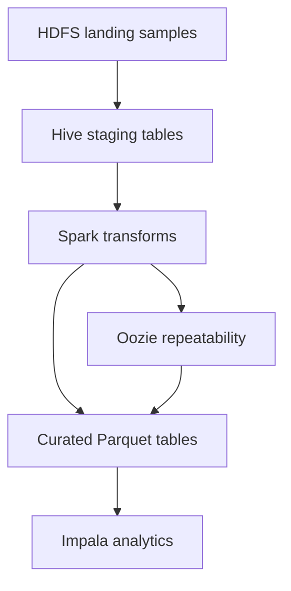

# Workshop concept — Cloudera enablement

## Purpose and audience

This curriculum helps mixed teams (data engineering, data management, analytics, IT-adjacent roles) learn **CDP as a platform**, not isolated products. Progress follows a single, practical use case: **grid monitoring pilot data** — smart-meter measurements from transformer stations, operator-owned weather stations, public weather and market feeds, and small reference datasets.

Modules are **numbered for sequence only**. You map them to workshop days or hours based on available time; each module lists an estimated duration.

## Didactic pattern (every module)

1. **Orient** — where the component sits in CDP and in the use case  
2. **Explain** — concepts trainers cover in slides or live demo  
3. **Apply** — hands-on steps with check questions and visible outcomes (see [workshop-guidelines.md](workshop-guidelines.md))  
4. **Relate** — link to landing/staging/curated thinking, governance, and the MVP pipeline  

Each hands-on block should end with a **visible outcome** (a path in HDFS, a YARN app, a query result, a table).

## Platform orientation (before or during module 00)

Participants should recognize:

| Surface | Role |
|---------|------|
| **Knox** | Secure gateway to UIs and APIs |
| **Cloudera Manager** | Service health, configuration, metrics |
| **Hue** | File browser, SQL editors, job browsing |
| **HDFS** | Distributed storage for files and table data |
| **YARN** | Resource manager for batch and interactive engines |
| **Hive / Impala** | SQL over data in HDFS |
| **Spark** | Distributed processing (batch and structured APIs) |
| **Ranger / Atlas** | Access control and metadata (introduced in basics, deepened in advanced/MVP) |

Module **00-setup** includes a short participant checklist (SSH, `kinit`, Hue/Knox URLs from your runbook).

## Learning objectives by track

### Basics track

After completing modules **01–06**, participants should be able to:

- Navigate and manage files in **HDFS**, including replication, trash, and permissions  
- Read **YARN** application state, queues, and logs for Hive/Spark/MR jobs  
- Create and query **Hive** external/managed tables tied to workshop data paths  
- Run a simple **Spark** job on YARN and interpret failure signals  
- Run interactive **Impala** queries and compare with Hive where relevant  

### Advanced track

After modules **10–13**, participants should be able to:

- Model **partitioning**, file formats, and performance trade-offs in Hive  
- Build multi-step **Spark** transforms (cleansing, joins, time alignment)  
- Use **Impala** for exploratory analysis on curated tables  
- Sketch a **repeatable Oozie** workflow (check → process → quality → publish)  

### MVP module

Module **20** ties the pipeline together: parameterized runs, quality gates, Ranger/Atlas touchpoints, and a documented data product outcome.

## Module catalog

Dependencies: follow the sequence unless you explicitly skip (e.g. Impala-only shop may shorten Hive depth). “Depends on” is the recommended **learning order** only — every lab is technically independent and needs just the `00-setup` bootstrap plus its own `setup/setup.sh` (see [workshop-guidelines.md](workshop-guidelines.md#labs-are-independent)).

| Module | Title | Depends on | Est. duration | Hands-on outcome |
|--------|-------|------------|---------------|------------------|
| **00-setup** | Environment bootstrap | — | 15 min | Workshop root on HDFS, samples loaded, personal `/user/$USER` |
| **01-basics-kerberos** | Kerberos fundamentals | 00 | ~35 min | `kinit`/`klist`/`kdestroy`, ticket lifetime and renewal, custom cache, common errors; optional keytab. First lab of the basics track |
| **02-basics-hdfs** | HDFS fundamentals | 01 | ~75 min | Personal workspace; inspect use-case CSVs; replication & trash |
| **03-basics-yarn** | YARN fundamentals | 02 | ~80 min | Submit MR/Tez/Spark app; find the AM; compare MR vs Tez; read queue, status, logs |
| **04-basics-hive** | Hive fundamentals | 02, 03 | ~100 min | External tables and partitions on `data/landisgyr`, ORC/Parquet on HDFS, failed UPDATE/DELETE on external tables, managed ACID tables, SQL basics, a basic join, table statistics |
| **05-basics-impala** | Impala fundamentals | 01 | ~45 min | Interactive SQL; Hive vs Impala timing; UPDATE/DELETE errors on external tables |
| **06-basics-spark** | Spark on YARN | 03, 04 | ~90 min | PySpark cleanse/join on meter and weather CSVs; Parquet curated output; `spark-submit`; external table in `ws_*` |
| **07-lakehouse-iceberg** | Lakehouse with Iceberg | 04, 05 | ~120 min | Idempotent loads by hand vs Iceberg; `UPDATE`/`DELETE`/`MERGE` in Hue/Impala; files on HDFS; time travel, snapshot isolation, rollback; joins |
| **10-advanced-hive** | Advanced Hive SQL | 04 | ~75 min | Complex joins, window functions (rank, lag, running totals), complex types, ROLLUP, WKT geo data on use case |
| **11-advanced-spark** | Spark pipelines | 06, 10 | ~90 min | Multi-source alignment, derived features |
| **12-advanced-impala** | Impala for analytics | 05, 11 | ~60 min | Aggregations, KPIs for pilot sensors |
| **13-advanced-oozie** | Workflow orchestration | 11 | ~75 min | Parametrized workflow with quality step |
| **20-mvp-pipeline** | Full pipeline | 10–13 | ~120 min | End-to-end run, documentation, governance checklist |

## Use case data on HDFS

Bootstrap loads synthetic CSVs from `data/samples/` into:

`${WORKSHOP_ROOT}/data/<dataset>/`

Examples:

- `data/landisgyr/sample-landisgyr-data.csv`  
- `data/operator_weather/sample-operator-weather.csv`  
- `data/awattar/sample-awattar-prices.csv`  

Later Hive/Spark modules reference these paths consistently (no separate toy `id,name,value` dataset).

Module **02-basics-hdfs** introduces the layout and file operations; **04-basics-hive** owns table types, managed vs external, and partitioning detail.

## Prerequisites

- CDP cluster with HDFS, YARN, Hive, Spark, Impala (as needed per module)  
- Kerberos-enabled users for each participant  
- Knox/Hue URLs documented for the cohort  
- Edge node with Hadoop client configs and this repo at `WORKSHOP_LOCAL`  
- Trainer: CM edge node for admin setup scripts (they `kinit` as `hdfs` automatically)

## Fallback options

If a service is unavailable:

| Gap | Fallback |
|-----|----------|
| Hue | CLI-only labs; trainer screenshots for file browser |
| Impala | Defer module 05/12; use Hive for SQL |
| Spark | Trainer-run notebook or pre-materialized curated tables |
| Ranger demos | Rely on POSIX permissions from setup scripts; show Ranger UI read-only |
| Participant cluster access | Trainer demo mode with shared screen; participants use `check.sh` against recorded outputs |

## How modules build the data product

Basics modules establish **landing** literacy and first **staging** steps. Advanced modules deepen **curated** layers and **ops**. MVP module runs the chain with checks and governance.

## Relation to legacy day-1 concept

An earlier day-based outline (platform intro, HDFS/YARN/Hive in one day) informed this document. Content is **split by technology** here so you can combine or split sessions without renaming repository paths.
