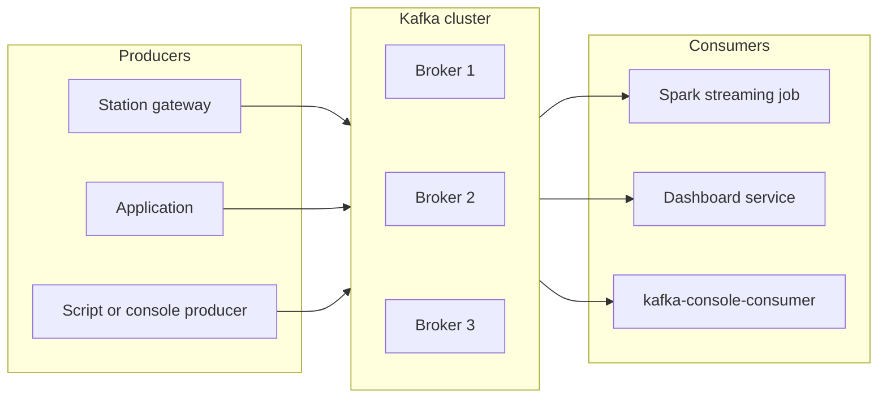

# Theory

What Kafka is, how data is stored and read, and how clients log in with Kerberos

---

# What is Apache Kafka?

- A **distributed commit log**: producers **append** messages to a named **topic**, consumers **read** them later, at their own pace
- Runs as a **cluster of brokers**. Messages are stored on disk, **replicated**, and kept for a configurable time
- **Decouples** the sender from the receiver: the sensor feed does not wait for the dashboard, and a new consumer does not change the producer
- Built for **many small messages** and high throughput: measurements, events, log lines
- An Apache project. Cloudera ships it as the service **Kafka** (with Ranger authorization and Kerberos)

<div class="grid grid-cols-2 gap-4 mt-4 text-sm">
<div class="rounded border-2 border-gray-500/40 p-2">
  <b>Batch today:</b> a daily CSV file per source lands on HDFS and a job picks it up. Data is hours old when it is read.
</div>
<div class="rounded border-2 border-green-500/60 bg-green-500/10 p-2">
  <b>With Kafka:</b> each station reading is a message that arrives within seconds. Several applications read the same stream independently.
</div>
</div>

<div class="mt-3 p-2 rounded bg-blue-500/10 text-sm">
Think of it as a <b>log file that many programs can append to and many programs can read</b>, and that the cluster keeps safe for you.
</div>

---

# Where Kafka sits in a CDP cluster



<div class="grid grid-cols-3 gap-8 mt-3 text-sm">

<div class="border-l-4 border-gray-500 pl-3">
  <div class="font-bold text-base">Clients</div>
  <div class="mt-1 opacity-80">Producers and consumers connect <b>straight to the brokers</b>, over TLS and <b>SASL</b> (Kerberos). There is no gateway in between.</div>
</div>

<div class="border-l-4 border-blue-500 pl-3">
  <div class="font-bold text-base">Brokers</div>
  <div class="mt-1 opacity-80">Store the data on local disks. Each broker leads some partitions and keeps copies of others.</div>
</div>

<div class="border-l-4 border-green-500 pl-3">
  <div class="font-bold text-base">Around Kafka</div>
  <div class="mt-1 opacity-80"><b>Ranger</b> decides who may use which topic. The <b>KDC</b> proves identities. <b>SMM</b> shows topics and lag.</div>
</div>

</div>

---

# Topics, partitions and offsets

<svg viewBox="0 0 900 235" width="100%" class="mt-1" style="font-size:13px" fill="currentColor">
<defs><marker id="kf-arrow-log" viewBox="0 0 10 10" refX="9" refY="5" markerWidth="7" markerHeight="7" orient="auto-start-reverse"><path d="M0,0 L10,5 L0,10 z" fill="currentColor"/></marker></defs>
<text x="10" y="46" font-weight="bold">Partition 0</text>
<rect x="130" y="20" width="56" height="40" rx="5" fill="rgba(59,130,246,0.25)" stroke="#3b82f6" stroke-width="1.5"/>
<text x="158" y="45" text-anchor="middle" style="font-size:12px">TS-101</text>
<text x="158" y="76" text-anchor="middle" style="font-size:11px" opacity="0.7">0</text>
<rect x="192" y="20" width="56" height="40" rx="5" fill="rgba(59,130,246,0.25)" stroke="#3b82f6" stroke-width="1.5"/>
<text x="220" y="45" text-anchor="middle" style="font-size:12px">TS-101</text>
<text x="220" y="76" text-anchor="middle" style="font-size:11px" opacity="0.7">1</text>
<rect x="254" y="20" width="56" height="40" rx="5" fill="rgba(59,130,246,0.25)" stroke="#3b82f6" stroke-width="1.5"/>
<text x="282" y="45" text-anchor="middle" style="font-size:12px">TS-101</text>
<text x="282" y="76" text-anchor="middle" style="font-size:11px" opacity="0.7">2</text>
<rect x="316" y="20" width="56" height="40" rx="5" fill="rgba(59,130,246,0.25)" stroke="#3b82f6" stroke-width="1.5"/>
<text x="344" y="45" text-anchor="middle" style="font-size:12px">TS-101</text>
<text x="344" y="76" text-anchor="middle" style="font-size:11px" opacity="0.7">3</text>
<rect x="378" y="20" width="56" height="40" rx="5" fill="rgba(59,130,246,0.25)" stroke="#3b82f6" stroke-width="1.5"/>
<text x="406" y="45" text-anchor="middle" style="font-size:12px">TS-101</text>
<text x="406" y="76" text-anchor="middle" style="font-size:11px" opacity="0.7">4</text>
<rect x="440" y="20" width="56" height="40" rx="5" fill="rgba(59,130,246,0.25)" stroke="#3b82f6" stroke-width="1.5"/>
<text x="468" y="45" text-anchor="middle" style="font-size:12px">TS-101</text>
<text x="468" y="76" text-anchor="middle" style="font-size:11px" opacity="0.7">5</text>
<rect x="502" y="20" width="56" height="40" rx="5" fill="none" stroke="currentColor" stroke-width="1.2" stroke-dasharray="4 3" opacity="0.6"/>
<text x="530" y="45" text-anchor="middle" opacity="0.6">next</text>
<line x1="562" y1="40" x2="868" y2="40" stroke="currentColor" stroke-width="1.5" marker-end="url(#kf-arrow-log)"/>
<text x="10" y="116" font-weight="bold">Partition 1</text>
<rect x="130" y="90" width="56" height="40" rx="5" fill="rgba(34,197,94,0.25)" stroke="#22c55e" stroke-width="1.5"/>
<text x="158" y="115" text-anchor="middle" style="font-size:12px">TS-204</text>
<text x="158" y="146" text-anchor="middle" style="font-size:11px" opacity="0.7">0</text>
<rect x="192" y="90" width="56" height="40" rx="5" fill="rgba(34,197,94,0.25)" stroke="#22c55e" stroke-width="1.5"/>
<text x="220" y="115" text-anchor="middle" style="font-size:12px">TS-204</text>
<text x="220" y="146" text-anchor="middle" style="font-size:11px" opacity="0.7">1</text>
<rect x="254" y="90" width="56" height="40" rx="5" fill="rgba(34,197,94,0.25)" stroke="#22c55e" stroke-width="1.5"/>
<text x="282" y="115" text-anchor="middle" style="font-size:12px">TS-204</text>
<text x="282" y="146" text-anchor="middle" style="font-size:11px" opacity="0.7">2</text>
<rect x="316" y="90" width="56" height="40" rx="5" fill="rgba(34,197,94,0.25)" stroke="#22c55e" stroke-width="1.5"/>
<text x="344" y="115" text-anchor="middle" style="font-size:12px">TS-204</text>
<text x="344" y="146" text-anchor="middle" style="font-size:11px" opacity="0.7">3</text>
<rect x="378" y="90" width="56" height="40" rx="5" fill="rgba(34,197,94,0.25)" stroke="#22c55e" stroke-width="1.5"/>
<text x="406" y="115" text-anchor="middle" style="font-size:12px">TS-204</text>
<text x="406" y="146" text-anchor="middle" style="font-size:11px" opacity="0.7">4</text>
<rect x="440" y="90" width="56" height="40" rx="5" fill="rgba(34,197,94,0.25)" stroke="#22c55e" stroke-width="1.5"/>
<text x="468" y="115" text-anchor="middle" style="font-size:12px">TS-204</text>
<text x="468" y="146" text-anchor="middle" style="font-size:11px" opacity="0.7">5</text>
<rect x="502" y="90" width="56" height="40" rx="5" fill="rgba(34,197,94,0.25)" stroke="#22c55e" stroke-width="1.5"/>
<text x="530" y="115" text-anchor="middle" style="font-size:12px">TS-204</text>
<text x="530" y="146" text-anchor="middle" style="font-size:11px" opacity="0.7">6</text>
<rect x="564" y="90" width="56" height="40" rx="5" fill="none" stroke="currentColor" stroke-width="1.2" stroke-dasharray="4 3" opacity="0.6"/>
<text x="592" y="115" text-anchor="middle" opacity="0.6">next</text>
<line x1="624" y1="110" x2="868" y2="110" stroke="currentColor" stroke-width="1.5" marker-end="url(#kf-arrow-log)"/>
<text x="10" y="186" font-weight="bold">Partition 2</text>
<rect x="130" y="160" width="56" height="40" rx="5" fill="rgba(249,115,22,0.25)" stroke="#f97316" stroke-width="1.5"/>
<text x="158" y="185" text-anchor="middle" style="font-size:12px">TS-305</text>
<text x="158" y="216" text-anchor="middle" style="font-size:11px" opacity="0.7">0</text>
<rect x="192" y="160" width="56" height="40" rx="5" fill="rgba(249,115,22,0.25)" stroke="#f97316" stroke-width="1.5"/>
<text x="220" y="185" text-anchor="middle" style="font-size:12px">TS-305</text>
<text x="220" y="216" text-anchor="middle" style="font-size:11px" opacity="0.7">1</text>
<rect x="254" y="160" width="56" height="40" rx="5" fill="rgba(249,115,22,0.25)" stroke="#f97316" stroke-width="1.5"/>
<text x="282" y="185" text-anchor="middle" style="font-size:12px">TS-305</text>
<text x="282" y="216" text-anchor="middle" style="font-size:11px" opacity="0.7">2</text>
<rect x="316" y="160" width="56" height="40" rx="5" fill="rgba(249,115,22,0.25)" stroke="#f97316" stroke-width="1.5"/>
<text x="344" y="185" text-anchor="middle" style="font-size:12px">TS-305</text>
<text x="344" y="216" text-anchor="middle" style="font-size:11px" opacity="0.7">3</text>
<rect x="378" y="160" width="56" height="40" rx="5" fill="none" stroke="currentColor" stroke-width="1.2" stroke-dasharray="4 3" opacity="0.6"/>
<text x="406" y="185" text-anchor="middle" opacity="0.6">next</text>
<line x1="438" y1="180" x2="868" y2="180" stroke="currentColor" stroke-width="1.5" marker-end="url(#kf-arrow-log)"/>
<text x="868" y="14" text-anchor="end" style="font-size:12px">new messages are appended at the end</text>
</svg>

<div class="flex gap-6 text-sm mt-1">
<span class="opacity-70">Colour = key (here the station id):</span>
<span><span class="inline-block w-3 h-3 rounded-sm align-middle" style="background:rgba(59,130,246,0.5)"></span> station <code>TS-101</code></span>
<span><span class="inline-block w-3 h-3 rounded-sm align-middle" style="background:rgba(34,197,94,0.5)"></span> station <code>TS-204</code></span>
<span><span class="inline-block w-3 h-3 rounded-sm align-middle" style="background:rgba(249,115,22,0.5)"></span> station <code>TS-305</code></span>
</div>

<div class="text-sm mt-3">

- A **topic** is a named log, split into **partitions**. Each partition is an **ordered, append-only** sequence; every message gets an **offset**, its position in the partition (numbered from 0 per partition)
- Messages are never changed and reading does not remove them. **Order is guaranteed inside one partition**, not across partitions
- A message has an optional **key** and a **value**. The same key always goes to the **same partition** (hash of the key modulo the number of partitions), so all messages of one key stay in order. Without a key, messages are spread over the partitions
- Different keys can share a partition. Adding partitions later changes the modulo: **new** messages of a key may then go to another partition

</div>

---

# Brokers, replicas and leaders

<div class="grid grid-cols-3 gap-3 mt-2 text-sm">

<div class="rounded-lg border-2 border-gray-500/50 p-2">
  <div class="font-bold text-center">Broker 1</div>
  <div class="mt-2 rounded border-2 border-green-500 bg-green-500/15 px-2 py-1">Partition 0 <b>leader</b></div>
  <div class="mt-1 rounded border border-gray-500/50 px-2 py-1">Partition 1 follower</div>
  <div class="mt-1 rounded border border-gray-500/50 px-2 py-1">Partition 2 follower</div>
</div>

<div class="rounded-lg border-2 border-gray-500/50 p-2">
  <div class="font-bold text-center">Broker 2</div>
  <div class="mt-2 rounded border border-gray-500/50 px-2 py-1">Partition 0 follower</div>
  <div class="mt-1 rounded border-2 border-green-500 bg-green-500/15 px-2 py-1">Partition 1 <b>leader</b></div>
  <div class="mt-1 rounded border border-gray-500/50 px-2 py-1">Partition 2 follower</div>
</div>

<div class="rounded-lg border-2 border-gray-500/50 p-2">
  <div class="font-bold text-center">Broker 3</div>
  <div class="mt-2 rounded border border-gray-500/50 px-2 py-1">Partition 0 follower</div>
  <div class="mt-1 rounded border border-gray-500/50 px-2 py-1">Partition 1 follower</div>
  <div class="mt-1 rounded border-2 border-green-500 bg-green-500/15 px-2 py-1">Partition 2 <b>leader</b></div>
</div>

</div>

<div class="text-sm mt-3">

- **Replication factor 3** means three copies of every partition, each on a different broker
- The **leader** handles all reads and writes of its partition. The **followers** copy from the leader
- **ISR** (in-sync replicas): the copies that are up to date. Only an ISR member can become the new leader
- If a broker fails, a follower in the ISR takes over. Clients find the new leader themselves

</div>

<div class="mt-2 p-2 rounded bg-blue-500/10 text-xs">
<code>kafka-topics --describe</code> shows exactly this: <b>Leader</b>, <b>Replicas</b> and <b>Isr</b> per partition.
</div>

---

# Producers

<div class="grid grid-cols-[1fr_1fr] gap-6">
<div class="text-sm">

- A producer connects to **any broker**, learns the cluster layout, and sends each message **directly to the leader** of its partition
- It collects messages into **batches** (per partition) and may **compress** them
- **`acks`** says when a send counts as done: `0` never waits, `1` leader wrote it, `all` every in-sync replica has it (default in new clients)
- A failed send is **retried**. That can produce **duplicates** unless the producer is *idempotent*

<div class="mt-3 p-2 rounded bg-yellow-500/10">
An <b>idempotent</b> producer (default in new clients) first asks a broker for a <b>producer ID</b>. The brokers then drop the duplicates that retries would cause.
</div>

</div>
<div>

```bash
# The simplest producer: one line is one message
echo "hello world" | kafka-console-producer \
    --bootstrap-server <broker-host>:9093 \
    --producer.config client.properties \
    --topic my-topic
```

<div class="text-sm mt-2">

Real producers are programs that use a client library (Java, Python, ...) and set key and value in code. The console producer is a test tool.

</div>
</div>
</div>

---

# Consumers and consumer groups

<svg viewBox="0 0 900 250" width="100%" class="mt-1" style="font-size:13px" fill="currentColor">
<defs>
  <marker id="kf-arrow-grp" viewBox="0 0 10 10" refX="9" refY="5" markerWidth="7" markerHeight="7" orient="auto-start-reverse">
    <path d="M0,0 L10,5 L0,10 z" fill="currentColor"/>
  </marker>
</defs>

<!-- topic -->
<rect x="10" y="5" width="190" height="240" rx="10" fill="rgba(128,128,128,0.08)" stroke="rgba(128,128,128,0.7)" stroke-width="2"/>
<text x="105" y="25" text-anchor="middle" font-weight="bold">Topic, 3 partitions</text>
<rect x="30" y="45" width="150" height="40" rx="5" fill="rgba(128,128,128,0.14)" stroke="rgba(128,128,128,0.7)" stroke-width="1.2"/>
<text x="105" y="70" text-anchor="middle">Partition 0</text>
<rect x="30" y="110" width="150" height="40" rx="5" fill="rgba(128,128,128,0.14)" stroke="rgba(128,128,128,0.7)" stroke-width="1.2"/>
<text x="105" y="135" text-anchor="middle">Partition 1</text>
<rect x="30" y="175" width="150" height="40" rx="5" fill="rgba(128,128,128,0.14)" stroke="rgba(128,128,128,0.7)" stroke-width="1.2"/>
<text x="105" y="200" text-anchor="middle">Partition 2</text>

<!-- group A -->
<rect x="400" y="5" width="260" height="140" rx="10" fill="rgba(59,130,246,0.10)" stroke="#3b82f6" stroke-width="2"/>
<text x="530" y="25" text-anchor="middle" font-weight="bold">Group A: dashboard</text>
<rect x="420" y="40" width="220" height="40" rx="5" fill="rgba(128,128,128,0.14)" stroke="rgba(128,128,128,0.7)" stroke-width="1.2"/>
<text x="530" y="65" text-anchor="middle">Consumer 1: partitions 0, 1</text>
<rect x="420" y="92" width="220" height="40" rx="5" fill="rgba(128,128,128,0.14)" stroke="rgba(128,128,128,0.7)" stroke-width="1.2"/>
<text x="530" y="117" text-anchor="middle">Consumer 2: partition 2</text>

<!-- group B -->
<rect x="400" y="160" width="260" height="85" rx="10" fill="rgba(34,197,94,0.10)" stroke="#22c55e" stroke-width="2"/>
<text x="530" y="180" text-anchor="middle" font-weight="bold">Group B: copy to HDFS</text>
<rect x="420" y="193" width="220" height="40" rx="5" fill="rgba(128,128,128,0.14)" stroke="rgba(128,128,128,0.7)" stroke-width="1.2"/>
<text x="530" y="218" text-anchor="middle">Consumer 1: all partitions</text>

<!-- group A connections -->
<line x1="180" y1="65" x2="420" y2="55" stroke="#3b82f6" stroke-width="1.8" marker-end="url(#kf-arrow-grp)"/>
<line x1="180" y1="130" x2="420" y2="62" stroke="#3b82f6" stroke-width="1.8" marker-end="url(#kf-arrow-grp)"/>
<line x1="180" y1="195" x2="420" y2="118" stroke="#3b82f6" stroke-width="1.8" marker-end="url(#kf-arrow-grp)"/>

<!-- group B connections -->
<line x1="180" y1="75" x2="420" y2="205" stroke="#22c55e" stroke-width="1.6" stroke-dasharray="5 3" marker-end="url(#kf-arrow-grp)"/>
<line x1="180" y1="140" x2="420" y2="212" stroke="#22c55e" stroke-width="1.6" stroke-dasharray="5 3" marker-end="url(#kf-arrow-grp)"/>
<line x1="180" y1="205" x2="420" y2="222" stroke="#22c55e" stroke-width="1.6" stroke-dasharray="5 3" marker-end="url(#kf-arrow-grp)"/>

<!-- own positions -->
<text x="690" y="70" style="font-size:12px">own position</text>
<text x="690" y="86" style="font-size:12px">in every partition</text>
<text x="690" y="205" style="font-size:12px">own position</text>
<text x="690" y="221" style="font-size:12px">in every partition</text>
</svg>

<div class="text-sm">

- A **consumer group** shares the work: each partition is read by **one** consumer of the group. A fourth consumer in a group of three partitions sits idle
- **Different groups are independent**: each one gets every message and keeps its own position
- Consumers **pull**: they ask for the next messages when they are ready
- Members join and leave: Kafka **rebalances** the partitions

</div>

---

# Offsets and lag

<svg viewBox="0 0 900 205" width="100%" class="mt-1" style="font-size:13px" fill="currentColor">
<text x="10" y="96" font-weight="bold">Partition 0</text>
<rect x="90" y="72" width="52" height="38" rx="5" fill="rgba(59,130,246,0.22)" stroke="#3b82f6" stroke-width="1.5"/>
<text x="116" y="127" text-anchor="middle" style="font-size:11px" opacity="0.7">0</text>
<rect x="148" y="72" width="52" height="38" rx="5" fill="rgba(59,130,246,0.22)" stroke="#3b82f6" stroke-width="1.5"/>
<text x="174" y="127" text-anchor="middle" style="font-size:11px" opacity="0.7">1</text>
<rect x="206" y="72" width="52" height="38" rx="5" fill="rgba(59,130,246,0.22)" stroke="#3b82f6" stroke-width="1.5"/>
<text x="232" y="127" text-anchor="middle" style="font-size:11px" opacity="0.7">2</text>
<rect x="264" y="72" width="52" height="38" rx="5" fill="rgba(59,130,246,0.22)" stroke="#3b82f6" stroke-width="1.5"/>
<text x="290" y="127" text-anchor="middle" style="font-size:11px" opacity="0.7">3</text>
<rect x="322" y="72" width="52" height="38" rx="5" fill="rgba(59,130,246,0.22)" stroke="#3b82f6" stroke-width="1.5"/>
<text x="348" y="127" text-anchor="middle" style="font-size:11px" opacity="0.7">4</text>
<rect x="380" y="72" width="52" height="38" rx="5" fill="rgba(59,130,246,0.22)" stroke="#3b82f6" stroke-width="1.5"/>
<text x="406" y="127" text-anchor="middle" style="font-size:11px" opacity="0.7">5</text>
<rect x="438" y="72" width="52" height="38" rx="5" fill="rgba(59,130,246,0.22)" stroke="#3b82f6" stroke-width="1.5"/>
<text x="464" y="127" text-anchor="middle" style="font-size:11px" opacity="0.7">6</text>
<rect x="496" y="72" width="52" height="38" rx="5" fill="rgba(59,130,246,0.22)" stroke="#3b82f6" stroke-width="1.5"/>
<text x="522" y="127" text-anchor="middle" style="font-size:11px" opacity="0.7">7</text>
<rect x="554" y="72" width="52" height="38" rx="5" fill="rgba(249,115,22,0.25)" stroke="#f97316" stroke-width="1.5"/>
<text x="580" y="127" text-anchor="middle" style="font-size:11px" opacity="0.7">8</text>
<rect x="612" y="72" width="52" height="38" rx="5" fill="rgba(249,115,22,0.25)" stroke="#f97316" stroke-width="1.5"/>
<text x="638" y="127" text-anchor="middle" style="font-size:11px" opacity="0.7">9</text>
<rect x="670" y="72" width="52" height="38" rx="5" fill="rgba(249,115,22,0.25)" stroke="#f97316" stroke-width="1.5"/>
<text x="696" y="127" text-anchor="middle" style="font-size:11px" opacity="0.7">10</text>
<rect x="728" y="72" width="52" height="38" rx="5" fill="rgba(249,115,22,0.25)" stroke="#f97316" stroke-width="1.5"/>
<text x="754" y="127" text-anchor="middle" style="font-size:11px" opacity="0.7">11</text>
<rect x="786" y="72" width="52" height="38" rx="5" fill="none" stroke="currentColor" stroke-width="1.2" stroke-dasharray="4 3" opacity="0.6"/>
<text x="812" y="96" text-anchor="middle" opacity="0.6">next</text>

<!-- current offset -->
<line x1="551" y1="40" x2="551" y2="116" stroke="#3b82f6" stroke-width="2.5"/>
<text x="551" y="18" text-anchor="middle" font-weight="bold" fill="#3b82f6">CURRENT-OFFSET = 8</text>
<text x="551" y="34" text-anchor="middle" style="font-size:11px">next message the group reads</text>

<!-- log end offset -->
<line x1="783" y1="40" x2="783" y2="116" stroke="#f97316" stroke-width="2.5"/>
<text x="783" y="18" text-anchor="middle" font-weight="bold" fill="#f97316">LOG-END-OFFSET = 12</text>
<text x="783" y="34" text-anchor="middle" style="font-size:11px">offset after the newest message</text>

<!-- read part -->
<polyline points="90,142 90,150 551,150 551,142" fill="none" stroke="#3b82f6" stroke-width="1.5"/>
<text x="320" y="170" text-anchor="middle" style="font-size:12px">already read by the group</text>

<!-- lag -->
<polyline points="557,142 557,150 783,150 783,142" fill="none" stroke="#f97316" stroke-width="1.5"/>
<text x="670" y="170" text-anchor="middle" font-weight="bold" style="font-size:13px">LAG = 12 - 8 = 4 messages</text>
<text x="670" y="188" text-anchor="middle" style="font-size:11px">written, but not yet read</text>
</svg>

<div class="grid grid-cols-[1.1fr_1fr] gap-6 mt-2">
<div class="text-sm">

- Kafka stores the **committed offset** of every consumer group, **per partition**. The figure shows one partition; a group has one position and one lag for each
- **Lag 0**: the group is up to date. **Growing lag**: consumers are slower than producers, or stopped
- **No data is lost** while the lag stays inside the retention time
- **Resetting the offsets** moves the group back, so it reads old messages again, for example after a bug fix

</div>
<div>

```bash
# Position and lag of a group
kafka-consumer-groups --describe --group my-group \
    --bootstrap-server <broker-host>:9093 \
    --command-config client.properties
```

<div class="text-xs mt-1 opacity-80">
Resetting (<code>--reset-offsets --to-earliest</code>) works only when the group has no running consumer.
</div>
</div>
</div>

---

# Retention: Kafka is not an archive

- Messages stay until the **retention** is over, **whether read or not**: `retention.ms` (a time, often 7 days by default) and/or `retention.bytes` (a size per partition)
- Kafka deletes whole **log segments**, not single messages
- **Compaction** (`cleanup.policy=compact`) is an alternative: keep only the latest message per key
- Settings are **per topic** and override the broker defaults

```bash
kafka-configs --bootstrap-server <broker-host>:9093 --command-config client.properties \
    --alter --entity-type topics --entity-name my-topic --add-config retention.ms=3600000
```

<div class="mt-4 p-3 rounded bg-green-500/10 text-sm">
For long-term storage the data has to move on: a consumer (for example a Spark job) writes the topic into <b>HDFS or an Iceberg table</b>. Kafka keeps the <b>recent</b> data.
</div>

---

# Security 1: how a Kafka client logs in

<div class="grid grid-cols-[1fr_auto_1fr_auto_1fr_auto_1fr] gap-1 items-stretch mt-2 text-[0.72rem]">

<div class="rounded-lg border-2 border-gray-500/60 bg-gray-500/10 p-2">
  <div class="font-bold text-sm">1. kinit</div>
  <div class="mt-1 opacity-80">You and the KDC</div>
  <div class="mt-1">Password gives a <b>TGT</b> in your ticket cache</div>
</div>
<div class="self-center w-4 border-t-2 border-gray-400"></div>

<div class="rounded-lg border-2 border-blue-500/60 bg-blue-500/10 p-2">
  <div class="font-bold text-sm">2. Service ticket</div>
  <div class="mt-1 opacity-80">The client asks the KDC</div>
  <div class="mt-1">Ticket for the broker service <code>kafka/&lt;host&gt;</code></div>
</div>
<div class="self-center w-4 border-t-2 border-gray-400"></div>

<div class="rounded-lg border-2 border-green-500/60 bg-green-500/10 p-2">
  <div class="font-bold text-sm">3. SASL handshake</div>
  <div class="mt-1 opacity-80">Client and broker, over TLS</div>
  <div class="mt-1">Mechanism <b>GSSAPI</b>. The broker maps <code>user@REALM</code> to <code>user</code></div>
</div>
<div class="self-center w-4 border-t-2 border-gray-400"></div>

<div class="rounded-lg border-2 border-purple-500/60 bg-purple-500/10 p-2">
  <div class="font-bold text-sm">4. Every request</div>
  <div class="mt-1 opacity-80">The broker asks Ranger</div>
  <div class="mt-1">May this user publish, consume or describe this resource?</div>
</div>

</div>

<div class="mt-4">

```properties
# client.properties
security.protocol=SASL_SSL
sasl.mechanism=GSSAPI
sasl.kerberos.service.name=kafka
sasl.jaas.config=com.sun.security.auth.module.Krb5LoginModule required useTicketCache=true;
```

</div>

<div class="grid grid-cols-2 gap-x-8 gap-y-2 mt-3 text-sm">

<div class="border-l-4 border-gray-500 pl-3"><code>SASL_SSL</code>: log in with SASL and <b>encrypt with TLS</b></div>
<div class="border-l-4 border-blue-500 pl-3"><code>service.name=kafka</code>: the broker principal is <code>kafka/&lt;host&gt;@REALM</code>, so name the broker by its <b>full host name</b></div>
<div class="border-l-4 border-green-500 pl-3"><code>useTicketCache=true</code>: use the ticket from <code>kinit</code>. <b>No password, no keytab</b> in the file</div>
<div class="border-l-4 border-purple-500 pl-3">Without a valid ticket the client fails at once: it never asks for a password</div>

</div>

---

# Security 2: authentication is not authorization

<div class="grid grid-cols-2 gap-6 text-sm">
<div>

<div class="rounded border-2 border-blue-500/60 bg-blue-500/10 p-3">
  <div class="font-bold">Kerberos: who are you?</div>
  <div class="mt-1">Proves the identity of client and broker. Says nothing about what you may do.</div>
</div>

<div class="rounded border-2 border-purple-500/60 bg-purple-500/10 p-3 mt-3">
  <div class="font-bold">Ranger: what may you do?</div>
  <div class="mt-1">The broker asks Ranger for each request. Policies name a <b>resource</b> and a <b>permission</b>. Denied requests show up in the <b>Ranger audit</b>.</div>
</div>

</div>
<div>

| Ranger resource | Typical permissions |
|-----------------|---------------------|
| **Topic** | publish, consume, describe, create, delete, configure, alter |
| **Consumer group** | consume, describe, delete |
| **Cluster** | describe, create, idempotent write |
| **Transactional ID** | publish, describe |

<div class="mt-3 p-2 rounded bg-yellow-500/10 text-xs">
A typical setup: each user may create and use <b>only a topic and a group of their own</b> and may only <b>consume</b> shared topics. A refused write ends with <code>TopicAuthorizationException</code>.
</div>

</div>
</div>

---

# The command-line tools

<div class="text-xs">

| Tool | Does | Config flag |
|------|------|-------------|
| `kafka-topics` | create, list, describe, alter, delete topics | `--command-config` |
| `kafka-console-producer` | send lines from stdin as messages | `--producer.config` |
| `kafka-console-consumer` | print messages, with key, partition, offset | `--consumer.config` |
| `kafka-consumer-groups` | group state, lag, reset and delete offsets | `--command-config` |
| `kafka-configs` | per-topic settings such as `retention.ms` | `--command-config` |
| `kafka-producer-perf-test` | throughput test of a producer | `--producer.config` |

</div>

<div class="mt-4 text-sm">

- All of them need `--bootstrap-server <broker-host>:<port>`: one or more brokers to **find the cluster**, not the only ones that are used
- **One properties file** with the Kerberos settings serves all tools, only the flag name differs
- `kafka-console-consumer` without `--group` invents a group name: with Ranger group policies, always pass `--group`

</div>

---

# Limits and gotchas

- **Order only inside a partition.** For order per station, use the station as key
- **Partitions can grow, never shrink.** Adding some changes where a key goes
- **Messages are immutable.** No update, no delete of one message. Corrections are new messages
- **Delivery can repeat.** Retries and re-reading mean consumers should handle the same message twice
- **Kafka is a buffer, not a database.** No query by field, only by topic, partition and offset
- **Lag is the signal to watch.** Growing lag means the readers fall behind
- **Hostnames matter.** The client builds `kafka/<host>@REALM` from the broker name you give: use the full host name, not an IP address
- **Two layers can say no.** A `LoginException` is Kerberos (no ticket), a `...AuthorizationException` is Ranger

---

# Kafka and its neighbours

<div class="text-xs">

| Option | Strength | Limit |
|--------|----------|-------|
| **CSV files on HDFS** (landing) | Simple, cheap, easy to replay | Data arrives in batches, hours late |
| **Kafka topic** | Seconds of latency, many independent readers, replay | Finite retention, no queries |
| **Hive / Impala / Iceberg table** | SQL, long-term storage, governance | Not made for single-message delivery |
| Spark Structured Streaming | Reads a topic, writes HDFS or Iceberg continuously | A job to build and run (not part of this lab) |

</div>

<div class="mt-4 p-3 rounded bg-green-500/10 text-sm">
Kafka does not replace HDFS or the SQL engines. It is the <b>entry door for streaming data</b>; the data that has to stay lands in HDFS or Iceberg tables.
</div>

---

# What you do in the lab

<div class="text-xs">

| Section | You do | Concept |
|---------|--------|---------|
| 0 | Write the client file, fail without a ticket, `kinit`, list topics | SASL_SSL, GSSAPI, ticket cache |
| 1 | Create your topic, read leader, replicas and ISR | Partitions, replication |
| 2 | Hello world, then the meter sample keyed by station, read live in a second terminal | Producer, key, offset, consumer |
| 3 | Read the group position, create lag, catch up | Consumer group, lag |
| 4 | Reset the group, read all messages again | Messages stay, offset reset |
| 5 | Set the retention of your topic | Retention |
| 6 | Read the shared topic, fail to write to it | Ranger authorization |

</div>

<div class="mt-4 p-3 rounded bg-yellow-500/10 text-sm">
You may have <b>one topic and one consumer group</b>, both named like your user. Run the self-check before the clean-up at the end of the lab.
</div>

---
layout: end
---

# Thank you

Questions?
