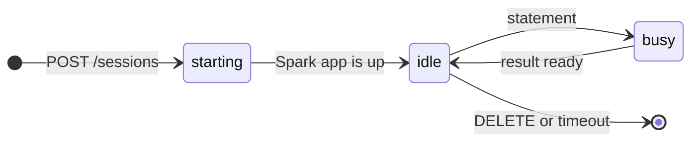
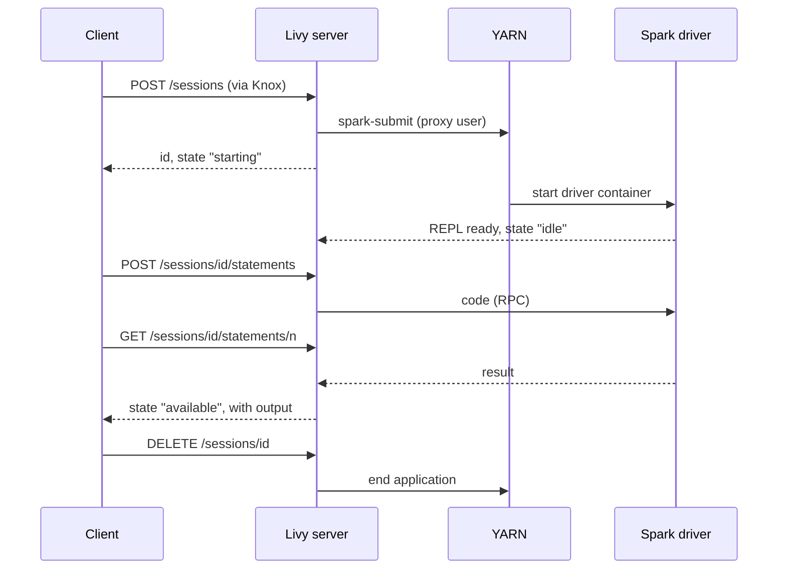
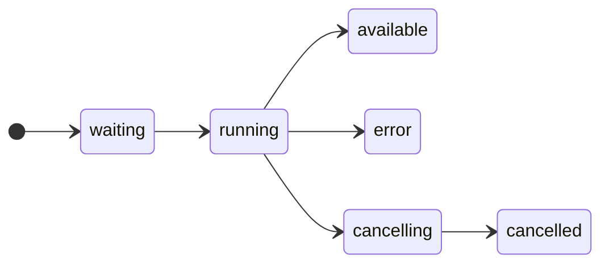
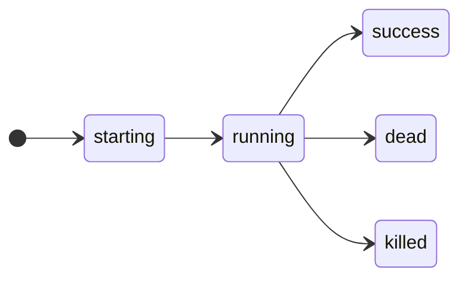
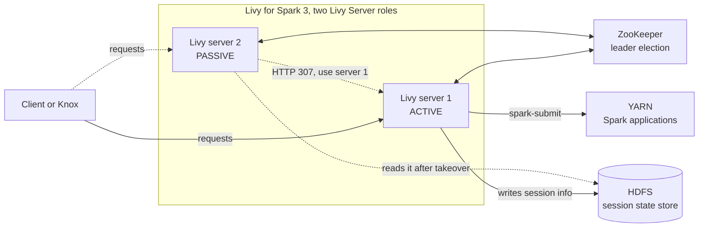

# Theory

What Livy is, where it runs and how sessions and batches work

---

# What is Apache Livy?

- A **REST service for Apache Spark**: you start Spark applications and send them code over **HTTPS**
- Runs as a **server** next to the cluster. The Spark application runs **on the cluster (YARN)**, not inside Livy
- Two kinds of work: **sessions** (interactive code snippets) and **batches** (a finished program, like `spark-submit`)
- The client needs **no Spark installation**, no cluster config and no Kerberos ticket: an HTTP client is enough
- Each application runs **as the calling user** (impersonation), so many users can share one cluster
- An Apache project (top-level since 2026). Cloudera ships it as the service **Livy for Spark 3**

<div class="grid grid-cols-2 gap-4 mt-4 text-sm">
<div class="rounded border-2 border-gray-500/40 p-2">
  <b>Without Livy:</b> shell on an edge node, Spark client, cluster config and Kerberos ticket on every machine. No way to start Spark from an application outside the cluster zone.
</div>
<div class="rounded border-2 border-green-500/60 bg-green-500/10 p-2">
  <b>With Livy:</b> one URL and a login. Notebooks, schedulers and web applications start and control Spark with plain HTTPS calls.
</div>
</div>

<div class="mt-3 p-2 rounded bg-blue-500/10 text-sm">
Think of it as <code>pyspark</code> and <code>spark-submit</code> with an HTTP interface.
</div>

---

# Where Livy sits in a CDP cluster

<svg viewBox="0 0 900 300" width="100%" class="mt-1" style="font-size:13px" fill="currentColor">
<defs>
  <marker id="lv-arrow" viewBox="0 0 10 10" refX="9" refY="5" markerWidth="7" markerHeight="7" orient="auto-start-reverse">
    <path d="M0,0 L10,5 L0,10 z" fill="currentColor"/>
  </marker>
</defs>

<!-- client frames -->
<rect x="10" y="10" width="190" height="130" rx="10" fill="rgba(128,128,128,0.08)" stroke="rgba(128,128,128,0.7)" stroke-width="2"/>
<text x="105" y="29" text-anchor="middle" font-weight="bold">Clients outside the cluster</text>
<rect x="25" y="42" width="160" height="34" rx="5" fill="rgba(128,128,128,0.14)" stroke="rgba(128,128,128,0.7)" stroke-width="1.2"/>
<text x="105" y="64" text-anchor="middle">curl, scripts</text>
<rect x="25" y="88" width="160" height="34" rx="5" fill="rgba(128,128,128,0.14)" stroke="rgba(128,128,128,0.7)" stroke-width="1.2"/>
<text x="105" y="110" text-anchor="middle">Jupyter (sparkmagic)</text>

<rect x="10" y="155" width="190" height="135" rx="10" fill="rgba(128,128,128,0.08)" stroke="rgba(128,128,128,0.7)" stroke-width="2"/>
<text x="105" y="174" text-anchor="middle" font-weight="bold">Clients inside the cluster</text>
<rect x="25" y="190" width="160" height="34" rx="5" fill="rgba(128,128,128,0.14)" stroke="rgba(128,128,128,0.7)" stroke-width="1.2"/>
<text x="105" y="212" text-anchor="middle">Hue</text>
<rect x="25" y="238" width="160" height="34" rx="5" fill="rgba(128,128,128,0.14)" stroke="rgba(128,128,128,0.7)" stroke-width="1.2"/>
<text x="105" y="260" text-anchor="middle">Zeppelin</text>

<!-- Knox -->
<rect x="250" y="54" width="140" height="56" rx="8" fill="rgba(128,128,128,0.14)" stroke="rgba(128,128,128,0.8)" stroke-width="2"/>
<text x="320" y="78" text-anchor="middle" font-weight="bold">Knox gateway</text>
<text x="320" y="96" text-anchor="middle" style="font-size:12px">TLS, LDAP login</text>

<!-- Livy server -->
<rect x="470" y="10" width="200" height="280" rx="10" fill="rgba(59,130,246,0.10)" stroke="#3b82f6" stroke-width="2"/>
<text x="570" y="29" text-anchor="middle" font-weight="bold">Livy server</text>
<text x="570" y="44" text-anchor="middle" style="font-size:11px">(bookkeeping only)</text>
<rect x="490" y="58" width="160" height="72" rx="5" fill="rgba(128,128,128,0.14)" stroke="rgba(128,128,128,0.7)" stroke-width="1.2"/>
<text x="570" y="85" text-anchor="middle" font-weight="bold">REST API</text>
<text x="570" y="103" text-anchor="middle" style="font-size:12px;font-family:monospace">/sessions</text>
<text x="570" y="119" text-anchor="middle" style="font-size:12px;font-family:monospace">/batches</text>
<rect x="490" y="176" width="160" height="76" rx="5" fill="rgba(128,128,128,0.14)" stroke="rgba(128,128,128,0.7)" stroke-width="1.2"/>
<text x="570" y="205" text-anchor="middle" font-weight="bold">spark-submit process</text>
<text x="570" y="225" text-anchor="middle" style="font-size:12px">with --proxy-user</text>
<line x1="570" y1="130" x2="570" y2="176" stroke="currentColor" stroke-width="1.5" marker-end="url(#lv-arrow)"/>

<!-- Cluster -->
<rect x="730" y="10" width="160" height="280" rx="10" fill="rgba(34,197,94,0.10)" stroke="#22c55e" stroke-width="2"/>
<text x="810" y="29" text-anchor="middle" font-weight="bold">Cluster</text>
<text x="810" y="44" text-anchor="middle" style="font-size:11px">YARN applications,</text>
<text x="810" y="57" text-anchor="middle" style="font-size:11px">started as the user</text>
<rect x="745" y="70" width="130" height="85" rx="5" fill="rgba(128,128,128,0.14)" stroke="rgba(128,128,128,0.7)" stroke-width="1.2"/>
<text x="810" y="98" text-anchor="middle" font-weight="bold">Session</text>
<text x="810" y="118" text-anchor="middle" style="font-size:12px">driver with REPL,</text>
<text x="810" y="134" text-anchor="middle" style="font-size:12px">executors</text>
<rect x="745" y="175" width="130" height="90" rx="5" fill="rgba(128,128,128,0.14)" stroke="rgba(128,128,128,0.7)" stroke-width="1.2"/>
<text x="810" y="203" text-anchor="middle" font-weight="bold">Batch</text>
<text x="810" y="223" text-anchor="middle" style="font-size:12px">driver with your</text>
<text x="810" y="239" text-anchor="middle" style="font-size:12px">program, executors</text>

<!-- connections: outside clients through Knox -->
<line x1="185" y1="59" x2="250" y2="72" stroke="currentColor" stroke-width="1.5" marker-end="url(#lv-arrow)"/>
<line x1="185" y1="105" x2="250" y2="92" stroke="currentColor" stroke-width="1.5" marker-end="url(#lv-arrow)"/>
<text x="217" y="48" text-anchor="middle" style="font-size:11px" fill="currentColor">HTTPS</text>
<line x1="390" y1="82" x2="490" y2="82" stroke="currentColor" stroke-width="1.5" marker-end="url(#lv-arrow)"/>
<text x="430" y="62" text-anchor="middle" style="font-size:11px" fill="currentColor">REST,</text>
<text x="430" y="74" text-anchor="middle" style="font-size:11px" fill="currentColor">doAs user</text>

<!-- connections: Hue and Zeppelin call Livy directly -->
<polyline points="185,255 430,255 430,207" fill="none" stroke="currentColor" stroke-width="1.5"/>
<polyline points="185,207 430,207 430,112 490,112" fill="none" stroke="currentColor" stroke-width="1.5" marker-end="url(#lv-arrow)"/>
<text x="307" y="199" text-anchor="middle" style="font-size:11px" fill="currentColor">REST, directly to Livy</text>

<!-- connections: Livy to the cluster -->
<line x1="650" y1="92" x2="745" y2="92" stroke="currentColor" stroke-width="1.5" stroke-dasharray="4 3" marker-start="url(#lv-arrow)" marker-end="url(#lv-arrow)"/>
<text x="698" y="81" text-anchor="middle" style="font-size:11px" fill="currentColor">RPC</text>
<text x="698" y="108" text-anchor="middle" style="font-size:11px" fill="currentColor">(session)</text>
<polyline points="650,198 700,198 700,130 745,130" fill="none" stroke="currentColor" stroke-width="1.5" marker-end="url(#lv-arrow)"/>
<line x1="650" y1="230" x2="745" y2="230" stroke="currentColor" stroke-width="1.5" marker-end="url(#lv-arrow)"/>
<text x="698" y="248" text-anchor="middle" style="font-size:11px" fill="currentColor">submits</text>
</svg>

<div class="grid grid-cols-3 gap-8 mt-6 text-sm">

<div class="border-l-4 border-gray-500 pl-3">
  <div class="font-bold text-base">Gateway</div>
  <div class="mt-1 opacity-80"><b>Knox</b> is the front door: TLS, LDAP login, authorization. Hue and Zeppelin run in the cluster and call Livy directly.</div>
</div>

<div class="border-l-4 border-blue-500 pl-3">
  <div class="font-bold text-base">Livy server</div>
  <div class="mt-1 opacity-80">Keeps only the <b>bookkeeping</b>. A session talks to its driver over <b>RPC</b>; for a batch Livy only watches YARN.</div>
</div>

<div class="border-l-4 border-green-500 pl-3">
  <div class="font-bold text-base">Cluster</div>
  <div class="mt-1 opacity-80">Driver and executors run in <b>YARN containers</b> as the user. Needs <b>Spark 3 on YARN</b> and <b>YARN</b>; <b>Hive</b> is optional.</div>
</div>

</div>

---

# Two kinds of Livy work

<div class="grid grid-cols-2 gap-6 mt-4 text-sm">

<div class="rounded-lg border-2 border-blue-500/60 bg-blue-500/10 p-3 h-full">
  <div class="font-bold text-lg">Session (interactive)</div>
  <div class="mt-1">A running Spark shell you talk to. You send <b>statements</b> (code snippets) one after another.</div>
  <div class="mt-3 text-xs">
    <div><b>Like:</b> <code>pyspark</code> shell, notebook kernel</div>
    <div><b>REST:</b> <code>/sessions</code>, <code>/sessions/&lt;id&gt;/statements</code></div>
    <div><b>You send:</b> code as text, many times</div>
    <div><b>State:</b> variables, DataFrames, temp views stay between statements</div>
    <div><b>Ends:</b> you <code>DELETE</code> it, or an idle timeout removes it</div>
  </div>
</div>

<div class="rounded-lg border-2 border-purple-500/60 bg-purple-500/10 p-3 h-full">
  <div class="font-bold text-lg">Batch</div>
  <div class="mt-1">A finished program that runs once. You hand over a file and its arguments.</div>
  <div class="mt-3 text-xs">
    <div><b>Like:</b> <code>spark-submit</code></div>
    <div><b>REST:</b> <code>/batches</code></div>
    <div><b>You send:</b> path of a script or JAR on HDFS, arguments, resources</div>
    <div><b>State:</b> none, everything is gone when the program ends</div>
    <div><b>Ends:</b> by itself (<code>success</code> or <code>dead</code>)</div>
  </div>
</div>

</div>

<div class="mt-6 text-sm">

- Both are **ordinary Spark applications on YARN**: they show up in `yarn application -list` and have a Spark UI
- Each session or batch has its own **id** (the two id spaces are separate) and an optional unique **name**
- Rule of thumb: **sessions for people** exploring, **batches for repeatable pipelines**

</div>

---

# Session life cycle



<div class="text-xs">

| State | Meaning |
|-------|---------|
| `starting`, `idle`, `busy` | Launching on YARN, ready for input, running a statement |
| `shutting_down`, `success` | Being closed, stopped normally |
| `error`, `dead`, `killed` | The application failed or was ended: **all state is lost** |

</div>

- `POST /sessions` returns **at once** with `starting`. The Spark application needs **20 to 60 seconds**: clients **poll** `GET /sessions/<id>/state` until `idle`
- The description shows the YARN `appId`, the `owner`, the `proxyUser` and the Spark UI link (`appInfo`)
- A session lives until it is **deleted** or Livy's **idle timeout** removes it. Closing a notebook tab does **not** delete it

---

# Request flow of a session

<div class="grid grid-cols-[1.5fr_1fr] gap-4 items-start">
<div>



</div>
<div class="text-sm mt-2">

- Every call is **asynchronous**: you get an id back and **poll** for the answer. Notebook frontends hide the polling
- Livy **unwraps** your request, sends the code to the **remote Spark context** over RPC and wraps the result as JSON again
- `DELETE` ends the YARN application: its containers are freed
- Knox sits in front of every call (not drawn)

</div>
</div>

---

# Creating a session: what you can choose

<div class="grid grid-cols-[1.1fr_1fr] gap-6">
<div class="text-[0.7rem]">

| Field | Meaning |
|-------|---------|
| `kind`, `name` | Language (`spark`, `pyspark`, `sparkr`, `sql`), unique name |
| `driverMemory`, `executorMemory`, `executorCores`, `numExecutors` | As in `spark-submit` |
| `queue`, `conf` | YARN queue, any Spark property |
| `jars`, `pyFiles`, `files`, `archives` | Extra files, on HDFS |
| `ttl`, `heartbeatTimeoutInSecond` | Lifetime rules |
| `proxyUser` | User to run as (set by the gateway) |

</div>
<div>

```json
// POST /sessions
{
  "kind": "pyspark",
  "name": "my-session",
  "driverMemory": "1g",
  "executorMemory": "1g",
  "executorCores": 1,
  "numExecutors": 1,
  "conf": {
    "spark.sql.catalogImplementation": "hive"
  }
}
```

</div>
</div>

<div class="mt-2 text-sm">

- Since Livy 0.5 one session can run **several languages**: give the code `kind` (`spark`, `pyspark`, `sparkr`, `sql`) with each statement
- The server can **forbid** some Spark settings (`spark-blacklist.conf`): users cannot override them

</div>

---

# Statements: code in a running session

<div class="grid grid-cols-[1fr_1.15fr] gap-6">
<div class="text-sm">

A **statement** is one snippet of code, executed in the **same interpreter** as all earlier ones.

- Ids count up per session: 0, 1, 2 ...
- Statements run **one after another**; a new one waits while the session is `busy`
- A **failed** statement is a result (`status: error`), not a failed session: it stays `idle`, variables stay
- `POST .../statements/<id>/cancel` stops a running statement



</div>
<div>

```json
// POST /sessions/0/statements
{"code": "1 + 1"}

// GET /sessions/0/statements/0
{
  "id": 0,
  "code": "1 + 1",
  "state": "available",
  "output": {
    "status": "ok",
    "execution_count": 0,
    "data": {"text/plain": "2"}
  },
  "progress": 1.0
}
```

<div class="text-sm mt-2">

`output.data` maps a **mime type** to the result. Large results are a bad idea: they travel as JSON through Livy.

</div>
</div>
</div>

---

# Batches: a program on the cluster

<div class="grid grid-cols-[1fr_1.1fr] gap-6">
<div class="text-sm">

A batch is the REST version of `spark-submit`.

1. `POST /batches` with the file, arguments and resources: answer with the batch **id**
2. Livy runs `spark-submit` as the user and **watches the YARN application**
3. Poll `GET /batches/<id>/state` until `success` or `dead`
4. `GET /batches/<id>/log` shows what `spark-submit` printed
5. `DELETE /batches/<id>` ends a running batch and removes the record



</div>
<div>

```json
// POST /batches
{
  "file": "hdfs:///apps/spark_job.py",
  "name": "nightly-job",
  "args": ["/data/in", "/data/out"],
  "executorMemory": "2g",
  "queue": "default"
}
```

<div class="text-sm mt-2">

- `file` must be on **HDFS** (a local path is rejected unless the server whitelists it)
- Python script, or a **JAR plus `className`**
- No statements, no state between runs
- **Program output** (`print`) is in the **YARN log**, not in the Livy batch log

</div>
</div>
</div>

---

# Identity and security: who is the user?

<div class="grid grid-cols-[1fr_auto_1fr_auto_1fr_auto_1fr] gap-1 items-stretch mt-4 text-[0.72rem]">

<div class="rounded-lg border-2 border-gray-500/60 bg-gray-500/10 p-2">
  <div class="font-bold text-sm">1. Client to Knox</div>
  <div class="mt-1 opacity-80">HTTPS</div>
  <div class="mt-1">LDAP user and password (HTTP Basic)</div>
</div>
<div class="self-center w-4 border-t-2 border-gray-400"></div>

<div class="rounded-lg border-2 border-blue-500/60 bg-blue-500/10 p-2">
  <div class="font-bold text-sm">2. Knox to Livy</div>
  <div class="mt-1 opacity-80">Knox is a superuser</div>
  <div class="mt-1">Forwards the call with <code>doAs=&lt;user&gt;</code></div>
</div>
<div class="self-center w-4 border-t-2 border-gray-400"></div>

<div class="rounded-lg border-2 border-green-500/60 bg-green-500/10 p-2">
  <div class="font-bold text-sm">3. Livy to YARN</div>
  <div class="mt-1 opacity-80">Livy's own Kerberos login</div>
  <div class="mt-1"><code>spark-submit --proxy-user &lt;user&gt;</code></div>
</div>
<div class="self-center w-4 border-t-2 border-gray-400"></div>

<div class="rounded-lg border-2 border-purple-500/60 bg-purple-500/10 p-2">
  <div class="font-bold text-sm">4. Spark to data</div>
  <div class="mt-1 opacity-80">Runs as the user</div>
  <div class="mt-1">HDFS, Metastore, <b>Ranger</b> see the user</div>
</div>

</div>

<div class="mt-5 text-sm">

- **Impersonation** (`livy.impersonation.enabled`, on by default in Cloudera Manager): without it, every job would run as the `livy` service user. Files would belong to it and Ranger could not tell users apart
- **Superusers** (`livy.superusers`, default `knox zeppelin`) may act for other users and see all sessions. A service such as **Hue** must be added to the list
- **Access control** (`livy.server.access-control.*`): without extra rights only the **owner** and a superuser can view or change a session. Optional lists: allowed, view and modify users
- **CSRF protection:** `POST` and `DELETE` need the header `X-Requested-By`, otherwise the answer is `400`
- Livy itself can use **SPNEGO** and TLS. Behind Knox the clients never see Kerberos

</div>

---

# Operating Livy: lifetime of a session

<div class="text-sm">

| Rule | Effect |
|------|--------|
| `livy.server.session.timeout` | Removes **idle** sessions, default `1h` |
| `livy.server.session.timeout-check=false` | Sessions never time out. **You** must delete them |
| `ttl` | Time limit for an inactive session, set per session |
| `heartbeatTimeoutInSecond` | Orphans a session when the client stops calling |

</div>

- A session holds its **YARN containers** the whole time, also when idle. Closing a notebook does not end it
- **Session recovery:** Livy writes session information to a **state store**, so it finds its sessions again after a restart. In Cloudera Manager this is on by default, with the store in **HDFS**
- **Access control:** `livy.server.access-control.*` decides who may view or change sessions of other users

---

# Operating Livy: high availability



<div class="text-sm">

- Enabled by adding a **second Livy Server role**: Cloudera Manager sets `livy.server.recovery.mode=ha` and the ZooKeeper settings
- **One active** server, the others **passive**. If the active one fails, a passive one takes over and recovers the sessions
- Passive servers answer with **HTTP 307**. Knox or the client must follow it and resend the login (`curl --location-trusted`)
- **No extra capacity:** the active server does all the work

</div>

---

# Limits and gotchas

- **One session is one full Spark application.** Many open sessions mean many idle containers. Forgotten sessions block the queue until the timeout
- **Results travel as JSON** through Livy. Pull back small samples only, write big results to HDFS or a table
- **State lives in the driver.** When the application ends or is deleted, variables are gone. Only files and tables stay
- **Starting takes time** (20 to 60 seconds). Reuse a session instead of opening one per statement
- **The Livy log is the log of the submit process**, not of your program. Output of `print` is in the statement result (session) or the YARN log
- **Sessions are visible** to other users: name, owner and application id show up in the list
- **The driver must be reachable from the Livy host** for the RPC connection, and Livy must be allowed to impersonate the workshop users
- **Two services, two failures:** a `401` or `403` comes from Knox, a `400` from Livy, a dead session from YARN or Spark

---

# Livy and its neighbours

<div class="text-xs">

| Option | Strength | Limit |
|--------|----------|-------|
| `pyspark` / `spark-submit` on the edge node | Full control of Spark options, Kerberos | Needs a shell and a Spark client on a cluster-attached machine |
| **Livy session** | Notebook from anywhere, state across statements | Holds containers, results as JSON, one more service |
| **Livy batch** | One HTTPS call from a scheduler or application outside the cluster | No streaming progress, debugging through YARN logs |
| Hue Spark SQL editor | No install for analysts | Less control, Livy underneath |
| Oozie `spark` action | Cluster-internal orchestration | Cluster-attached, workflow XML |

</div>

<div class="mt-4 p-3 rounded bg-green-500/10 text-sm">
Livy does not replace Spark, YARN or Knox. It is the <b>thin service in the middle</b> that turns "start a Spark application" into an authenticated HTTP call.
</div>

---

# What you do in the lab

<div class="text-xs">

| Section | You do | Concept |
|---------|--------|---------|
| 0 | Log in through Knox, list sessions and batches | Gateway, REST, impersonation |
| 1 | Open a PySpark session, find it on YARN | Session, `starting` to `idle`, driver in a container |
| 2 | Send statements, make an error on purpose | Statements, state in the session, `error` vs `dead` |
| 3, 4 | Run the pipeline, read the log, delete the session | Session state, lifetime, cleanup |
| 5 | Submit the same script as a batch | Batch, `success`, YARN log |
| 6 | Jupyter on your laptop with `sparkmagic` | Notebook as a Livy client |
| 7 | Break it on purpose (optional) | Failure signals, Livy or `spark-submit` |

</div>

<div class="mt-4 p-3 rounded bg-yellow-500/10 text-sm">
Always <b>delete your sessions</b> at the end of a section. A forgotten session keeps its YARN containers for everybody else's cluster share.
</div>

---
layout: end
---

# Thank you

Questions?
