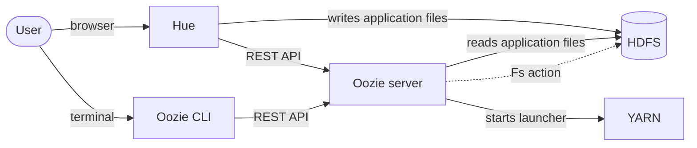
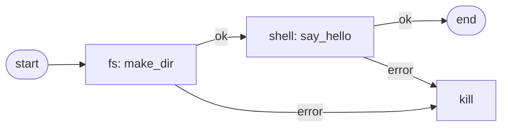
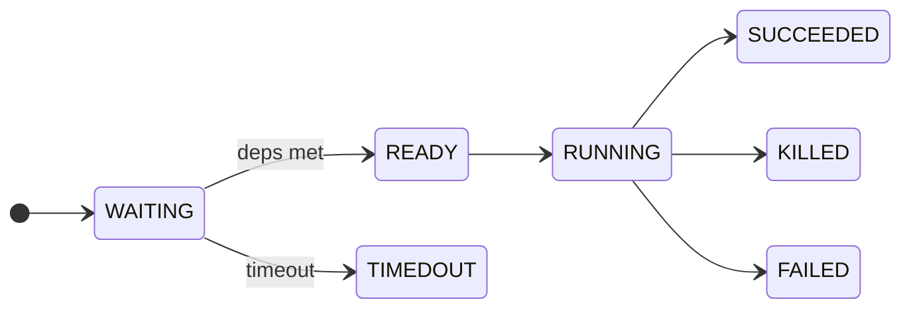

# The basics

What Oozie is and what it can do

---

# What is Apache Oozie?

- The **workflow scheduler** of the Hadoop platform
- Runs as a **server** (web service) next to YARN and HDFS
- You describe **what runs in which order** in an XML file
- Oozie starts the steps, watches them, and decides what happens on success or error
- Can start jobs **on a time schedule** or **when data arrives**
- On this platform you rarely see it directly: **Hue** has editors for it

<div class="mt-6 p-3 rounded bg-blue-500/10">
Think of it as "cron with dependencies, retries and a view of what happened", for jobs that run on the cluster.
</div>

---

# Where Oozie sits



- **Hue** and the **Oozie CLI** are two clients of the same Oozie server. Both use its REST API to submit and manage jobs. Hue also offers the editors and the Job Browser.
- **HDFS** holds the application files (`workflow.xml`, `coordinator.xml`). **YARN** runs the launchers and the jobs they start.
- The **Fs action** (dotted line) is performed by the Oozie server itself, directly on HDFS, without a launcher.

---

# Physical architecture

<div class="grid grid-cols-[1fr_3.2fr_1.3fr] gap-3 items-center text-xs mt-2">

<div class="text-center">
  <div class="rounded-full border-2 border-blue-500/60 bg-blue-500/10 p-4">
    <b>Oozie client</b><br/>CLI, REST, Hue
  </div>
  <div class="mt-1 text-blue-600">job submit &rarr;</div>
</div>

<div class="rounded border-2 border-gray-500/50 p-3 bg-gray-500/5">
  <div class="text-center font-bold text-sm mb-2">Oozie server (Tomcat)</div>
  <div class="grid grid-cols-[1fr_auto_1fr_auto_1fr] gap-1 items-center text-center">
    <div class="rounded border p-1 bg-blue-500/10">Timer<br/>(UTC)</div><div>&rarr;</div>
    <div class="rounded border p-1 bg-blue-500/10">Coordinator<br/>engine</div><div>&rarr;</div>
    <div class="rounded border p-1 bg-blue-500/10">Workflow<br/>engine</div>
  </div>
  <div class="grid grid-cols-[1fr_auto_1fr_auto_1fr] gap-1">
    <div></div><div></div><div></div><div></div>
    <div class="flex justify-center"><div class="h-2 border-l-2 border-gray-500"></div></div>
  </div>
  <div class="h-2 border-t-2 border-x-2 border-gray-500 mx-[16%] mb-1"></div>
  <div class="grid grid-cols-3 gap-2 text-center">
    <div class="rounded-full border p-2 bg-green-500/10">Action 1</div>
    <div class="rounded-full border p-2 bg-green-500/10">Action 2</div>
    <div class="rounded-full border p-2 bg-green-500/10">Action 3</div>
  </div>
</div>

<div class="text-center">
  <div class="text-blue-600 mb-1">&larr; job state &rarr;</div>
  <div class="rounded border-2 border-gray-500/50 p-2 bg-gray-500/5">
    <b>State DB</b><br/>(RDBMS)
    <div class="rounded border p-1 mt-1 bg-blue-500/10">Bundle</div>
    <div class="rounded border p-1 mt-1 bg-blue-500/10">Coordinator</div>
    <div class="rounded border p-1 mt-1 bg-blue-500/10">Workflow</div>
  </div>
</div>

</div>

<div class="grid grid-cols-2 text-xs text-blue-600 text-center my-2">
  <div>&darr; data condition monitoring</div>
  <div>&darr; job submission and monitoring</div>
</div>

<div class="rounded border-2 border-gray-500/50 p-2 bg-gray-500/5 text-xs">
  <div class="text-center font-bold text-sm mb-1">Hadoop cluster</div>
  <div class="grid grid-cols-3 gap-3 text-center">
    <div class="rounded border p-2 bg-blue-500/10"><b>HDFS</b><br/>workflow.xml, datasets</div>
    <div class="rounded-full border p-2 bg-blue-500/10"><b>ShareLib</b><br/>Hive, Spark ... jars on HDFS</div>
    <div class="rounded border p-2 bg-blue-500/10"><b>YARN</b><br/>launchers and jobs</div>
  </div>
</div>

<div class="mt-3 text-sm">

- The server is a **web application**; it keeps **all state in a database**, not in memory
- The timer finds due coordinator actions; data conditions are checked against **HDFS**

</div>

---

# Three kinds of Oozie jobs

<div class="grid grid-cols-[1fr_auto_1fr_auto_1.5fr] gap-2 items-center mt-6 text-sm">

<div class="rounded-lg border-2 border-purple-500/60 bg-purple-500/10 p-3 h-full">
  <div class="font-bold text-lg">Bundle</div>
  <div class="mt-1">Groups coordinators so they start, stop and suspend together</div>
  <div class="mt-2 text-xs opacity-70"><code>bundle.xml</code><br/>Hue: Bundle</div>
</div>

<div class="flex flex-col items-center text-xs w-16">
  <div class="px-2 py-0.5 rounded bg-gray-500/20 font-bold">1 : n</div>
  <div class="w-full border-t-2 border-gray-400 my-1"></div>
  <div class="opacity-70">contains</div>
</div>

<div class="rounded-lg border-2 border-blue-500/60 bg-blue-500/10 p-3 h-full">
  <div class="font-bold text-lg">Coordinator</div>
  <div class="mt-1">Decides <b>when</b>: on a schedule or when data arrives. Creates one coordinator action per interval</div>
  <div class="mt-2 text-xs opacity-70"><code>coordinator.xml</code><br/>Hue: Schedule</div>
</div>

<div class="flex flex-col items-center text-xs w-16">
  <div class="px-2 py-0.5 rounded bg-gray-500/20 font-bold">1 : n</div>
  <div class="w-full border-t-2 border-gray-400 my-1"></div>
  <div class="opacity-70">starts</div>
</div>

<div class="rounded-lg border-2 border-green-500/60 bg-green-500/10 p-3 h-full">
  <div class="font-bold text-lg">Workflow</div>
  <div class="mt-1">Decides <b>what</b>: a graph of <b>actions</b> and control nodes</div>
  <div class="mt-3 p-2 rounded bg-white/60 dark:bg-black/20 flex items-center justify-center text-[0.65rem]">
    <div class="w-3 h-3 rounded-full bg-gray-700"></div>
    <div class="w-2 border-t-2 border-gray-500"></div>
    <div class="rounded-full border-2 border-green-600/70 bg-green-500/20 px-2 py-1">Action 1</div>
    <div class="w-2 border-t-2 border-gray-500"></div>
    <div class="rounded-full border-2 border-green-600/70 bg-green-500/20 px-2 py-1">Action 2</div>
    <div class="w-2 border-t-2 border-gray-500"></div>
    <div class="rounded-full border-2 border-green-600/70 bg-green-500/20 px-2 py-1">Action 3</div>
    <div class="w-2 border-t-2 border-gray-500"></div>
    <div class="w-3 h-3 rounded-full border-4 border-gray-700"></div>
  </div>
  <div class="mt-1 text-center text-[0.65rem] opacity-70">1 : n actions, between start and end</div>
  <div class="mt-2 text-xs opacity-70"><code>workflow.xml</code><br/>Hue: Workflow</div>
</div>

</div>

<div class="grid grid-cols-[1fr_auto_1fr_auto_1.5fr] gap-2 mt-4 text-xs text-center opacity-80">
  <div></div><div class="w-16"></div>
  <div></div><div class="w-16"></div>
  <div>one workflow run per coordinator action<br/>(a workflow can also be started on its own)</div>
</div>

<div class="mt-6 text-sm">

- **One bundle** has several coordinators, **one coordinator** runs one workflow application again and again, **one workflow** has several actions
- Only the workflow is required. Coordinator and bundle are optional layers on top
- In the Job Browser the coordinators are called **Schedules**

</div>

---

# Workflow: actions and control nodes

<div class="grid grid-cols-2 gap-8">
<div>

### Control nodes

| Node | Purpose |
|------|---------|
| `start` | Entry point |
| `end` | Workflow **SUCCEEDED** |
| `kill` | Workflow **KILLED**, with a message |
| `decision` | Choose a path (switch/case with EL) |
| `fork` / `join` | Run branches in parallel, wait for all |

</div>
<div>

### Action nodes

| Action | Does |
|--------|------|
| `fs` | HDFS operations (mkdir, delete, move, chmod, touchz) |
| `shell` | Run a command or script |
| `hive` / `hive2` | Run a Hive script |
| `spark` | Run a Spark application |
| `java`, `sqoop`, `ssh`, `email` | Other task types |
| `sub-workflow` | Call another workflow |

</div>
</div>

Every action has an **ok** transition and an **error** transition.

---

# A workflow is a graph



- **OK** goes to the next action, **error** goes to the kill node (default in Hue)
- Finished actions are **not undone** when a later action fails
- A workflow ends in one of two states: **SUCCEEDED** (end node) or **KILLED** (kill node)
- Values are passed with `${...}` placeholders: **variables** like `${wf_date}` and **EL functions** like `${wf:user()}` (explained in the section on variables)

---

# Fs action vs. launcher actions

<div class="grid grid-cols-2 gap-8">
<div>

### Fs action

- A plain HDFS call made by the **Oozie server** itself (it acts on behalf of your user)
- No YARN application, no external id
- Fast and cheap
- Also run inside the server: `email`, `sub-workflow` and the control nodes (decision, fork, join)

</div>
<div>

### Shell, Hive, Spark, Java ...

- Oozie starts a small **launcher** application on YARN
- The launcher runs the **client** of the action in a container (the command, Beeline, spark-submit ...)
- The action has an **external id**: the YARN application of the launcher
- Output and logs of the launcher are in the YARN log

</div>
</div>

`<capture-output/>` keeps the standard output of a shell action (as `key=value` lines, max. 2 KB) so that later nodes can read it with `${wf:actionData('name')['key']}`.

---

# Where the work really runs

<div class="text-[0.72rem] mt-3">

<div class="grid grid-cols-[0.6fr_1.1fr_1.5fr_1.7fr] gap-2 text-center font-bold mb-1">
  <div></div>
  <div class="rounded p-2 bg-gray-500/20">Oozie server<br/><span class="font-normal">(Tomcat JVM)</span></div>
  <div class="rounded p-2 bg-blue-500/20">Launcher container<br/><span class="font-normal">(YARN application started by Oozie)</span></div>
  <div class="rounded p-2 bg-green-500/20">Outside the launcher<br/><span class="font-normal">(own service or other YARN containers)</span></div>
</div>

<div class="grid grid-cols-[0.6fr_1.1fr_1.5fr_1.7fr] gap-2 text-center items-stretch">

  <div class="font-mono font-bold self-center">fs</div>
  <div class="rounded border-2 border-gray-500/60 bg-gray-500/10 p-2">HDFS call runs <b>here</b></div>
  <div class="text-gray-400 self-center">no launcher</div>
  <div class="text-gray-400 self-center">&ndash;</div>

  <div class="font-mono font-bold self-center">shell</div>
  <div class="text-gray-400 self-center">only starts the launcher</div>
  <div class="rounded border-2 border-blue-500/60 bg-blue-500/10 p-2">your <b>command</b> runs here</div>
  <div class="text-gray-400 self-center">&ndash;</div>

  <div class="font-mono font-bold self-center">hive2</div>
  <div class="text-gray-400 self-center">only starts the launcher</div>
  <div class="rounded border-2 border-blue-500/60 bg-blue-500/10 p-2"><b>Beeline</b> (client) runs here and sends the query</div>
  <div class="rounded border-2 border-green-500/60 bg-green-500/10 p-2"><b>HiveServer2</b> runs the query (Tez containers on YARN)</div>

  <div class="font-mono font-bold self-center">spark</div>
  <div class="text-gray-400 self-center">only starts the launcher</div>
  <div class="rounded border-2 border-blue-500/60 bg-blue-500/10 p-2"><b>spark-submit</b> (client) runs here and submits the app</div>
  <div class="rounded border-2 border-green-500/60 bg-green-500/10 p-2"><b>Spark application</b> (driver and executors in YARN containers)</div>

</div>

</div>

<div class="mt-4 text-sm">

- The **client runs inside the launcher container**. It only submits the work and waits for the result.
- `java`: your main class runs in the launcher, like `shell`. `hive` (CLI): the Hive CLI runs in the launcher and starts Tez or MapReduce applications outside of it.
- The launcher's `externalId` and log therefore show only the submit. The real work is in the right-hand column.

</div>

---

# Coordinator: when does a workflow start?

<div class="grid grid-cols-2 gap-8">
<div>

### Time-based

- `frequency` as a crontab expression or a number of minutes
- `start` and `end` define the window
- Oozie creates **one coordinator action per interval**
- Every action has a **nominal time**: when the run was *planned*
- Start in the past: Oozie **catches up** on all missed intervals

</div>
<div>

### Data-based

- A **dataset** is a folder (a URI template) with a **done-flag**, usually an empty `_SUCCESS` file
- An **input event** says: this action needs that dataset instance
- The action waits in **WAITING** until the flag exists
- The producer writes the flag **last**, so nobody reads half-written data

</div>
</div>

---

# Coordinator action life cycle



- **WAITING**: action created for its nominal time. **READY**: dependencies met (time reached, flag found); then the workflow starts
- The nominal time stays the **day the action was planned for**, not the time the file arrived
- `<timeout>`, `throttle` and `concurrency` control waiting and parallel actions
- A late file is not missed: the action keeps checking until the flag appears

---

# SLAs: is the job on time?

<div class="grid grid-cols-[1fr_1.2fr] gap-6">
<div class="text-sm">

An **SLA** (service level agreement) tells Oozie **when a job should start and end**. Oozie then watches it and records every violation.

- Defined with an `<sla:info>` block in `workflow.xml` or `coordinator.xml`
- All times are relative to the **nominal time**
- Three possible **events**:
  - **START_MISS**: did not start by `should-start`
  - **END_MISS**: not finished by `should-end`
  - **DURATION_MISS**: ran longer than `max-duration`
- `alert-events` and `alert-contact` send an **e-mail** on a miss
- Status of all SLAs: **Jobs → SLAs** tab in Hue
- Oozie only **reports**. It does not kill or restart the job

</div>
<div>

```xml
<action name="load-daily" ...>
  ...
  <sla:info>
    <sla:nominal-time>${coord:nominalTime()}</sla:nominal-time>
    <sla:should-start>${10 * MINUTES}</sla:should-start>
    <sla:should-end>${60 * MINUTES}</sla:should-end>
    <sla:max-duration>${45 * MINUTES}</sla:max-duration>
    <sla:alert-events>end_miss,duration_miss</sla:alert-events>
    <sla:alert-contact>team@example.com</sla:alert-contact>
  </sla:info>
</action>
```

<div class="text-xs mt-2">

Needs the namespace `xmlns:sla="uri:oozie:sla:0.2"` in the root element.

</div>
</div>
</div>

---

# Bundles

<div class="grid grid-cols-[1fr_1.15fr] gap-6">
<div class="text-sm">

A bundle **groups coordinators** that belong together, for example all parts of one data pipeline.

- **One handle**: start, suspend, resume or kill all its coordinators in one step
- **One kick-off time** for the whole group
- **Shared parameters**, and parameters per coordinator
- It does **not run anything itself** and it does **not order** its coordinators. Dependencies between them are still expressed with datasets
- Optional: pipelines with a single coordinator do not need one
- Hue has a **Bundle** editor (Scheduler menu)

</div>
<div>

```xml
<bundle-app name="meter-pipeline"
            xmlns="uri:oozie:bundle:0.2">
  <controls>
    <kick-off-time>${kickoff}</kick-off-time>
  </controls>
  <coordinator name="ingest">
    <app-path>${nameNode}/apps/ingest</app-path>
  </coordinator>
  <coordinator name="load-daily">
    <app-path>${nameNode}/apps/load</app-path>
    <configuration>
      <property>
        <name>landing_dir</name>
        <value>${nameNode}/data/landing</value>
      </property>
    </configuration>
  </coordinator>
</bundle-app>
```

</div>
</div>

---

# Expression Language (EL)

The XML files of Oozie are not fixed text. Wherever you see `${...}`, Oozie **evaluates** what is inside and puts the result in its place. The small language for this is the **Expression Language (EL)**, the same syntax as in Java web pages (JSP).

<div class="grid grid-cols-2 gap-6 mt-4 text-sm">
<div class="p-3 rounded bg-blue-500/10">

### A name

`${wf_date}`

Looks up a **variable** that someone has to supply, for example Hue, the CLI or the coordinator. If nobody supplies it, the job fails.

</div>
<div class="p-3 rounded bg-green-500/10">

### A function call

`${wf:user()}`

Calls an **EL function**: Oozie works out the value itself. Nobody has to define it.

</div>
</div>

<div class="mt-6 text-center font-mono text-2xl">
${<span class="text-blue-500">wf</span>:<span class="text-green-600">user</span>()}
</div>

<div class="grid grid-cols-3 gap-4 mt-2 text-center text-xs">
  <div><span class="text-blue-500 font-bold">wf</span><br/>function family (prefix)</div>
  <div><span class="text-green-600 font-bold">user</span><br/>function name</div>
  <div><span class="font-bold">()</span><br/>arguments, here none; result: the user who started the job</div>
</div>

<div class="mt-4 text-sm">

- Families: `wf:` (the running workflow), `coord:` (schedule time and data), `fs:` (HDFS checks such as `fs:exists(path)`)
- The next slide lists the variables and EL functions side by side

</div>

---

# Variables in Oozie: `${...}`

In its XML files, Oozie **replaces every `${...}`** with a value before the action runs (plain text substitution). Variables inside a script, like Hive's `${day}`, are filled in later by the engine.

<div class="text-sm mt-4">

| Kind | Examples | Who provides it |
|------|----------|-----------------|
| **Property** | `${nameNode}`, `${jobTracker}`, `${start_date}`, `${wf_date}` | Whoever starts the job: Hue (submit dialog), the CLI (`job.properties`) or the coordinator |
| **EL function** (workflow) | `${wf:user()}`, `${wf:errorMessage(...)}` | Oozie, evaluated when the workflow node runs |
| **EL function** (coordinator) | `${coord:nominalTime()}`, `${coord:formatTime(...)}`, `${coord:dataIn('name')}` | Oozie, evaluated when the coordinator action is created or starts |
| **Action parameter** | `<param>day=${wf_date}</param>` in a Hive action | The workflow; the engine (Hive) then fills it into its script |

</div>

<div class="mt-4 text-sm">

- Coordinator functions (`coord:`) work only in `coordinator.xml`, workflow functions (`wf:`) only in `workflow.xml`
- A workflow **cannot see a name that nobody passes**. If `${wf_date}` is used, the starter must define it

</div>

---

# How a variable travels

One day's load, from the submit dialog down to the Hive script. Each step hands the value to the next one.

<div class="grid grid-cols-[1fr_auto_1fr_auto_1fr_auto_1fr] gap-1 items-stretch mt-6 text-[0.72rem]">

<div class="rounded-lg border-2 border-gray-500/60 bg-gray-500/10 p-2">
  <div class="font-bold text-sm">1. Hue submit</div>
  <div class="mt-1 opacity-80">Dialog and Hue define:</div>
  <div class="mt-1 font-mono">start_date<br/>end_date<br/>nameNode</div>
</div>
<div class="self-center w-4 border-t-2 border-gray-400"></div>

<div class="rounded-lg border-2 border-blue-500/60 bg-blue-500/10 p-2">
  <div class="font-bold text-sm">2. coordinator.xml</div>
  <div class="mt-1 opacity-80">Action for 5 Nov creates:</div>
  <div class="mt-1 font-mono">wf_date = 20261105<br/>landing_dir = hdfs://.../oozie_lab/landing</div>
</div>
<div class="self-center w-4 border-t-2 border-gray-400"></div>

<div class="rounded-lg border-2 border-green-500/60 bg-green-500/10 p-2">
  <div class="font-bold text-sm">3. workflow.xml</div>
  <div class="mt-1 opacity-80">Hive action parameters:</div>
  <div class="mt-1 font-mono">day = ${wf_date}<br/>landing_dir = ${landing_dir}<br/>ws_user = ${wf:user()}</div>
</div>
<div class="self-center w-4 border-t-2 border-gray-400"></div>

<div class="rounded-lg border-2 border-purple-500/60 bg-purple-500/10 p-2">
  <div class="font-bold text-sm">4. Hive script</div>
  <div class="mt-1 opacity-80">Hive fills in its variables:</div>
  <div class="mt-1 font-mono">day = 20261105<br/>ws_user = &lt;your_user&gt;<br/>landing_dir = hdfs://...</div>
</div>

</div>

<div class="mt-6 text-sm">

The script text `ADD PARTITION (dt='${day}')` becomes `ADD PARTITION (dt='20261105')`.

- **Who replaces what:** Oozie replaces the values in steps 2 and 3, **Hive** replaces `${day}`, `${landing_dir}` and `${ws_user}` in step 4
- **Value empty in the script?** Check each hand-over in this order: coordinator property, workflow property, Hive action parameter. The job's **Properties** and **XML** tabs show them
- **Gotcha:** dataset paths are evaluated when the coordinator is submitted, so `${user.name}` does not work there. Use the literal user name

</div>

---

# How Hue fits in

- The Workflow and Schedule editors are **XML generators**
- Hue stores the files in a workspace folder on **HDFS** and submits them to the Oozie server
- Hue adds variables: `${nameNode}`, `${jobTracker}`, `${wf_application_path}`
- Action names are generated (`fs-5b32`); the names you type are only labels in the editor
- Hue writes older schema versions (`workflow:0.5`, `shell-action:0.1`)
- The **Job Browser** shows workflows, schedules, bundles and their **XML**, **Logs** and **Configuration**

<div class="mt-6 p-3 rounded bg-green-500/10">
With Hue you do not type XML: you build with the mouse and can read what Hue generated.
Writing XML by hand is the topic of the advanced Oozie module.
</div>
